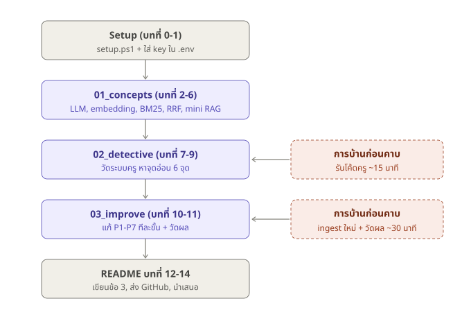
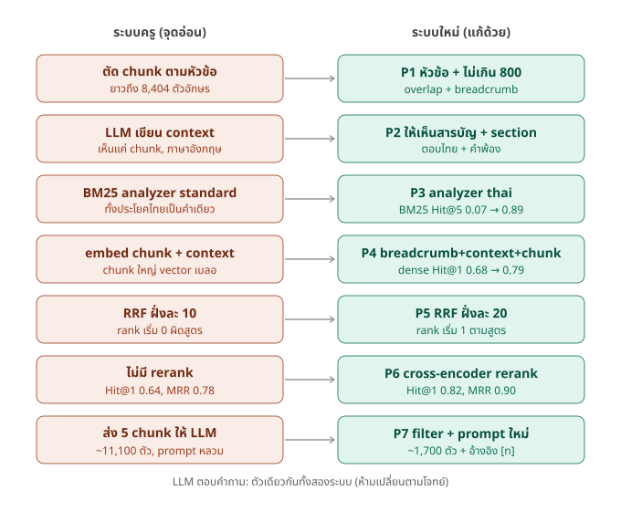

# Workshop: สร้างระบบ RAG และปรับปรุงให้ดีขึ้น ตั้งแต่ศูนย์

> เอกสารประกอบการสอน Assignment วิชา KDAI NLP (Authentic RAG ของครูเอ้ สไลด์หน้า 22, 25)
> ผู้เรียนไม่จำเป็นต้องมีพื้นฐาน RAG มาก่อน แต่ควรเขียน Python ได้ระดับเบื้องต้น
> ทุก output ที่ยกมาในเอกสารนี้ **รันจริง** (14 ต.ค. 2026) ผลของผู้เรียนอาจต่างเล็กน้อยตามรุ่นโมเดล/LLM ที่ใช้
> LLM ที่ใช้รันทุก output ในเอกสารนี้: `gemma-4-26b-a4b-it` ผ่าน Gemini API (ตัวเดียวกันทุกขั้น ทั้งระบบครูและระบบใหม่)

```
rag-workshop/
├── README.md              ← เอกสารนี้ (คำอธิบายละเอียดทุกบท)
├── docs/                  ← ผังภาพรวม 2 ผัง (ใช้ในสไลด์ได้)
├── install.ps1 / install.sh ← คำสั่งเดียว: โหลดทุกอย่างไป Desktop + clone repo ครู + รัน setup
├── teacher/               ← repo ของครูเอ้ (install clone ให้, ไม่อยู่ใน repo นี้)
├── setup.ps1 / setup.sh   ← รันครั้งเดียว เตรียมเครื่องให้ครบ (Windows / Mac-Linux)
├── check_setup.py         ← ตรวจว่าเครื่องพร้อมหรือยัง
├── docker-compose.yml     ← OpenSearch (setup เรียกให้อัตโนมัติ)
├── requirements.txt       ← library + เวอร์ชันที่ทดสอบแล้ว
├── .env.example           ← แม่แบบไฟล์ API key (setup คัดลอกเป็น .env ให้)
├── notebooks/             ← ลงมือทำในคาบ: คำอธิบาย + โค้ด + ผลจริง อยู่ด้วยกัน
│   ├── 01_concepts.ipynb             บทที่ 2-6   แนวคิดพื้นฐาน (LLM, embedding, analyzer, BM25, RRF, mini RAG)
│   ├── 02_detective.ipynb            บทที่ 7-9   วัดระบบครู + หาจุดอ่อน 6 จุดพร้อมหลักฐาน
│   └── 03_improve_and_measure.ipynb  บทที่ 10-11 ปรับปรุง P1-P7 ทีละขั้น + วัดผล
├── steps/                 ← โค้ดจริงของระบบ (notebook import ไปใช้)
│   ├── common.py                  ตัวช่วยกลาง (เรียก LLM, ต่อ OpenSearch, โหลด embedding)
│   ├── step01..06_*.py            สคริปต์เดี่ยวของบทที่ 2-9 (เนื้อหาเดียวกับ notebook รันใน terminal ได้)
│   ├── step07_improved.py         ระบบที่ปรับปรุงแล้ว (บทที่ 10)
│   ├── step08_evaluate.py         วัดผลเทียบสองระบบ (บทที่ 11)
│   └── questions.json             ชุดคำถามตัวอย่าง 29 ข้อ
├── corpus_input/          ← เอกสาร 4 ไฟล์ของครู (หัดเยอรมัน, อหิวาต์, ต้อกระจก, กรดไหลย้อน)
└── results/
    ├── contexts.json      ← context ที่ LLM สร้างไว้แล้ว 159 chunk (ข้าม ~60 นาทีตอน ingest ดูภาคผนวก ค)
    └── metrics.md         ← ตารางผลวัดจริง
```

### ภาพรวมทั้งหมดใน 2 ผัง

**ผังที่ 1: เส้นทางของเวิร์กช็อป** ทำอะไรก่อนหลัง และงานที่ช้าอยู่ตรงไหน (ให้เป็นการบ้าน)



**ผังที่ 2: ระบบครูเทียบระบบใหม่ทีละขั้น** แต่ละแถวคือขั้นเดียวกันของ RAG ซ้าย = จุดอ่อนที่พบ (บทที่ 9) ขวา = วิธีแก้และผลที่ได้ (บทที่ 10-11)



### ใช้ README กับ notebook คู่กันยังไง

| | README (ไฟล์นี้) | notebook |
|---|---|---|
| เหมาะกับ | อ่านทำความเข้าใจก่อน/หลังคาบ, ผู้สอนเตรียมสอน | ลงมือในคาบ รันทีละ cell เห็นผลทันที |
| มีอะไร | เหตุผล ทางเลือก ตารางเปรียบเทียบ ครบทุกบท 0-14 | คืออะไร → ทำทำไม → ทายก่อนรัน → โค้ด → ผลจริง → อ่านผล → ลองเอง (บทที่ 2-11) |
| บทที่ไม่มีใน notebook | บทที่ 0-1 (โจทย์, ติดตั้ง), 12-14 (เขียนรายงาน, ส่งงาน, นำเสนอ) | |

ลำดับที่แนะนำ: **รัน setup (บทที่ 1) → เปิด notebook 01 → 02 → 03 → กลับมาอ่าน README บทที่ 12-14**


## สารบัญ

| ภาค | บท | ได้อะไร |
|---|---|---|
| **ก. เตรียมตัว** | 0. โจทย์และวิธีคิด | รู้ว่าครูวัดอะไร และทำไมต้องวัดผลเป็นตัวเลข |
| | 1. เตรียมเครื่อง | Python, Docker, OpenSearch, API key พร้อมใช้ |
| **ข. เข้าใจทีละชิ้น** | 2. LLM ไม่รู้เรื่องในเอกสารเรา | เห็นปัญหาที่ RAG มาแก้ |
| | 3. Embedding | เข้าใจการค้นด้วยความหมาย |
| | 4. Inverted index และ analyzer | เข้าใจการค้นด้วยคำ (และกับดักภาษาไทย) |
| | 5. BM25 vs Dense vs Hybrid | รู้ว่าแต่ละแบบเก่งอะไร และรวมกันด้วย RRF |
| | 6. RAG ทั้งวงจรใน 40 บรรทัด | เห็นภาพ R-A-G ครบก่อนเจอระบบใหญ่ |
| **ค. Assignment** | 7. ข้อ (1) รันระบบของครู | ระบบตามสไลด์หน้า 22, 25 |
| | 8. สร้างไม้บรรทัด (ชุดวัดผล) | วัดได้ว่าดีขึ้นจริงหรือไม่ |
| | 9. นักสืบ: หาจุดอ่อน | 6 จุดอ่อนพร้อมหลักฐาน |
| | 10. ข้อ (2) ปรับปรุงทีละขั้น | 7 การปรับปรุงพร้อมเหตุผล |
| | 11. วัดผลและอ่านตาราง | ตัวเลขสำหรับข้อ (3) |
| | 12. ข้อ (3) เขียนคำอธิบาย | โครงที่ได้คะแนน |
| | 13. ข้อ (4)(5) ส่งงาน | GitHub + email |
| | 14. ข้อ (6) ถ้าโดนสุ่มนำเสนอ | สคริปต์ + คำถามที่ครูน่าจะถาม |
| **ง. ภาคผนวก** | ก. แก้ปัญหาที่พบบ่อย · ข. คำศัพท์ · ค. แผนการสอน | |

---

# ภาค ก. เตรียมตัว

## บทที่ 0: โจทย์และวิธีคิด

### 0.1 โจทย์

1. สร้างระบบ RAG ตามโค้ดและคำอธิบายในสไลด์หน้า 22 (Hands-on 1: นำเข้าเอกสาร) และ 25 (Hands-on 2: ถาม ค้น สรุปคำตอบ)
2. ปรับปรุงระบบข้อ 1 ในส่วน chunking, embedding, search algorithm, scoring, reranking ฯลฯ **ที่ไม่ใช่การเปลี่ยน LLM ที่ใช้ตอบ**
3. อธิบายว่า (1) กับ (2) ต่างกันตรงไหน ดีขึ้นอย่างไร เพราะอะไร
4. เก็บโค้ด + คำอธิบายบน GitHub
5. ส่ง link ทาง email subject `KDAI-NLP-[รหัสนักศึกษา]-Assignment-4Oct2026` ก่อนคาบถัดไป
6. ครูจะสุ่มงานมาให้เจ้าของนำเสนอ

### 0.2 ตีโจทย์: ครูวัดอะไรจริง ๆ

วิธีตีโจทย์ที่ใช้ได้กับทุก assignment: แยก "สิ่งที่ต้องส่ง" ออกจาก "สิ่งที่ผู้ตรวจอยากรู้ว่าเราเข้าใจ"

| ข้อ | สิ่งที่ส่ง | สิ่งที่ครูวัด | ถ้าทำไม่ถึง จะเป็นยังไง |
|---|---|---|---|
| 1 | ระบบที่รันได้ | เข้าใจว่าแต่ละขั้นทำอะไร | รันได้แต่อธิบายไม่ได้ว่า chunk/index/RRF คืออะไร |
| 2 | ระบบที่ปรับปรุง | รู้ว่าคุณภาพของ RAG ขึ้นกับส่วน **Retrieval** | เปลี่ยนไปเยอะแต่บอกไม่ได้ว่าแก้ปัญหาอะไร |
| 3 | คำอธิบาย | มี **หลักฐาน** (ตัวเลข) + มี **เหตุผล** (อธิบายกลไกได้) | "ระบบใหม่ตอบดีขึ้น" โดยไม่มีตัวเลข = คะแนนน้อย |
| 6 | การนำเสนอ | อธิบายด้วยคำพูดตัวเองได้ | อ่านสไลด์ตาม ตอบคำถามไม่ได้ |

ข้อสังเกตจากโจทย์ข้อ 2: ครูยกตัวอย่างไว้ 5 อย่าง (chunking, embedding, search algorithm, scoring, reranking)
นี่คือ "ใบ้" ว่าครูอยากเห็นการปรับในส่วน R ของ RAG ซึ่งเวิร์กช็อปนี้แตะครบทั้ง 5 (บทที่ 10)

### 0.3 ทำไมห้ามเปลี่ยน LLM และอะไรนับว่า "เปลี่ยน LLM"

**เหตุผล:** ถ้าเปลี่ยนจาก Qwen เป็นโมเดลที่เก่งกว่า คำตอบดีขึ้นแน่ แต่ตอบไม่ได้ว่าดีขึ้นเพราะ "ค้นเก่งขึ้น" หรือ "โมเดลเก่งขึ้น"
นี่คือหลักการทดลอง: **เปลี่ยนตัวแปรทีละตัว ที่เหลือคงที่** (ตัวแปรต้น = วิธี retrieval, ตัวแปรตาม = คุณภาพ, ตัวแปรควบคุม = LLM)
ครูพูดในคาบ 20 ก.ย. ว่า "ถ้าค้นมาดีแล้วยังตอบผิด ถึงจะโทษโมเดล"

**อะไรทำได้ อะไรไม่ได้** (ตีความที่ปลอดภัย ถ้าไม่แน่ใจให้ถามครู หรือเขียนบอกใน README):

| การเปลี่ยน | ทำได้ไหม | เหตุผล |
|---|---|---|
| เปลี่ยน LLM ที่ตอบคำถามสุดท้าย | ❌ | โจทย์ห้ามตรง ๆ |
| เปลี่ยน chunking / embedding / analyzer / search / RRF / reranker | ✅ | โจทย์ยกตัวอย่างเอง |
| แก้ prompt ตอนตอบ (โมเดลเดิม) | ⚠️ ทำได้แต่ควรรายงานแยก | ไม่ใช่การเปลี่ยน LLM แต่ก็ไม่ใช่ retrieval ล้วน |
| เปลี่ยน LLM ที่ใช้สร้าง context ตอน ingest | ⚠️ เลี่ยงดีกว่า | เทคนิคแล้วไม่ใช่ LLM ที่ "generate คำตอบสุดท้าย" แต่จะถูกถามว่าผลมาจากโมเดลไหม ใช้ตัวเดียวกันตลอดปลอดภัยที่สุด |
| ใช้ LLM อื่นแทน Qwen เพราะไม่มี key | ✅ ถ้าใช้ตัวเดียวกันทั้งสองระบบ | ตัวแปรควบคุมยังคงที่ |

> ไม่มี OpenRouter key ใช้ LLM อื่นแทนได้ (โค้ดในเวิร์กช็อปรองรับทุกเจ้าที่ใช้ OpenAI SDK ได้)
> **เงื่อนไขเดียว: ระบบเดิมกับระบบใหม่ต้องใช้ LLM ตัวเดียวกัน** และเขียนบอกใน README

### 0.4 วิธีคิดที่ใช้ตลอดเวิร์กช็อป (และทำไมแต่ละข้อสำคัญ)

| หลัก | ทำอย่างไร | ถ้าไม่ทำจะเกิดอะไร |
|---|---|---|
| 1. **วัดก่อนแก้** | สร้างชุดคำถาม + ตัวชี้วัด และวัดระบบเดิมก่อนแตะโค้ด | ข้อ 3 เหลือแค่ "รู้สึกว่าดีขึ้น" และอาจแก้แล้วแย่ลงโดยไม่รู้ตัว |
| 2. **อ่านโค้ดแบบนักสืบ** | ถาม "ข้อมูลจริงที่วิ่งผ่านบรรทัดนี้คืออะไร" แล้ว print ดู | เชื่อชื่อตัวแปร เช่น `full_doc_content` ที่จริงไม่ใช่เอกสารเต็ม (บทที่ 9) |
| 3. **สงสัยสมมติฐานภาษาอังกฤษ** | ทุกจุดที่แยกคำ นับคำ ตัดประโยค ให้ลองกับภาษาไทย | พลาดบั๊กใหญ่ที่สุดของงาน (analyzer, การนับ token) |
| 4. **แก้ทีละอย่าง วัดทุกครั้ง** (ablation) | เปิดการปรับปรุงทีละชั้น วัดทุกชั้น | ไม่รู้ว่าอะไรช่วย อะไรไม่ช่วย อะไรทำให้แย่ลง |
| 5. **รายงานตรง ๆ** | เขียนกรณีที่แย่ลงและข้อจำกัดด้วย | ครูถามจุดอ่อนแล้วตอบไม่ได้ เสียความน่าเชื่อถือทั้งงาน |

### 0.5 แผนที่ของเวิร์กช็อป: แต่ละบทตอบคำถามอะไร

```
ปัญหา: LLM ไม่รู้เรื่องในเอกสารเรา                                         ← บทที่ 2
ทางแก้ RAG ต้องมี:  ค้นด้วยความหมาย (embedding)                           ← บทที่ 3
                    ค้นด้วยคำ (inverted index, BM25)                       ← บทที่ 4, 5
                    รวมสองแบบ (RRF)                                       ← บทที่ 5
                    ประกอบทั้งวงจร                                         ← บทที่ 6
ระบบของครู:         รันให้ได้ (ข้อ 1)                                       ← บทที่ 7
                    วัดให้เป็น                                             ← บทที่ 8
                    หาว่าอ่อนตรงไหน                                        ← บทที่ 9
ระบบใหม่:           แก้ทีละจุด (ข้อ 2)                                      ← บทที่ 10
                    พิสูจน์ด้วยตัวเลข (ข้อ 3)                               ← บทที่ 11, 12
ส่งและนำเสนอ                                                               ← บทที่ 13, 14
```

### 0.6 ทำไมเรียงบทแบบนี้ (ไม่กระโดดไปรันโค้ดครูเลย)

| ทางเลือกในการสอน | ข้อดี | ข้อเสีย |
|---|---|---|
| รันโค้ดครูก่อน แล้วค่อยอธิบาย | เห็นผลเร็ว | โค้ด ~500 บรรทัด + OpenSearch + LLM พร้อมกัน ผู้เรียนจับไม่ได้ว่าส่วนไหนสำคัญ พอหาจุดอ่อนก็หาไม่เจอเพราะไม่รู้ว่า "ปกติ" ควรเป็นยังไง |
| **เข้าใจทีละชิ้นด้วยสคริปต์เล็ก ๆ ก่อน (ที่เลือก)** | แต่ละชิ้น 30-60 บรรทัด เห็นผลชัด ทายผลก่อนรันได้ | ช้ากว่าในชั่วโมงแรก |

เหตุผลหลัก: บทที่ 9 (หาจุดอ่อน) ต้องใช้ความรู้จากบทที่ 3-5 ตรง ๆ เช่น ถ้าไม่เคยเห็นบทที่ 4 ว่า `standard` ตัดไทยยังไง
จะไม่มีวันสงสัยบรรทัด `"analyzer": "standard"` ในโค้ดครู

---

## บทที่ 1: เตรียมเครื่อง

ทำตามลำดับ และ **ตรวจผลทุกข้อก่อนไปข้อถัดไป** (ทุกขั้นมีคำสั่งตรวจ)
เหตุผล: ปัญหาติดตั้งที่ไม่ได้ตรวจตอนนั้น จะไปโผล่เป็น error งง ๆ ตอนรัน RAG ซึ่งหาต้นเหตุยากกว่ามาก

### 1.0 วิธีเร็ว: setup อัตโนมัติ (แนะนำ)

ติดตั้ง 2 อย่างนี้ให้เครื่องก่อน (ทำด้วยมือ เพราะต้องกดยอมรับและอาจต้องรีสตาร์ต):
1. **Python 3.10-3.12** จาก python.org (Windows: ติ๊ก **"Add python.exe to PATH"**)
2. **Docker Desktop** จาก docker.com แล้วเปิดโปรแกรมทิ้งไว้จนขึ้น "Engine running"

จากนั้นเปิด **PowerShell** แล้ววาง **คำสั่งเดียว** (Windows):

```bash
irm https://raw.githubusercontent.com/Patchanon04/kdai-rag-workshop/main/install.ps1 | iex
```

macOS / Linux (เปิด Terminal):

```bash
curl -fsSL https://raw.githubusercontent.com/Patchanon04/kdai-rag-workshop/main/install.sh | bash
```

คำสั่งนี้ทำ 3 อย่าง:
1. โหลดเวิร์กช็อปไปไว้ที่ **Desktop
ag-workshop** (มี git ใช้ git clone, ไม่มีโหลดเป็น zip ให้)
2. **clone repo ของครูเอ้** (github.com/aekanun2020/2025-authenticRAG) ไว้ใน `rag-workshop	eacher` สำหรับบทที่ 7
3. รัน `setup.ps1` / `setup.sh` ต่อให้อัตโนมัติ (รายละเอียดด้านล่าง)

รันซ้ำได้: ถ้ามีโฟลเดอร์อยู่แล้วจะอัปเดตเป็นรุ่นล่าสุด (กรณีโหลดด้วย git) ไม่เขียนทับไฟล์ที่ผู้เรียนแก้

ถ้าได้โฟลเดอร์มาทางอื่นแล้ว (เช่น zip) ให้เปิด terminal ในโฟลเดอร์ `rag-workshop` แล้วรันแค่ setup:

```bash
powershell -ExecutionPolicy Bypass -File setup.ps1
```

macOS / Linux:

```bash
bash setup.sh
```

สคริปต์ทำ 7 ขั้นให้ (รันซ้ำได้ ขั้นที่ทำแล้วจะข้าม): หา Python → สร้าง `.venv` → ติดตั้ง library (~2-3 GB ครั้งแรก 5-15 นาที)
→ ลงทะเบียน Jupyter kernel "RAG Workshop (.venv)" → เปิด OpenSearch ด้วย Docker → ดาวน์โหลดโมเดล (~4.5 GB) → สร้าง `.env` และตรวจความพร้อม

**ทำไมใช้ Docker แค่ OpenSearch ไม่ใส่ทุกอย่างใน Docker:**

| ทางเลือก | ข้อดี | ข้อเสีย |
|---|---|---|
| **Docker เฉพาะ OpenSearch + Python ใน venv (ที่เลือก)** | ส่วนที่ติดตั้งยากที่สุด (Java + config) จบในคำสั่งเดียว; Python/notebook ทำงานในเครื่องตรง ๆ ดีบักง่าย | ต้องมี Python ในเครื่อง |
| ทุกอย่างใน Docker (Python + Jupyter ใน container) | เครื่องสะอาด ไม่ต้องลง Python | โมเดล 4.5 GB ต้องโหลดใน container หรือ mount; ไฟล์บน Windows ที่ mount เข้า container ช้า; เปิด Jupyter ผ่าน URL + token; พังแล้วหาสาเหตุยาก ไม่เหมาะกับห้องที่เพิ่งเริ่ม |

หลังรันเสร็จ:
1. เปิดไฟล์ `.env` ใส่ API key ของตัวเอง (บทที่ 1.6)
2. ตรวจรวมพร้อมทดสอบ key:

```bash
.venv\Scripts\python check_setup.py --llm
```

ต้องเห็นทุกข้อเป็น `[ผ่าน]` และบรรทัดสุดท้าย "พร้อมเริ่มเวิร์กช็อป" (ผลจริงตอนทดสอบเอกสารนี้):

```
  [ผ่าน]  Python 3.10 ขึ้นไป  (3.11.1)
  [ผ่าน]  library opensearchpy  ((3, 2, 0))
  ...
  [ผ่าน]  OpenSearch ที่ localhost:9200  (version 2.19.1, thai analyzer: ['หญิง', 'ครรภ์'])
  [ผ่าน]  embedding model BAAI/bge-m3  (อยู่ใน cache แล้ว)
  [ผ่าน]  reranker BAAI/bge-reranker-v2-m3  (อยู่ใน cache แล้ว)
  [ผ่าน]  API key ในไฟล์ .env  (model = gemma-4-26b-a4b-it)
  [ผ่าน]  เรียก LLM ได้จริง  (LLM ตอบว่า '5')

พร้อมเริ่มเวิร์กช็อป
```

3. เปิดโฟลเดอร์ใน VS Code → เปิด `notebooks/01_concepts.ipynb` → มุมขวาบนเลือก kernel **"RAG Workshop (.venv)"**

> หัวข้อ 1.1-1.8 ด้านล่างคือสิ่งที่ setup ทำให้ **ทีละขั้นพร้อมเหตุผล** อ่านเพื่อเข้าใจ หรือทำเองด้วยมือถ้า setup พัง

### 1.0.1 ภาพรวม: ต้องมีอะไรบ้าง และแต่ละอย่างอยู่ตรงไหนของระบบ

```
เครื่องเรา
├── Python + venv ──── รันโค้ดทั้งหมด (chunk, เรียก embedding, ค้น, เรียก LLM)
│     ├── sentence-transformers ── รัน embedding model และ reranker ในเครื่อง (ไม่เสียเงิน)
│     ├── opensearch-py ────────── คุยกับ OpenSearch
│     └── openai ───────────────── ส่ง prompt ไปหา LLM บนอินเทอร์เน็ต
├── Docker ─── OpenSearch (port 9200) ── เก็บ vector + inverted index
└── .env ───── API key ของ LLM
อินเทอร์เน็ต
└── LLM (Qwen ผ่าน OpenRouter / Gemini / ...) ── สร้าง context และตอบคำถาม (เสียเงินหรือใช้โควตาฟรี)
```

สังเกต: มีแค่ LLM ที่อยู่นอกเครื่อง embedding และ reranker รันในเครื่องเราเอง
นี่คือเหตุผลที่บางขั้นช้า (ใช้ CPU เครื่องเรา) แต่ไม่เสียเงิน

### 1.1 Python 3.10 ขึ้นไป

**ทำไม 3.10+:** library รุ่นใหม่ (sentence-transformers, llama-index) เลิกรองรับรุ่นเก่า และสไลด์ครูใช้ 3.10

ดาวน์โหลดจาก python.org (Windows: ติ๊ก **"Add python.exe to PATH"** ตอนติดตั้ง ถ้าลืม terminal จะหา `python` ไม่เจอ)

ตรวจ:

```bash
python --version
```

ต้องได้ `Python 3.10.x` ขึ้นไป ถ้าได้ `Python was not found` = ลืมติ๊ก PATH ให้ติดตั้งใหม่

### 1.2 Git และ VS Code

- **Git** (git-scm.com): ใช้ตอนส่งงานขึ้น GitHub (บทที่ 13) และใช้ดาวน์โหลดโค้ดครูได้
- **VS Code** (code.visualstudio.com) + extension "Python": แก้โค้ด, ดู error ชัด, มี terminal ในตัว

ตรวจ:

```bash
git --version
```

### 1.3 Docker Desktop

**ทำไมต้องใช้ Docker:** OpenSearch เป็นโปรแกรม Java ขนาดใหญ่ การติดตั้งตรง ๆ ต้องตั้งค่า Java และ config หลายไฟล์
Docker คือ "กล่อง" ที่มีโปรแกรม + ทุกอย่างที่มันต้องใช้ ติดตั้งมาเรียบร้อยแล้ว สั่งคำสั่งเดียวก็ได้ OpenSearch ที่ทุกคนในห้องเหมือนกันทุกประการ

| ทางเลือก | ข้อดี | ข้อเสีย |
|---|---|---|
| **Docker (ที่เลือก)** | คำสั่งเดียว, ทุกคนได้รุ่นเดียวกัน, ลบทิ้งง่าย | ต้องติดตั้ง Docker Desktop, กิน RAM |
| ติดตั้ง OpenSearch ตรง ๆ | ไม่ต้องมี Docker | ต้องตั้ง Java, config ยาก, ปัญหาต่างกันทุกเครื่อง |
| OpenSearch บน cloud (AWS) | ไม่กินเครื่อง | เสียเงิน, ต้องตั้งค่าความปลอดภัย |

ดาวน์โหลดที่ docker.com/products/docker-desktop (Windows ต้องเปิด WSL2 ตัวติดตั้งจะพาทำ) เปิดโปรแกรมทิ้งไว้จนขึ้น "Engine running"

ตรวจ:

```bash
docker run --rm hello-world
```

ต้องเห็น `Hello from Docker!` (คำสั่งนี้ดาวน์โหลด image เล็ก ๆ มารันแล้วลบทิ้ง `--rm` = ลบเมื่อจบ)

### 1.4 OpenSearch (Vector Database)

**ทำไม OpenSearch** (ไม่ใช่ vector DB ตัวอื่น): ครูใช้ในสไลด์, และมันเก็บได้ทั้ง vector (ค้นด้วยความหมาย) และ inverted index (ค้นด้วยคำ, BM25)
ในตัวเดียว จึงทำ hybrid search ได้โดยไม่ต้องมีสองระบบ (เปรียบเทียบทางเลือกละเอียดในบทที่ 10.1)

```bash
docker run -d --name opensearch -p 9200:9200 -p 9600:9600 -e discovery.type=single-node -e DISABLE_SECURITY_PLUGIN=true -e DISABLE_INSTALL_DEMO_CONFIG=true -e "OPENSEARCH_JAVA_OPTS=-Xms1g -Xmx1g" opensearchproject/opensearch:2.19.1
```

อ่านคำสั่งทีละส่วน:

| ส่วน | ความหมาย | ทำไมต้องมี |
|---|---|---|
| `docker run` | สร้างและเริ่ม container ใหม่ | |
| `-d` | รันเบื้องหลัง (detached) | ไม่งั้น terminal จะถูกยึดไว้แสดง log |
| `--name opensearch` | ตั้งชื่อ container | ครั้งหน้าสั่ง `docker start opensearch` ได้ |
| `-p 9200:9200` | เชื่อม port 9200 ของเครื่องเรากับของ container | Python จะคุยกับ OpenSearch ผ่าน `localhost:9200` |
| `-p 9600:9600` | port สำหรับดูสถานะประสิทธิภาพ | ไม่ได้ใช้ในเวิร์กช็อป ใส่ตามคำสั่งของครู |
| `discovery.type=single-node` | รันเครื่องเดียว | ปกติ OpenSearch จะพยายามหาเครื่องอื่นมาเป็น cluster ถ้าไม่บอกจะรอจนไม่ยอมเริ่ม |
| `DISABLE_SECURITY_PLUGIN=true` | ปิด https และรหัสผ่าน | ใช้ในเครื่องตัวเองเท่านั้น **ห้ามใช้ในระบบจริงที่เปิดสู่อินเทอร์เน็ต** |
| `DISABLE_INSTALL_DEMO_CONFIG=true` | ไม่สร้าง config ตัวอย่างของระบบความปลอดภัย | คู่กับบรรทัดบน ไม่งั้นรุ่นใหม่จะถามรหัสผ่านตอนเริ่ม |
| `OPENSEARCH_JAVA_OPTS=-Xms1g -Xmx1g` | จำกัด RAM ที่ Java ใช้ 1 GB | ค่า default อาจกินครึ่งหนึ่งของ RAM เครื่อง; สำหรับข้อมูล 159 chunk 1 GB เหลือเฟือ |
| `opensearchproject/opensearch:2.19.1` | image และ **รุ่นที่ระบุชัด** | ไม่ใช้ `latest` เพราะรุ่นใหม่อาจเปลี่ยนพฤติกรรม ทุกคนต้องได้รุ่นเดียวกับครู |

รอ ~30 วินาที (Java เริ่มช้า) แล้วตรวจ:

```bash
curl http://localhost:9200
```

ต้องเห็น JSON ที่มี `"number" : "2.19.1"` ถ้าได้ `Connection refused` ให้รอเพิ่ม แล้วดู log:

```bash
docker logs opensearch --tail 30
```

ครั้งหน้าที่เปิดเครื่องใช้ `docker start opensearch` (ข้อมูล index ที่สร้างไว้ยังอยู่ใน container)

### 1.5 โฟลเดอร์งานและ virtual environment

**ทำไมต้องมี venv:** library ของงานนี้ (โดยเฉพาะ langchain รุ่นเก่าที่โค้ดครูต้องใช้ ในบทที่ 7) อาจชนกับ library ของงานอื่นในเครื่อง
venv = Python แยกเฉพาะโปรเจกต์ ติดตั้งอะไรก็อยู่ในโฟลเดอร์ `.venv` ไม่กระทบที่อื่น ลบโฟลเดอร์ทิ้ง = ล้างทั้งหมด

| ทางเลือก | เมื่อไรเหมาะ |
|---|---|
| **venv (ที่เลือก)** | มากับ Python ไม่ต้องติดตั้งอะไรเพิ่ม |
| conda (ตามสไลด์ครู) | ถ้ามี Anaconda/Miniconda อยู่แล้ว ใช้ได้เหมือนกัน: `conda create -n advrag python=3.10` แล้ว `conda activate advrag` |
| uv | เร็วกว่ามาก แต่ต้องติดตั้งเพิ่ม และผู้เรียนส่วนใหญ่ยังไม่รู้จัก |

```bash
cd rag-workshop
```

```bash
python -m venv .venv
```

เปิดใช้งาน (Windows PowerShell):

```bash
.venv\Scripts\Activate.ps1
```

(macOS/Linux: `source .venv/bin/activate`; ถ้า PowerShell ขึ้น "running scripts is disabled" ให้รัน `Set-ExecutionPolicy -Scope CurrentUser RemoteSigned` ครั้งเดียว)
ทุกครั้งที่เปิด terminal ใหม่ต้อง activate ใหม่ จะเห็น `(.venv)` หน้าบรรทัด ถ้าไม่เห็น = ติดตั้งไปที่ Python หลักของเครื่อง

ติดตั้ง library:

```bash
pip install -r requirements.txt
```

(ไฟล์ `requirements.txt` ตรึงเวอร์ชันที่ทดสอบแล้ว กัน library รุ่นใหม่เปลี่ยนพฤติกรรมจนโค้ดพัง ตารางด้านล่างคือตัวหลัก ๆ)

| library | ใช้ทำอะไร | ใช้ในบท |
|---|---|---|
| `opensearch-py` | client สำหรับคุยกับ OpenSearch (สร้าง index, ใส่ข้อมูล, ค้น) | 4, 5, 7-11 |
| `sentence-transformers` | โหลดและรัน embedding model (bge-m3) และ reranker; ติดตั้ง PyTorch มาด้วย (~1-2 GB) | 3, 5, 6, 10 |
| `openai` | OpenAI SDK ใช้เรียก LLM ทุกเจ้าที่รองรับรูปแบบเดียวกัน | 2, 6, 7, 10 |
| `numpy` | คำนวณ vector (cosine, เรียงลำดับ) | 3, 6 |
| `tqdm` | แถบความคืบหน้า (โค้ดครูใช้) | 7 |

### 1.6 API key ของ LLM

ตามสไลด์: สมัครที่ openrouter.ai/keys แล้วคัดลอก `.env.example` เป็น `.env` ในโฟลเดอร์ `rag-workshop` แล้วใส่ key:

```
OPENROUTER_API_KEY=sk-or-xxxxxxxx
```

ใช้ LLM เจ้าอื่น (ตัวอย่าง Gemini API ซึ่งมี free tier, สร้าง key ที่ aistudio.google.com):

```
LLM_API_KEY=xxxxxxxx
LLM_BASE_URL=https://generativelanguage.googleapis.com/v1beta/openai/
LLM_MODEL=gemma-4-26b-a4b-it
```

**ทำไมเก็บ key ในไฟล์ `.env` ไม่เขียนในโค้ด:** โค้ดจะขึ้น GitHub แต่ `.env` จะไม่ขึ้น (ใส่ใน `.gitignore`)
ถ้าเขียน key ในโค้ด พอ push ทุกคนบนโลกเห็น บอตสแกน GitHub เจอ key ภายในไม่กี่นาที แล้วเอาไปใช้ในชื่อเรา

> **ระวังโควตา free tier:** ทั้งเวิร์กช็อปเรียก LLM ประมาณ 250-300 ครั้ง (ระบบครู ~53 + ระบบใหม่ ~160 ตอนสร้าง context
> + การวัดผล ~30) ตอนทดสอบเอกสารนี้ `gemini-2.5-flash` ฟรีให้แค่ **20 ครั้ง/วัน** ใช้ไม่พอ และ `gemma-4-31b-it` ล่ม (error 500) อยู่หลายชั่วโมง
> เอกสารนี้จึงรันทั้งหมดด้วย `gemma-4-26b-a4b-it` (key เดียวกัน) ซึ่งใช้ได้ทั้งเวิร์กช็อป แต่ช้าเพราะจำกัด token ต่อนาที และบางครั้งตอบ 500 — `common.py` รอและลองใหม่ให้อัตโนมัติ
> ถ้าสอนทั้งห้อง ให้แต่ละคนใช้ key ของตัวเอง หรือเติมเงิน OpenRouter สัก $5 (Qwen 2.5 72B ถูกมาก) หรือใช้ไฟล์ context ที่แจก (ภาคผนวก ค)

> **สำคัญมาก:** สร้างไฟล์ `.gitignore` ที่มีบรรทัด `.env` **ก่อน** `git add` ครั้งแรก
> ถ้าเผลอ push ไปแล้วให้ revoke key ทันที (ลบ commit ไม่พอ เพราะ key ถูกเห็นไปแล้ว)

### 1.7 รู้จัก `steps/common.py` (ไฟล์ที่ทุก step ใช้)

**ทำไมมีไฟล์นี้:** ทุก step ต้องเรียก LLM, ต่อ OpenSearch, โหลด embedding model ถ้าเขียนซ้ำทุกไฟล์ แก้ทีหลังต้องแก้ 8 ที่
และที่สำคัญที่สุด: **การเรียก LLM อยู่ที่เดียว** รับประกันว่าทุก step ใช้ LLM ตัวเดียวกัน (หลักในบทที่ 0.3)

อ่านทีละส่วน:

```python
_env = ROOT / ".env"
if _env.exists():
    for line in _env.read_text(encoding="utf-8").splitlines():
        if "=" in line and not line.lstrip().startswith("#"):    # ข้ามบรรทัดว่างและบรรทัด comment
            k, v = line.split("=", 1)                            # split แค่ครั้งแรก เพราะ key บางเจ้ามี "=" อยู่ข้างใน
            os.environ.setdefault(k.strip(), v.strip())          # setdefault: ถ้าตั้งใน terminal ไว้แล้ว ให้ค่านั้นชนะ
```

อ่าน `.env` เอง ~5 บรรทัด แทนการติดตั้ง `python-dotenv` (ลด library ที่ต้องติดตั้ง ลดจุดที่จะพัง)

```python
LLM_MODEL = os.environ.get("LLM_MODEL", "qwen/qwen-2.5-72b-instruct")   # ไม่ตั้ง = ใช้ Qwen ตามสไลด์
```

```python
def llm(prompt, max_tokens=4000, temperature=0.2, system="You are a helpful assistant."):
    ...
    _client = OpenAI(api_key=key, base_url=os.environ.get("LLM_BASE_URL", "https://openrouter.ai/api/v1"))
```

| ส่วน | เหตุผล |
|---|---|
| `_client` สร้างครั้งแรกที่ถูกเรียก | step ที่ไม่ใช้ LLM (step02-04) จะได้ไม่ต้องมี key |
| `base_url` | OpenAI SDK คุยกับเจ้าไหนก็ได้ที่ทำ API แบบเดียวกัน เปลี่ยนแค่ URL (เหตุผลที่ครูเรียกมันว่า "มาตรฐาน") |
| `max_tokens=4000` | โมเดลรุ่นใหม่บางตัว "คิดก่อนตอบ" และนับส่วนคิดรวมใน max_tokens ถ้าตั้งน้อย คำตอบจะถูกตัดกลางประโยค (เจอจริงตอนทดสอบ) |
| `temperature=0.2` | ค่าต่ำ = ตอบนิ่ง ไม่สุ่มมาก เหมาะกับงานตอบตามข้อมูล (step ไหนต้องการต่างจากนี้จะส่งค่าเอง) |

```python
for attempt in range(8):
    try:
        r = _client.chat.completions.create(...)
        break
    except (RateLimitError, InternalServerError, APIConnectionError) as e:
        m = re.search(r"retry in ([\d.]+)s", str(e))       # บางเจ้าบอกมาว่าให้รอกี่วินาที
        wait = float(m.group(1)) + 2 if m else 30
        if wait > 300 or attempt == 7:                      # ให้รอเกิน 5 นาที = โควตารายวันหมด รอไปก็เปล่าประโยชน์
            raise
        time.sleep(wait)
```

**ทำไมต้อง retry:** ตอน ingest เรียก LLM ~160 ครั้งติดกัน free tier จะตอบ 429 (เกินโควตาต่อนาที) หรือ 500 (server ล่มชั่วคราว) แน่นอน
ถ้าไม่ retry โปรแกรมพังกลางทาง ถ้า retry ไม่จำกัด จะค้างไม่รู้จบเมื่อโควตารายวันหมด

```python
return re.sub(r"(?s)<thought>.*?(</thought>|$)", "", text).strip()
```

บางโมเดล (เช่น Gemma 4) ส่งส่วน "คิด" มาในคำตอบด้วย ตัดทิ้งให้เหลือแต่คำตอบ

ฟังก์ชันอื่น: `opensearch()` สร้าง client ต่อ `localhost:9200`, `embedder()` โหลด bge-m3 ครั้งเดียวแล้วเก็บไว้ (โหลดแต่ละครั้งใช้ ~10 วินาที),
`read_corpus()` คืน `{ชื่อไฟล์: เนื้อหา}` ของ 4 ไฟล์ โดยอ่านด้วย `encoding="utf-8"` เสมอ (Windows ไม่ใส่จะอ่านไทยพัง)

### 1.8 ตรวจรวม

```bash
python -c "import opensearchpy, sentence_transformers, openai; print('ok')"
```

```bash
curl http://localhost:9200
```

ผ่านทั้งสองข้อ = พร้อมเริ่มบทที่ 2

---

# ภาค ข. เข้าใจทีละชิ้น

> ทุก step รันจากโฟลเดอร์ `rag-workshop` ด้วย `python steps/stepXX_....py`
> แนะนำให้ผู้เรียน **ทายผลก่อนรัน** แล้วค่อยดูว่าตรงกับที่คิดไหม

## บทที่ 2: LLM ไม่รู้เรื่องในเอกสารเรา

### 2.1 ปัญหา

องค์กรมีเอกสารภายใน (ระเบียบ คู่มือ ข้อมูลสินค้า) อยากให้ AI ตอบคำถามจากเอกสารเหล่านั้น แต่ LLM เรียนจากข้อมูลบนอินเทอร์เน็ตถึงวันหนึ่ง
มันไม่เคยเห็นเอกสารของเรา คำถามคือ: ถ้าถามไปตรง ๆ จะเกิดอะไร

### 2.2 ทำไม LLM ถึง "แต่ง" แทนที่จะบอกว่าไม่รู้

LLM ทำงานโดยทำนาย token ถัดไปที่น่าจะเป็นที่สุด ซ้ำไปเรื่อย ๆ (ตามที่ครูสอนเรื่อง Softmax ที่ชั้นสุดท้าย)
มันถูกฝึกให้ตอบได้ลื่นไหลและน่าเชื่อ ไม่ได้ถูกฝึกให้ตรวจว่าตัวเองรู้จริงไหม
ถามว่า "บทความเผยแพร่เมื่อวันที่เท่าไร" → token ที่น่าจะตามมาคือ "วันที่ ... พ.ศ. ..." มันจึงเติมวันที่ที่ดูสมเหตุสมผลให้ = **hallucination**

### 2.3 ทางแก้ที่มี (และทำไมเลือก RAG)

| ทางแก้ | วิธี | ข้อดี | ข้อเสีย |
|---|---|---|---|
| สั่งใน prompt ว่า "ถ้าไม่รู้ให้บอกไม่รู้" | แก้ prompt | ง่าย | ลดการแต่งได้บ้าง แต่ไม่ทำให้มันรู้คำตอบ |
| Fine-tune | สอนโมเดลด้วยเอกสารเรา | ไม่ต้องค้นทุกครั้ง | แพง, เอกสารเปลี่ยนต้องเทรนใหม่, โมเดล "จำ" ข้อมูลได้ไม่แม่น, ตรวจย้อนไม่ได้ว่าตอบจากไหน |
| ยัดเอกสารทั้งหมดลง prompt (long context) | ส่งทั้ง 4 ไฟล์ทุกคำถาม | ไม่ต้องค้น | 4 ไฟล์ = 237,000 ตัวอักษร (~100k+ token) ทุกคำถาม แพงมาก, เกิน context ของหลายโมเดล, เอกสารองค์กรจริงมีเป็นพันไฟล์ใส่ไม่ได้, โมเดลมักพลาดข้อมูลที่อยู่กลาง prompt ยาว ๆ |
| **RAG** | ค้นเฉพาะท่อนที่เกี่ยว แล้วใส่ prompt | ถูก (ส่งไม่กี่พันตัวอักษร), แก้เอกสารแล้วใช้ได้ทันที, อ้างอิงได้ว่าตอบจากท่อนไหน | ถ้าค้นผิด ตอบผิด → **คุณภาพขึ้นกับ Retrieval** (ซึ่งคือเหตุผลของโจทย์ข้อ 2) |

ครูพูดในคาบว่าสำหรับความรู้องค์กร fine-tune "สู้ RAG ไม่ได้เลย"

### 2.4 รัน

```bash
python steps/step01_llm.py
```

### 2.5 ผลจริง

```
Q: ตามบทความของเมดไทย ระยะฟักตัวของโรคหัดเยอรมันนานกี่วัน และบทความเผยแพร่เมื่อวันที่เท่าไร
A (ไม่มี context): ตามบทความของ **MedThai** เรื่องโรคหัดเยอรมัน (Rubella) ระบุข้อมูลไว้ดังนี้ครับ:
*   **ระยะฟักตัวของโรค:** 14-21 วัน
*   **วันที่เผยแพร่บทความ:** 23 พฤษภาคม 2561
```

ในเอกสารจริง (`corpus_input/1.md` บรรทัดที่ 3): เผยแพร่ **27 กรกฎาคม 2020**, ระยะฟักตัว **12-24 วัน เฉลี่ย 16-18 วัน**

### 2.6 อ่านผล

- **ระยะฟักตัว:** ใกล้เคียงแต่ผิด (14-21 แทน 12-24 เฉลี่ย 16-18) เพราะความรู้ทางการแพทย์ทั่วไปมีอยู่ในข้อมูลที่โมเดลเรียนมา แต่ไม่ใช่ตัวเลขของ **เอกสารนี้**
- **วันที่:** ผิดทั้งหมด (23 พฤษภาคม 2561 แทน 27 กรกฎาคม 2020) และพูดว่า "ตามบทความของ MedThai ระบุข้อมูลไว้ดังนี้" ราวกับได้อ่านมาจริง นี่คือลักษณะของ hallucination: **มั่นใจและละเอียด** จึงอันตราย
- ถ้าเป็นระบบตอบคำถามเรื่องระเบียบการลาขององค์กร คำตอบแบบนี้คือ "ตอบผิดอย่างมั่นใจ"

### 2.7 อ่านโค้ด `step01_llm.py` ทีละบรรทัด

```python
from common import LLM_MODEL, llm                 # ใช้ฟังก์ชันกลาง (บทที่ 1.7) LLM ตัวเดียวกับทุก step

question = "ตามบทความของเมดไทย ระยะฟักตัวของโรคหัดเยอรมันนานกี่วัน และบทความเผยแพร่เมื่อวันที่เท่าไร"
```

ทำไมเลือกคำถามนี้ (การออกแบบการทดลอง):

| ส่วนของคำถาม | ทดสอบอะไร |
|---|---|
| "ระยะฟักตัว" | ความรู้ทั่วไปที่โมเดลน่าจะรู้ → ดูว่าตอบตรงกับ **เอกสารเรา** ไหม |
| "เผยแพร่เมื่อวันที่" | ข้อมูลที่มีเฉพาะในเอกสารเรา โมเดลไม่มีทางรู้ → ดูว่ามันยอมรับไหมว่าไม่รู้ |
| "ตามบทความของเมดไทย" | บอกชัดว่าถามเรื่องเอกสารไหน ให้โอกาสโมเดลตอบว่า "ไม่ได้เห็นบทความ" |

```python
print("A (ไม่มี context):", llm(question))       # ส่งคำถามดิบ ๆ ไม่มี Context
```

ในภาษาของครู: prompt นี้มีแค่ System Prompt (ใน `common.py`: "You are a helpful assistant.") + User Prompt (คำถาม) ไม่มี Context

### 2.8 ลองเอง

1. แก้ `question` เป็นคำถามที่มีแต่ในเอกสาร เช่น "บทความเรื่องกรดไหลย้อนของเมดไทยแนะนำสมุนไพรอะไรบ้าง" ดูว่าแต่งไหม
2. แก้ให้ส่ง system prompt ว่า "ถ้าไม่แน่ใจให้ตอบว่าไม่ทราบ" (`llm(question, system="...")`) ดูว่าการแต่งลดลงไหม ได้คำตอบที่ถูกไหม
   (คาดว่า: ลดการแต่ง แต่ไม่ได้คำตอบที่ถูก = prompt อย่างเดียวไม่พอ ต้องให้ข้อมูล)

### 2.9 ชวนคิด

- ถ้าเปลี่ยนเป็นโมเดลที่เก่งกว่า ปัญหานี้หายไหม (ไม่หาย โมเดลเก่งแค่ไหนก็ไม่เคยเห็นเอกสารภายในของเรา)

---

## บทที่ 3: Embedding — ค้นด้วยความหมาย

### 3.1 ปัญหา

RAG ต้อง "ค้นท่อนที่เกี่ยวกับคำถาม" วิธีที่ทุกคนนึกออกก่อนคือค้นคำ (เหมือน Ctrl+F หรือ SQL `WHERE text LIKE '%...%'`)
แต่ผู้ใช้ไม่ได้ใช้คำเดียวกับเอกสาร ถาม "คนท้อง" เอกสารเขียน "หญิงตั้งครรภ์" ค้นคำแบบนี้หาไม่เจอ (ตัวอย่าง "ตั้งครรภ์" vs "ตั้งท้อง" ที่ครูยกในคาบ)

### 3.2 ทางเลือกในการแทนข้อความเพื่อเทียบความหมาย

| วิธี | หลักการ | "คนท้อง" กับ "หญิงตั้งครรภ์" |
|---|---|---|
| เทียบตัวอักษร / คำตรงกัน | มีคำเดียวกันไหม | ไม่มีคำร่วม → ไม่เหมือน ❌ |
| TF-IDF vector | นับคำ ถ่วงด้วยความหายาก | ยังเป็นการนับคำ → ไม่เหมือน ❌ |
| เฉลี่ย word vector (word2vec) | แต่ละคำมี vector แล้วเอามาเฉลี่ย | ใกล้กันบ้าง แต่ไม่สนลำดับคำ ("หมากัดคน" = "คนกัดหมา") |
| **Sentence embedding (ที่เลือก)** | Transformer อ่านทั้งประโยค (รู้บริบท ลำดับ) แล้วบีบเป็น vector เดียว | ใกล้กันมาก ✅ |

### 3.3 Embedding model ทำงานอย่างไร (พอให้อธิบายได้)

```
"คนท้องเป็นโรคหัดเยอรมัน"
  → tokenizer ตัดเป็น token
  → Transformer (attention: แต่ละ token มองทุก token อื่น จึงรู้ว่า "ท้อง" ที่นี่หมายถึงตั้งครรภ์ ไม่ใช่ท้องเสีย)
  → ได้ vector ต่อ token
  → รวม (pooling) เป็น vector เดียวของทั้งประโยค: ตัวเลข 1024 ตัว
```

ต่างจาก LLM ตรงที่ **ไม่มีชั้น Softmax ทำนาย token ถัดไป** output เป็น vector (ตามที่ครูสอน: Embedding Model ≠ LLM)
โมเดลถูกฝึกด้วยคู่ประโยคที่ความหมายเดียวกัน ให้ vector อยู่ใกล้กัน และคู่ที่ต่างกัน ให้อยู่ไกลกัน

**ทำไมเลือก `BAAI/bge-m3`:** รองรับ 100+ ภาษารวมไทย, รับข้อความยาวได้ถึง 8,192 token, ติดอันดับต้นใน benchmark การค้นหลายภาษา, ฟรีและรันในเครื่อง
(ตารางเทียบกับโมเดลอื่นในบทที่ 10.1)

### 3.4 วัดความใกล้ของ vector อย่างไร

ครูยกในคาบ 3 แบบ:

| ตัววัด | สูตร (A, B คือ vector) | สนใจอะไร |
|---|---|---|
| **Cosine similarity** | A·B / (‖A‖ ‖B‖) | **ทิศทาง** ของ vector (มุมระหว่างกัน) ไม่สนความยาว ได้ค่า -1 ถึง 1 |
| Euclidean distance | √Σ(Aᵢ-Bᵢ)² | ระยะทางเส้นตรง (ยิ่งน้อยยิ่งใกล้) |
| Manhattan distance | Σ\|Aᵢ-Bᵢ\| | ระยะเดินแบบตาราง |

**ทำไมใช้ cosine:** ความหมายของข้อความถูกเก็บใน "ทิศ" ของ vector ส่วนความยาวมักสะท้อนสิ่งที่ไม่เกี่ยวกับความหมาย (เช่นความยาวข้อความ)
และ bge-m3 ถูกฝึกมาให้ใช้กับ cosine

**เทคนิค normalize:** ถ้าทำให้ทุก vector ยาว = 1 ก่อน (‖A‖ = ‖B‖ = 1) สูตร cosine เหลือแค่ A·B (dot product)
คำนวณเร็วมาก เทียบกับทุก chunk ได้ด้วยการคูณเมทริกซ์ครั้งเดียว (ใช้ในบทที่ 6)

### 3.5 รัน

```bash
python steps/step02_embedding.py
```

ครั้งแรกจะดาวน์โหลดโมเดล ~2 GB (เก็บไว้ใน `~/.cache/huggingface` ครั้งต่อไปไม่โหลดซ้ำ)

### 3.6 ผลจริง

```
vector shape: (4, 1024)
10 ตัวแรกของประโยค 0: [-0.067  0.014 -0.059 -0.002 -0.026  0.046 -0.016  0.045  0.025 -0.049]

cosine similarity (1 = เหมือนกันมาก)
[0] 1.00  0.90  0.44  0.75   หญิงตั้งครรภ์ติดเชื้อหัดเยอรมัน
[1] 0.90  1.00  0.48  0.66   คนท้องเป็นโรคหัดเยอรมัน
[2] 0.44  0.48  1.00  0.41   ผู้ป่วยอหิวาตกโรคถ่ายเป็นน้ำซาวข้าว
[3] 0.75  0.66  0.41  1.00   pregnant woman infected with rubella
```

### 3.7 อ่านผล

| คู่ | cosine | บอกอะไร |
|---|---|---|
| [0]-[1] | **0.90** | คำต่างกันเกือบหมด ("หญิงตั้งครรภ์ติดเชื้อ" vs "คนท้องเป็นโรค") แต่ความหมายเดียวกัน → ใกล้มาก |
| [0]-[3] | **0.75** | ข้ามภาษาได้ (คำถามอังกฤษ เจอเอกสารไทยได้) |
| [0]-[2] | 0.44 | คนละโรค → ไกล |

- ตัวเลขใน vector (`-0.067 0.014 ...`) อ่านเองไม่รู้เรื่อง ไม่มีตัวไหนแปลว่า "ตั้งครรภ์" ความหมายกระจายอยู่ในทั้ง 1024 ตัว
- คู่ที่ "ไม่เกี่ยว" ก็ไม่ได้เป็น 0 (ได้ 0.41-0.48) เพราะเป็นภาษาไทย เรื่องโรคเหมือนกัน จึงต้องดู **อันดับเทียบกัน** ไม่ใช่ตัดที่ค่าคงที่

### 3.8 อ่านโค้ด `step02_embedding.py` ทีละบรรทัด

```python
sentences = [
    "หญิงตั้งครรภ์ติดเชื้อหัดเยอรมัน",      # 0  ประโยคตั้งต้น
    "คนท้องเป็นโรคหัดเยอรมัน",              # 1  ความหมายเดียวกับ 0 แต่คำต่างกันเกือบหมด
    "ผู้ป่วยอหิวาตกโรคถ่ายเป็นน้ำซาวข้าว",   # 2  คนละเรื่อง (กลุ่มควบคุม)
    "pregnant woman infected with rubella",  # 3  ความหมายเดียวกับ 0 แต่เป็นภาษาอังกฤษ
]
```

ออกแบบเป็นการทดลอง: มีคู่ที่ควรใกล้ (0-1, 0-3) และคู่ที่ควรไกล (0-2) ถ้าผลไม่เป็นแบบนี้ = โมเดลไม่เหมาะกับงาน

```python
vecs = embedder().encode(sentences, normalize_embeddings=True)   # 4 ประโยค → ตาราง 4 × 1024, ทุกแถวยาว 1
sim = vecs @ vecs.T                                              # คูณกับตัวเองที่กลับด้าน = cosine ของทุกคู่ (4 × 4)
```

`vecs @ vecs.T` คือเทคนิคจาก 3.4: เพราะ normalize แล้ว dot product = cosine การคูณเมทริกซ์ครั้งเดียวได้ทุกคู่

### 3.9 ข้อจำกัดของ embedding (สำคัญต่อบทที่ 9-10)

- **บีบข้อมูล (lossy):** ข้อความยาวแค่ไหนก็ได้ 1024 ตัวเลข ข้อความ 8,000 ตัวอักษรที่มี 6 เรื่องจึงกลายเป็น "ค่าเฉลี่ย" → เหตุผลที่ต้อง chunk ให้เล็กพอ
- **ไม่แม่นกับชื่อเฉพาะ/ตัวเลข:** "โอเมพราโซล 20 มิลลิกรัม" กับ "โอเมพราโซล 40 มิลลิกรัม" vector แทบเหมือนกัน → เหตุผลที่ต้องมี BM25 คู่กัน
- **ต้องใช้โมเดลเดียวกันทั้งเอกสารและคำถาม:** โมเดลต่างกัน vector อยู่คนละ "พื้นที่" เทียบกันไม่ได้ แม้มิติเท่ากัน

### 3.10 ลองเอง

1. เพิ่มประโยค "ท้องเสียรุนแรง" ทายก่อนว่าจะใกล้ [1] "คนท้อง..." ไหม (ทดสอบว่าโมเดลแยก "ท้อง" สองความหมายได้)
2. เพิ่ม "โรคหัดเยอรมันในหญิงตั้งครรภ์ไม่อันตราย" (ความหมายตรงข้ามกับเรื่องจริง) ดูว่าใกล้ [0] แค่ไหน
   (คาดว่าใกล้มาก embedding จับ "เรื่อง" ได้ดี แต่จับ "ปฏิเสธ/ขัดแย้ง" ได้ไม่ดี เป็นข้อจำกัดที่ควรรู้)

---

## บทที่ 4: Inverted index และ analyzer — ค้นด้วยคำ

### 4.1 ปัญหา

บทที่ 3 พบว่า embedding ไม่แม่นกับชื่อเฉพาะและตัวเลข ถ้าผู้ใช้ถาม "โอเมพราโซลให้ขนาดเท่าไร" เราอยากได้ chunk ที่มีคำว่า "โอเมพราโซล" แน่ ๆ
ต้องมีการค้นด้วยคำ (lexical) ควบคู่ แต่การค้นคำใน 159 chunk ด้วยการวนทีละ chunk ช้า และถ้ามีเป็นล้าน chunk ทำไม่ได้

### 4.2 Inverted index คืออะไร ทำไมเร็ว

แทนที่จะเก็บ "chunk นี้มีคำอะไรบ้าง" (แบบหนังสือ) เก็บกลับด้าน "คำนี้อยู่ใน chunk ไหนบ้าง" (แบบดัชนีท้ายเล่ม):

```
"หัดเยอรมัน"   → chunk 1, 5, 9, ...
"ครรภ์"        → chunk 5, 12
"ราโซล"        → chunk 140, 143
```

ค้น "ครรภ์" = เปิดดัชนีหน้าเดียว ได้รายชื่อ chunk ทันที ไม่ต้องอ่านทุก chunk
และเก็บสถิติไว้ด้วย (สไลด์หน้า 24): คำนี้อยู่ใน chunk นี้กี่ครั้ง (term_freq), อยู่ในกี่ chunk (doc_freq) → ใช้คิดคะแนน BM25 (บทที่ 5)

### 4.3 Analyzer: ด่านแรกที่ตัดสินทุกอย่าง

ก่อนทำดัชนีต้องตัดข้อความเป็น "term" analyzer ของ OpenSearch มี 3 ขั้น:

```
ข้อความ → [character filter] แก้ตัวอักษร (เช่น ลบ HTML)
       → [tokenizer]         ตัดเป็นชิ้น ← จุดที่ภาษาไทยมีปัญหา
       → [token filter]      ทำตัวเล็ก, ตัด stopword ("และ", "ที่", "the")
       → term ที่เก็บในดัชนี
```

ตอนค้น คำถามก็ผ่าน analyzer **ตัวเดียวกัน** แล้วค่อยเอา term ไปเปิดดัชนี
→ ถ้า analyzer ตัดผิด ดัชนีผิด การค้นผิดทั้งหมด ไม่ว่าสูตรคะแนนจะดีแค่ไหน

### 4.4 รัน (ต้องเปิด OpenSearch)

```bash
python steps/step03_analyzer.py
```

### 4.5 ผลจริง

```
Rubella is a contagious viral infection
  standard -> ['rubella', 'is', 'a', 'contagious', 'viral', 'infection']
  thai     -> ['rubella', 'is', 'a', 'contagious', 'viral', 'infection']

ทำไมโรคหัดเยอรมันจึงมีอันตรายกับหญิงตั้งครรภ์
  standard -> ['ทำไมโรคหัดเยอรมันจึงมีอันตรายกับหญิงตั้งครรภ์']
  thai     -> ['ทำไม', 'โรค', 'หัดเยอรมัน', 'อันตราย', 'หญิง', 'ครรภ์']

ภาวะแทรกซ้อนในหญิงตั้งครรภ์ช่วงไตรมาสแรก
  standard -> ['ภาวะแทรกซ้อนในหญิงตั้งครรภ์ช่วงไตรมาสแรก']
  thai     -> ['ภาวะ', 'แทรกซ้อน', 'หญิง', 'ครรภ์', 'ไตร', 'มาส']
```

### 4.6 อ่านผล

- **ภาษาอังกฤษ:** สอง analyzer ได้เหมือนกัน (ตัดที่ช่องว่าง + ทำตัวเล็ก "Rubella" → "rubella")
- **ภาษาไทยกับ `standard`:** **ทั้งประโยคเป็น term เดียว** เพราะ tokenizer ของ standard ตัดที่ช่องว่างและเครื่องหมายเป็นหลัก
  ผลที่ตามมา: chunk นี้จะถูกค้นเจอก็ต่อเมื่อคำถามมี "ทำไมโรคหัดเยอรมันจึงมีอันตรายกับหญิงตั้งครรภ์" ตรงทุกตัวอักษรเป็นก้อนเดียว
- **ภาษาไทยกับ `thai`:** ใช้พจนานุกรมตัดเป็นคำ และทิ้ง stopword ("จึง", "มี", "กับ", "ใน", "ช่วง", "แรก")
- **`thai` ก็ไม่สมบูรณ์:** "ไตรมาส" → "ไตร", "มาส" (ไม่อยู่ในพจนานุกรม); "ตั้งครรภ์" → เหลือ "ครรภ์" ("ตั้ง" ถูกมองเป็น stopword)

ทำไมตัดผิดบางคำแล้วยังใช้ได้? ดูตัวอย่างจริงจาก index ของระบบใหม่ คำว่า "ยาโอเมพราโซล" (ชื่อยาที่ไม่อยู่ในพจนานุกรม):

```
thai analyzer: "ยาโอเมพราโซล" → ['ยา', 'โอ', 'เม', 'พ', 'ราโซล']
```

ถูกหั่นเป็นชิ้นที่ไม่มีความหมาย แต่ **คำถามที่มี "โอเมพราโซล" ก็ถูกหั่นแบบเดียวกันเป๊ะ** ชิ้นจึงตรงกัน ค้นเจอ
ข้อเสียคือชิ้นสั้น ๆ อย่าง "พ", "เม" ไปตรงกับ chunk อื่นที่ไม่เกี่ยวได้ (แต่ BM25 ให้คะแนนชิ้นที่พบบ่อยน้อย ดูบทที่ 5)

> **จำผลบทนี้ไว้** ระบบของครูใช้ `standard` เราจะกลับมาที่นี่ในบทที่ 9
> ดูสไลด์หน้า 24 อีกครั้ง: term ในตัวอย่างคือ `"และวิธีการรักษา"` ซึ่งเป็นวลี ไม่ใช่คำ

### 4.7 อ่านโค้ด `step03_analyzer.py` ทีละบรรทัด

```python
client = opensearch()
print("OpenSearch version:", client.info()["version"]["number"])     # ตรวจว่าต่อได้ก่อน ถ้าพังจะพังตรงนี้ อ่าน error ง่าย
```

```python
texts = [
    "Rubella is a contagious viral infection",                # กลุ่มควบคุม: ภาษาอังกฤษ
    "ทำไมโรคหัดเยอรมันจึงมีอันตรายกับหญิงตั้งครรภ์",          # คำถามข้อ 3 ของครู
    "ภาวะแทรกซ้อนในหญิงตั้งครรภ์ช่วงไตรมาสแรก",              # ข้อความแบบในเอกสาร มีศัพท์เฉพาะ
]
```

ใส่ภาษาอังกฤษไว้เป็น **กลุ่มควบคุม**: ถ้า standard ใช้ได้ดีกับอังกฤษแต่พังกับไทย = ปัญหาอยู่ที่ภาษา ไม่ใช่ที่ตัว analyzer เสีย

```python
tokens = client.indices.analyze(body={"analyzer": analyzer, "text": text})["tokens"]
```

`_analyze` API ให้ OpenSearch "ลองตัด" ข้อความโดยไม่ต้องสร้าง index เป็นเครื่องมือดีบักที่ควรรู้จัก
ใช้ได้กับ index ที่มีอยู่ด้วย (บทที่ 9 จะใช้ดูว่า index ของครูตัดข้อความจริงเป็นอะไร)

### 4.8 ลองเอง

1. เพิ่มข้อความที่มีชื่อเฉพาะ เช่น "ผู้ป่วยได้รับยาเตตราไซคลินและดอกซีไซคลิน" ดูว่า `thai` ตัดชื่อยาเป็นอะไร
2. ถามตัวเอง: ถ้าใช้ `standard` แต่ผู้ใช้พิมพ์คำถามเว้นวรรคทุกคำ ("โรค หัดเยอรมัน อันตราย") จะค้นเจอไหม (ไม่เจอ เพราะ term ใน index เป็นทั้งประโยค)

---

## บทที่ 5: BM25 vs Dense vs Hybrid (RRF)

### 5.1 ปัญหา

บทที่ 4 ได้ดัชนีที่บอกว่าคำอยู่ใน chunk ไหน แต่ chunk ที่มีคำในคำถามอาจมีเป็นสิบ ต้องมีวิธี **ให้คะแนนเพื่อเรียงลำดับ**
แล้วเรามีสองวิธีค้น (คำ กับ ความหมาย) ต้องตัดสินใจว่าจะใช้อันไหน หรือรวมกันอย่างไร

### 5.2 BM25 ให้คะแนนอย่างไร (ดูจากข้อมูลจริง)

**ทางเลือกในการให้คะแนนการค้นคำ:**

| วิธี | ปัญหา |
|---|---|
| นับว่ามีคำตรงกันกี่คำ | คำว่า "โรค" (มีทุก chunk) มีค่าเท่ากับ "โอเมพราโซล" (มี 2 chunk) |
| TF-IDF | ดีขึ้น แต่ chunk ที่มีคำซ้ำ 20 ครั้งได้คะแนนมากเกินจริง และ chunk ยาวได้เปรียบ |
| **BM25 (มาตรฐานของ search engine)** | แก้ทั้งสองข้อของ TF-IDF |

ให้ OpenSearch อธิบายคะแนนจริง (`"explain": true`) ของการค้น "โอเมพราโซล" ใน index ระบบใหม่ ได้ chunk เรื่องยารักษากรดไหลย้อน คะแนน **13.319**
แยกเป็นผลรวมของ 4 term (จาก "โอเมพราโซล" → `โอ`, `เม`, `พ`, `ราโซล`):

| term | อยู่ในกี่ chunk (n) | IDF | ใน chunk นี้กี่ครั้ง | TF | คะแนน = 2.2 × IDF × TF |
|---|---|---|---|---|---|
| ราโซล | 2 | **4.159** | 1 | 0.427 | 3.903 |
| พ | 8 | 2.935 | 2 | 0.598 | 3.861 |
| โอ | 5 | 3.370 | 1 | 0.427 | 3.163 |
| เม | 12 | **2.549** | 1 | 0.427 | 2.392 |
| | | | | **รวม** | **13.319** |

**IDF (ความหายาก)** คำนวณเองได้ (N = 159 chunk ทั้งหมด, n = จำนวน chunk ที่มีคำนี้):

```
IDF(ราโซล) = ln(1 + (N - n + 0.5) / (n + 0.5)) = ln(1 + (159 - 2 + 0.5) / 2.5) = ln(64) = 4.159   ✓ ตรงกับ OpenSearch
IDF(เม)    = ln(1 + (159 - 12 + 0.5) / 12.5) = 2.549
```

"ราโซล" อยู่แค่ 2 chunk จึงมีค่ามาก "เม" อยู่ 12 chunk (เป็นชิ้นของคำอื่นด้วย) จึงมีค่าน้อยกว่า
→ นี่คือเหตุผลที่ชิ้นสั้นจากการตัดคำผิด (บทที่ 4.6) ไม่ทำให้ผลพังมาก: ชิ้นที่เจอบ่อยถูก IDF ลดน้ำหนักเอง

**TF (ความถี่ในเอกสาร แบบมีเพดาน + ปรับตามความยาว):**

```
TF = freq / (freq + k1 × (1 - b + b × dl / avgdl))
   = 1 / (1 + 1.2 × (1 - 0.75 + 0.75 × 96 / 82.7)) = 0.427       (dl = ความยาว chunk นี้ 96 term, avgdl = ค่าเฉลี่ย 82.7)
```

| พารามิเตอร์ | ค่า default | ทำหน้าที่ |
|---|---|---|
| `k1 = 1.2` | เพดานความถี่ | freq 1 → TF 0.427, freq 2 → 0.598 (term "พ") เพิ่มขึ้นแต่ไม่ถึงสองเท่า คำซ้ำ 20 ครั้งไม่ได้ดีกว่า 2 ครั้ง 10 เท่า |
| `b = 0.75` | ลงโทษ chunk ยาว | chunk นี้ยาวกว่าค่าเฉลี่ย (96 vs 82.7) TF จึงถูกลดลงเล็กน้อย เพราะ chunk ยาวมีโอกาสมีคำนั้นโดยบังเอิญ |
| `2.2` | = k1 + 1 | ค่าคงที่ของสูตร ทำให้ freq = 1 ในเอกสารความยาวเฉลี่ยได้ TF × 2.2 ≈ 1 |

ลองดูคะแนนอธิบายด้วยตัวเอง (หลังจาก ingest ระบบใหม่ในบทที่ 10):

```bash
python -c "import sys; sys.path.insert(0,'steps'); from common import opensearch; h=opensearch().search(index='workshop-improved', body={'size':1,'explain':True,'query':{'match':{'content':'โอเมพราโซล'}}})['hits']['hits'][0]; print(h['_score']); [print(round(d['value'],3), d['description'][:60]) for d in h['_explanation']['details']]"
```

### 5.3 Dense search ให้คะแนนอย่างไร

คะแนน = cosine similarity ระหว่าง vector คำถามกับ vector ของ chunk (บทที่ 3) OpenSearch แปลงเป็นช่วง 0-1
ไม่สนว่ามีคำตรงกันไหม สนแค่ความหมาย

### 5.4 รัน

```bash
python steps/step04_bm25_vs_dense.py
```

สคริปต์สร้าง index เล็ก ๆ 6 ประโยค (analyzer `thai`) แล้วค้นด้วยสามวิธี

### 5.5 ผลจริง

```
Q: ยาโอเมพราโซล
  BM25  : [('5', 4.78), ('2', 1.02)] -> ยาโอเมพราโซลใช้ลดกรดในกระเพาะอาหารสำหรับโรคกรดไหลย้อน
  dense : [('5', 0.85), ('4', 0.66), ('3', 0.66)] -> ยาโอเมพราโซลใช้ลดกรดในกระเพาะอาหารสำหรับโรคกรดไหลย้อน
  RRF   : [('5', 0.0328), ('2', 0.0161), ('4', 0.0161)]

Q: ตาพร่ามัวเหมือนมีหมอกบัง
  BM25  : [] -> (ไม่เจอเลย)
  dense : [('4', 0.79), ('3', 0.72), ('1', 0.68)] -> ต้อกระจกทำให้แก้วตาขุ่น มองเห็นไม่ชัด
  RRF   : [('4', 0.0164), ('3', 0.0161), ('1', 0.0159)]

Q: pregnant woman rubella
  BM25  : [] -> (ไม่เจอเลย)
  dense : [('1', 0.76), ('0', 0.73), ('3', 0.68)] -> หญิงตั้งครรภ์ที่ติดเชื้อหัดเยอรมันในไตรมาสแรก ทารกอาจพิการแต่กำเนิด
  RRF   : [('1', 0.0164), ('0', 0.0161), ('3', 0.0159)]
```

### 5.6 อ่านผล

| คำถาม | BM25 | Dense | ทำไม |
|---|---|---|---|
| "ยาโอเมพราโซล" | เจอ **ห่างอันดับ 2 มาก** (4.78 vs 1.02) | เจอ แต่ห่างน้อย (0.85 vs 0.66) | ชื่อเฉพาะหายาก IDF สูง BM25 มั่นใจมาก; dense มองว่าทุกประโยคเป็น "เรื่องโรค" คล้าย ๆ กัน |
| "ตาพร่ามัวเหมือนมีหมอกบัง" | **ไม่เจอ** | เจอต้อกระจก | ไม่มีคำไหนตรงกับ "แก้วตาขุ่น มองเห็นไม่ชัด" แต่ความหมายเดียวกัน |
| "pregnant woman rubella" | **ไม่เจอ** | เจอ | BM25 ข้ามภาษาไม่ได้ |

ข้อสรุป: **สองวิธีอ่อนคนละจุด** จึงใช้ทั้งคู่แล้วรวมผล = hybrid search (สไลด์หน้า 18: embedding + BM25 ลด failed retrieval จาก 5.7% เหลือ 5.0%)

### 5.7 รวมผลสองวิธีอย่างไร: RRF

**ปัญหา:** คะแนน BM25 (4.78, ไม่มีเพดาน) กับ cosine (0.85, อยู่ใน 0-1) คนละสเกล บวกกันตรง ๆ BM25 ชนะเสมอ
(ทางเลือกอื่นและเหตุผลที่ไม่เลือก ดูบทที่ 10.6)

**RRF** ใช้ **อันดับ** แทนคะแนน:

```
RRF(chunk) = Σ ทุกระบบ  1 / (60 + อันดับในระบบนั้น)        อันดับเริ่มที่ 1
```

คำนวณด้วยมือจากผลจริง คำถาม "ยาโอเมพราโซล":
- chunk 5: อันดับ 1 ทั้งสองฝั่ง → 1/61 + 1/61 = **0.0328**
- chunk 2: อันดับ 2 ใน BM25 อย่างเดียว → 1/62 = **0.0161**
- ตรงกับที่โปรแกรมพิมพ์ออกมา

ทำไม 60? ค่าจากงานวิจัยต้นฉบับ ทำให้อันดับ 1 กับ 2 ต่างกันนิดเดียว (1/61 vs 1/62) ระบบเดียวจึงชี้ขาดไม่ได้ chunk ที่ **ทั้งสองระบบเห็นพ้อง** จะชนะ

**แบบฝึก:** chunk ที่ได้อันดับ 1 ใน dense แต่ไม่ติดใน BM25 กับ chunk ที่ได้อันดับ 3 ทั้งสองฝั่ง อันไหนชนะ
(1/61 = 0.0164 vs 1/63 + 1/63 = 0.0317 → อันดับ 3 ทั้งสองฝั่งชนะ เพราะ RRF ให้รางวัลการเห็นพ้อง)

### 5.8 อ่านโค้ด `step04_bm25_vs_dense.py` ทีละส่วน

**สร้าง index ที่รองรับทั้งสองแบบ:**

```python
client.indices.create(index=INDEX, body={
    "settings": {"index.knn": True},                          # เปิดความสามารถค้น vector ของ index นี้
    "mappings": {"properties": {
        "text": {"type": "text", "analyzer": "thai"},         # field ข้อความ → ทำ inverted index (BM25)
        "vec": {"type": "knn_vector", "dimension": 1024,      # field vector → ต้องบอกมิติให้ตรงกับโมเดล (bge-m3 = 1024)
                "method": {"name": "hnsw", "space_type": "cosinesimil", "engine": "lucene"}}}}})
```

`mappings` = "schema" ของ index บอกว่าแต่ละ field เป็นชนิดอะไร ทำดัชนีแบบไหน **ต้องกำหนดก่อนใส่ข้อมูล** เปลี่ยนทีหลังไม่ได้ (ต้องลบแล้วสร้างใหม่)
ถ้าใส่ `dimension` ไม่ตรงกับโมเดล ตอนใส่ข้อมูลจะ error

**ใส่ข้อมูล:**

```python
vecs = model.encode(docs, normalize_embeddings=True)
for i, (d, v) in enumerate(zip(docs, vecs)):
    client.index(index=INDEX, id=str(i), body={"text": d, "vec": v.tolist()})   # .tolist() แปลง numpy เป็น list ให้ส่งเป็น JSON ได้
client.indices.refresh(index=INDEX)          # บังคับให้ข้อมูลที่เพิ่งใส่ค้นเจอได้ทันที (ปกติ OpenSearch รอ ~1 วินาที)
```

ถ้าลืม `refresh` แล้วค้นทันที อาจได้ผลว่าง เป็นบั๊กที่งงมากถ้าไม่รู้

**ค้นสองแบบ:**

```python
def bm25(q, k=3):
    hits = client.search(index=INDEX, body={"size": k, "query": {"match": {"text": q}}})["hits"]["hits"]

def dense(q, k=3):
    v = model.encode(q, normalize_embeddings=True).tolist()      # คำถามต้อง embed ด้วยโมเดลเดียวกัน
    hits = client.search(index=INDEX, body={"size": k, "query": {"knn": {"vec": {"vector": v, "k": k}}}})["hits"]["hits"]
```

query `match` = ค้นคำ (ผ่าน analyzer ของ field แล้วคิด BM25), query `knn` = หา k vector ที่ใกล้ที่สุด

**RRF:**

```python
def rrf(*rankings, k=60):
    scores = {}
    for ranking in rankings:                                 # วนทีละระบบ (BM25, dense)
        for rank, (doc_id, _) in enumerate(ranking, 1):      # rank เริ่ม 1; ทิ้งคะแนนเดิม (_) ใช้แค่อันดับ
            scores[doc_id] = scores.get(doc_id, 0) + 1 / (k + rank)
    return sorted(..., key=lambda x: -x[1])                  # เรียงคะแนน RRF มากไปน้อย
```

สังเกตว่าคะแนนเดิม (`_`) ถูกทิ้งไปเลย นี่คือแก่นของ RRF

`client.indices.delete(index=INDEX)` ท้ายไฟล์ ลบ index ทดลองทิ้ง ไม่ให้รกเครื่อง

### 5.9 ลองเอง

1. เพิ่มคำถาม "เชื้อวิบริโอ" ทายก่อนว่า BM25 กับ dense อันไหนมั่นใจกว่า
2. เปลี่ยน `"analyzer": "thai"` เป็น `"standard"` แล้วรันใหม่ ดูว่าคำถาม "ยาโอเมพราโซล" ยังเจอไหม (จะเห็นปัญหาของระบบครูในขนาดเล็ก)

---

## บทที่ 6: RAG ทั้งวงจรใน 40 บรรทัด

### แนวคิด

ก่อนเจอระบบของครู (~500 บรรทัด + OpenSearch) ดูโครงทั้งหมดในรูปที่ง่ายที่สุดก่อน:

```
[Indexing - ทำครั้งเดียว]   ไฟล์ .md → Chunking → Embedding → เก็บ (chunk, vector)
[Query - ทุกคำถาม]         คำถาม → Embedding (โมเดลเดียวกัน) → หา chunk ที่ cosine สูงสุด (Retrieval)
                           → ใส่ chunk ลงส่วน Context ของ prompt (Augmented) → LLM ตอบ (Generation)
```

### รัน

```bash
python steps/step05_mini_rag.py
```

ลองคำถามอื่น:

```bash
python steps/step05_mini_rag.py "อหิวาตกโรคติดต่อทางไหน"
```

### ผลจริง

```
247 chunks

#1 score=0.703 [1.md]
หัดเยอรมัน, เหือด หรือ หัดสามวัน (German measles/...) เป็นโรคไข้ออกผื่นที่เกิดจากการติดเชื้อไวรัสหัดเยอรมัน ...

#2 score=0.701 [1.md]
ระยะฟักตัวของโรค (ตั้งแต่ได้รับเชื้อจนแสดงอาการ) : ประมาณ 12-24 วัน[1],[2],[3] โดยเฉลี่ยประมาณ 16-18 วัน

#3 score=0.688 [1.md]
- การติดเชื้อในเด็กตั้งแต่หลังคลอดเป็นต้นไปและในผู้ใหญ่ ...

A: ระยะฟักตัวของโรคประมาณ 12-24 วัน โดยเฉลี่ยประมาณ 16-18 วัน [2]
```

เทียบกับบทที่ 2: คำถามเดียวกัน LLM ตัวเดียวกัน แต่คราวนี้ **ตอบถูกและบอกได้ว่าเอามาจากท่อน [2]**

### อ่านโค้ดทีละบรรทัด (`step05_mini_rag.py`)

โค้ดนี้คือ "แผนที่" ของทุกระบบ RAG ในเวิร์กช็อป ระบบของครูและระบบใหม่ก็คือ 5 ขั้นนี้ แค่แต่ละขั้นซับซ้อนขึ้น

**ขั้น 1 Chunking**

```python
chunks = []
for name, text in read_corpus().items():                     # วนทุกไฟล์ (name = "1.md", text = เนื้อหาทั้งไฟล์)
    chunks += [(name, p.strip()) for p in text.split("\n\n")  # ตัดที่บรรทัดว่าง = ตัดเป็นย่อหน้า
               if len(p.strip()) > 50]                        # ทิ้งก้อนสั้นกว่า 50 ตัวอักษร (หัวข้อเปล่า ๆ, เส้นคั่น)
```

- เก็บเป็นคู่ `(ชื่อไฟล์, ข้อความ)` เพื่อให้รู้ว่า chunk มาจากไหน (ใช้ตอนอ้างอิง)
- ทำไมตัดที่ย่อหน้า: ง่ายที่สุดที่ยังพอเคารพความหมาย (คนเขียนขึ้นย่อหน้าใหม่เมื่อเปลี่ยนประเด็น)
- ทำไมทิ้ง < 50: ก้อนอย่าง `## อาการของโรค` ไม่มีเนื้อหา ถ้าเก็บไว้จะไปแย่งอันดับเพราะสั้นและตรงคำถาม

**ขั้น 2 Embedding**

```python
model = embedder()                                            # โหลด bge-m3 (ครั้งเดียว)
chunk_vecs = model.encode([c for _, c in chunks],             # ส่งเฉพาะข้อความ ไม่ส่งชื่อไฟล์
                          normalize_embeddings=True,          # ทำให้ทุก vector ยาว 1 → cosine = dot product
                          batch_size=16)                      # ทีละ 16 ก้อน เร็วกว่าทีละก้อน
```

ได้ `chunk_vecs` เป็นตาราง 247 แถว × 1024 คอลัมน์ (1 แถว = 1 chunk) ระบบจริงจะเก็บตารางนี้ลง Vector DB เพื่อไม่ต้องคำนวณใหม่ทุกครั้ง

**ขั้น 3 Retrieval**

```python
q_vec = model.encode(question, normalize_embeddings=True)     # คำถามต้อง embed ด้วยโมเดลเดียวกัน วิธีเดียวกัน
scores = chunk_vecs @ q_vec                                   # @ = คูณเมทริกซ์: ได้ cosine ของคำถามกับทุก chunk ในบรรทัดเดียว
top = scores.argsort()[::-1][:3]                              # argsort เรียงน้อย→มาก, [::-1] กลับเป็นมาก→น้อย, [:3] เอา 3 อันดับแรก
```

`chunk_vecs @ q_vec` คือการเทียบแบบ "เดินครบทุก chunk" (exact KNN ที่ครูสอน) ทำได้เพราะมีแค่ 247 chunk
ถ้ามีเป็นล้าน ต้องใช้ HNSW ใน Vector DB แทน

**ขั้น 4 Augmented**

```python
context = "\n\n".join(f"[{n}] {chunks[i][1]}" for n, i in enumerate(top, 1))   # ติดเลข [1] [2] [3] หน้าแต่ละ chunk
prompt = f"""ตอบคำถามโดยใช้ข้อมูลใน Context เท่านั้น ถ้าไม่มีให้ตอบว่าไม่พบข้อมูล และอ้างอิงเลข [n]

Context:
{context}

Question: {question}"""
```

prompt มี 3 ส่วน และแต่ละส่วนมีเหตุผล:

| ส่วน | ทำไม |
|---|---|
| "ใช้ข้อมูลใน Context เท่านั้น" | ไม่ให้ LLM เอาความรู้ที่จำมา (ซึ่งเห็นแล้วในบทที่ 2 ว่าผิด) มาปน |
| "ถ้าไม่มีให้ตอบว่าไม่พบข้อมูล" | ให้ทางออกกับ LLM ถ้าไม่บอก มันมักพยายามตอบให้ได้ (= แต่ง) |
| "อ้างอิงเลข [n]" | ตรวจย้อนได้ว่าแต่ละประโยคมาจาก chunk ไหน ถ้าอ้าง [2] แต่ [2] ไม่มีข้อมูลนั้น = จับได้ว่าแต่ง |

**ขั้น 5 Generation**

```python
print("\nA:", llm(prompt))
```

LLM ตัวเดียวกับบทที่ 2 ทุกอย่าง ต่างกันแค่ prompt ที่มี Context = นี่คือนิยามของ RAG

### อ่านผล (สังเกตปัญหาที่จะแก้ทีหลัง)

- chunk ที่มีคำตอบจริงอยู่ **อันดับ 2** ไม่ใช่ 1 แพ้ย่อหน้าแนะนำโรคไปนิดเดียว (0.703 vs 0.701)
  ถ้าส่งให้ LLM แค่ top-1 จะตอบผิด → นี่คือเหตุผลที่ต้องมี **reranking** (บทที่ 10)
- chunk #2 สั้นมากและไม่ได้บอกชื่อโรคในตัวเอง ("ระยะฟักตัวของโรค") ถ้ามีหลายโรคที่มีระยะฟักตัว embedding แยกไม่ออก
  → นี่คือเหตุผลของ **Contextual Retrieval** และ **breadcrumb** (บทที่ 10)

### ชวนคิด

- prompt ตรงไหนเป็น System / User / Context (ตอบ: ในโค้ดนี้ Context อยู่ใน User Prompt)
- ค้นที่ field ไหน คืนค่า field ไหน (คำถามที่ครูให้คะแนนในคาบ: ค้นที่ vector แต่คืน "ข้อความ" เพราะ LLM ต้องอ่านแบบคนอ่าน)
- ทำไมต้องสั่ง "ถ้าไม่มีให้ตอบว่าไม่พบข้อมูล"

---

# ภาค ค. Assignment

## บทที่ 7: ข้อ (1) รันระบบของครู

### 7.1 เป้าหมาย และหลักการ

เป้าหมาย: ได้ระบบตามสไลด์หน้า 22 (นำเข้าเอกสาร) และ 25 (ถาม-ค้น-สรุป) ที่ **รันได้และตรงกับต้นฉบับที่สุด**

ทำไม "ตรงกับต้นฉบับ" สำคัญ: ระบบนี้คือ **baseline** ที่ทุกตัวเลขในข้อ 3 จะเทียบด้วย ถ้าเผลอปรับปรุงตรงนี้ (แม้แต่แก้บั๊กเล็ก ๆ)
การเปรียบเทียบจะไม่ยุติธรรม และครูจะถามว่า "ระบบข้อ 1 ของคุณเหมือนของผมไหม"

**หลัก: แก้ให้น้อยที่สุดแค่ให้รันได้** และทุกจุดที่แก้ใส่ comment `# [PORT] เหตุผล` ให้ตรวจได้

### 7.2 ดาวน์โหลดโค้ดครู

ถ้าติดตั้งด้วยคำสั่งเดียว (บทที่ 1.0) repo ของครูถูก clone ไว้ที่ `rag-workshop/teacher/` แล้ว (มีทั้งโค้ด 2 ไฟล์ เอกสาร lab และ `corpus_input/`)
ให้ทำงานในโฟลเดอร์นั้นได้เลย ข้ามคำสั่งดาวน์โหลดด้านล่าง

ถ้ายังไม่มี ให้เอา 2 ไฟล์จาก github.com/aekanun2020/2025-authenticRAG มาไว้ในโฟลเดอร์ใหม่ เช่น `part1_baseline/`:

```bash
curl -O https://raw.githubusercontent.com/aekanun2020/2025-authenticRAG/main/authenticRAG.py
```

```bash
curl -O https://raw.githubusercontent.com/aekanun2020/2025-authenticRAG/main/onlysearchAuthenticRAG.py
```

| ไฟล์ | ตรงกับสไลด์ | ทำอะไร |
|---|---|---|
| `authenticRAG.py` | หน้า 22 Hands-on 1 | อ่าน .md → chunk → LLM สร้าง context → embed → ใส่ 2 index; ท้ายไฟล์ทดลองถาม 2 ข้อ |
| `onlysearchAuthenticRAG.py` | หน้า 25 Hands-on 2 | ค้นจาก index ที่มีอยู่ → ตอบ 5 คำถาม → บันทึก JSON |

ทำไมแยกสองไฟล์: การนำเข้า (ช้า เสียเงินค่า LLM) ทำครั้งเดียว ส่วนการถามทำได้ไม่จำกัดโดยไม่ต้องนำเข้าใหม่ ระบบ RAG จริงก็แยกแบบนี้

โค้ดครูต้องใช้ langchain รุ่นเก่า (สไลด์หน้า 22 เตือนไว้):

```bash
pip install llama-index-core "langchain==0.0.354" "langchain-community==0.0.13"
```

ทำไมต้องรุ่นเก่า: โค้ดครู `from langchain.schema import Document` ซึ่งรุ่นใหม่ย้ายที่ไปแล้ว และ langchain-community รุ่นใหม่ import ไม่ได้บน Windows
(นี่เป็นเหตุผลที่ต้องใช้ venv บทที่ 1.5: langchain รุ่นเก่านี้อาจชนกับงานอื่น)

### 7.3 อ่านโค้ดครูก่อนรัน (อ่านแบบเข้าใจ ยังไม่จับผิด)

ไล่ตามลำดับที่ `main()` เรียก:

**(ก) `__init__`: เตรียมเครื่องมือ**

```python
self.client = OpenAI(api_key=self.api_key, base_url="https://openrouter.ai/api/v1")   # LLM ผ่าน OpenRouter
self.embed_model = SentenceTransformer('BAAI/bge-m3')                                # embedding model
self.vector_index_name = "anthropic-vector-index"                                    # index 1: vector
self.bm25_index_name = "anthropic-bm25-index"                                        # index 2: BM25
self.md_parser = MarkdownNodeParser(chunk_size=256)                                  # ตัว chunk
```

ระบบครูใช้ **2 index แยก** (สไลด์หน้า 23) ระบบใหม่ในบทที่ 10 รวมเป็น index เดียวที่มีทั้ง vector และข้อความ (OpenSearch ทำได้) ผลเหมือนกัน จัดการง่ายกว่า

**(ข) `_create_or_update_indices`: สร้าง schema**

```python
"embedding": {"type": "knn_vector", "dimension": self.embedding_dim}               # vector 1024 มิติ
"content": {"type": "text", "analyzer": "standard"},                               # ← จำบรรทัดนี้ไว้ (บทที่ 4)
"contextualized_content": {"type": "text", "analyzer": "standard"},
```

**(ค) `load_documents`: อ่านและ chunk**

```python
loader = TextLoader(path)                                      # langchain อ่านไฟล์
llama_doc = Document(text=page.page_content, ...)              # แปลงเป็น document ของ llama-index
chunks = self.md_parser.get_nodes_from_documents(llama_docs)   # MarkdownNodeParser ตัด
lc_doc = LangchainDocument(page_content=chunk.text, ...)       # แปลงกลับเป็นของ langchain
```

สังเกต: ใช้สอง library (langchain + llama-index) แปลงไปมา เพื่อใช้ `MarkdownNodeParser` ของ llama-index (ตัดตามหัวข้อ markdown)

**(ง) `generate_context` + `get_context_prompt`: ให้ LLM เขียนบริบท**

```python
prompt = f"""<document>
{document_content}
</document>
Here is the chunk we want to situate within the whole document:
<chunk>
{chunk_content}
</chunk>
Please give a short succinct context ..."""
context = self.call_qwen_api(prompt, max_tokens=100, temperature=0.1)
```

prompt นี้มาจาก Anthropic ตรง ๆ ความตั้งใจ: ให้ LLM เห็นเอกสารเต็ม (`<document>`) แล้วบอกว่า chunk นี้อยู่ตรงไหน

**(จ) `add_documents_with_context`: วนทุก chunk แล้วใส่ index**

```python
full_doc_content = doc.page_content          # ← จำบรรทัดนี้ไว้ (ชื่อตัวแปรบอกว่า "เอกสารเต็ม")
context = self.generate_context(full_doc_content, doc.page_content)
contextualized_content = f"{doc.page_content}\n\n{context}"
embedding = self.encoder.embed_query(contextualized_content)     # embed chunk + context
```

ใส่ index vector: `embedding` + `content`; ใส่ index BM25: `content` + `contextualized_content` (= context อย่างเดียว ชื่อชวนงง)
ใช้ `bulk` ส่งทีเดียวทั้งหมด (เร็วกว่าส่งทีละ chunk มาก)

**(ฉ) การค้นและตอบ (`onlysearchAuthenticRAG.py`)**

```python
sparse_results = self.sparse_search(query, k=k*2)     # BM25 10 อันดับ
dense_results = self.dense_search(query, k=k*2)       # kNN 10 อันดับ
fused_results = self.rrf_fusion(rankings, k=rrf_k)    # RRF
return fused_results[:k]                               # 5 อันดับแรก
...
context += f"Content: {content}\nContext: {context_info}\n\n"     # ต่อ chunk เป็น context
truncated_context = self.truncate_context(context)                 # ตัดถ้ายาวเกิน
return self.generate_response(question, truncated_context)         # ส่งให้ LLM ตอบ
```

### 7.4 จับคู่โค้ดกับแผนภาพสไลด์หน้า 20

| กล่องในสไลด์ | ฟังก์ชันในโค้ด |
|---|---|
| ไฟล์เอกสาร .md → Chunk 1..N | `load_documents()` ใช้ `MarkdownNodeParser` |
| Qwen สร้าง Context ให้แต่ละ Chunk | `generate_context()` + `get_context_prompt()` |
| Context N + Chunk N | `contextualized_content = f"{chunk}\n\n{context}"` |
| Embedding model | `SentenceTransformer('BAAI/bge-m3')` |
| Vector database: Dense Retriever | `anthropic-vector-index` + `dense_search()` |
| Vector database: Sparse Retriever with BM25 | `anthropic-bm25-index` + `sparse_search()` |
| Rank fusion | `rrf_fusion()` |
| Top N chunks → Generative model → คำตอบ | `search_for_question()` → `generate_response()` |

**แบบฝึก:** ให้ผู้เรียนชี้ว่าบรรทัดไหนคือ Retrieval / Augmented / Generation
(เฉลย: R = `hybrid_search`, A = บรรทัดที่ต่อ `context +=` และใส่ใน prompt, G = `generate_response`)

### 7.5 แก้ให้รันได้ (และทำไมแต่ละจุดไม่นับว่า "ปรับปรุง")

| ปัญหาที่อาจเจอ | แก้ | ทำไมไม่นับเป็นการปรับปรุง |
|---|---|---|
| `No module named 'langchain.schema'` | ติดตั้ง langchain ตามรุ่นด้านบน | ไม่ได้แก้โค้ดเลย แค่ติดตั้งรุ่นที่ครูใช้ |
| Windows: `UnicodeDecodeError` ตอนอ่านไฟล์ | `TextLoader(path, encoding="utf-8")` | บน Mac/Linux (เครื่องครู) ค่า default เป็น utf-8 อยู่แล้ว เท่ากับทำให้ Windows ทำงานเหมือนเครื่องครู |
| path ของ corpus | แก้ `md_paths` ให้ชี้ไปที่ `../corpus_input/` | ไฟล์เดียวกัน แค่อยู่คนละที่ |
| ไม่ใช้ OpenRouter | แก้ `call_qwen_api` ให้เรียก LLM ที่ใช้ (ต้องเป็นตัวเดียวกับระบบใหม่) | ตัวแปรควบคุม ระบบใหม่ใช้ตัวเดียวกัน |

สิ่งที่ **ห้ามแตะ** แม้จะเห็นว่าผิด: analyzer, chunking, `full_doc_content`, RRF, prompt, `truncate_context`
→ เก็บไว้เป็นจุดอ่อนที่จะพิสูจน์ด้วยตัวเลขในบทที่ 9 และแก้ในบทที่ 10

### 7.6 รัน

Hands-on 1 นำเข้าเอกสาร (53 chunk = เรียก LLM 53 ครั้ง ใช้เวลาหลายนาที):

```bash
python authenticRAG.py
```

ระหว่างรันจะเห็น `Generated context for chunk 1/53: ...` ทีละ chunk สังเกตภาษาของ context ที่พิมพ์ออกมา (จะกลับมาดูในบทที่ 9)

Hands-on 2 ถาม 5 ข้อของครู ได้ไฟล์ `authentic_rag_search_results.json`:

```bash
python onlysearchAuthenticRAG.py
```

### 7.7 ตรวจผล

ดูว่ามีข้อมูลใน index จริง:

```bash
curl "http://localhost:9200/_cat/indices?v"
```

ต้องเห็น `anthropic-vector-index` และ `anthropic-bm25-index` แต่ละตัว `docs.count` = 53
เปิด `authentic_rag_search_results.json` ดูว่าคำตอบแต่ละข้อมาจาก chunk ไหน (`results`) อ่านแล้วรู้สึกยังไงกับความยาวของ chunk ที่ถูกส่งไป

### 7.8 ลองเอง

แก้คำถามใน `onlysearchAuthenticRAG.py` เป็น "ยาโอเมพราโซลให้ขนาดเท่าไร" ดูผล Sparse search found กี่อัน (คำใบ้สำหรับบทที่ 9)

---

## บทที่ 8: สร้างไม้บรรทัด (ชุดวัดผล)

> ทำบทนี้ **ก่อน** แก้โค้ด เพราะต้องวัดระบบเดิมเป็นจุดตั้งต้น

### 8.1 ปัญหา

ถ้าลองถามระบบ 5 คำถามแล้วดูด้วยตาว่า "ระบบใหม่ตอบดีกว่า" มีปัญหา 3 ข้อ:
1. **ลำเอียง:** เราอยากให้ระบบใหม่ชนะ จะเห็นข้อดีของมันมากกว่า
2. **ไม่พอ:** 5 คำถาม ระบบไหนก็อาจโชคดี
3. **แยกไม่ออก:** คำตอบดีขึ้นเพราะค้นเจอ หรือเพราะ LLM รู้เอง

ต้องมี **ชุดคำถามที่มีเฉลย** + **ตัวชี้วัดที่คำนวณได้** เหมือนข้อสอบปรนัยที่มีเฉลย ใครตรวจก็ได้คะแนนเท่ากัน

### 8.2 ทางเลือกในการวัด

| วัดอะไร | วิธี | ข้อดี | ข้อเสีย |
|---|---|---|---|
| คำตอบ ด้วยคนอ่าน | ให้คนให้คะแนน | ตรงความรู้สึกผู้ใช้ | ช้า ลำเอียง ทำซ้ำไม่ได้ |
| คำตอบ ด้วย LLM เป็นกรรมการ (RAGAS/DeepEval) | ให้ LLM เทียบกับเฉลย | อัตโนมัติ | ต้องเรียก LLM เพิ่ม, กรรมการเองก็ผิดได้ |
| **Retrieval ด้วย evidence (ที่เลือกเป็นหลัก)** | ดูว่า chunk ที่ค้นได้มีข้อความคำตอบไหม | เร็ว ฟรี ทำซ้ำได้ ไม่ขึ้นกับ LLM | ไม่ได้วัดคำตอบสุดท้ายโดยตรง |

เลือกวัด retrieval เป็นหลัก เพราะ (1) โจทย์ข้อ 2 ให้ปรับ retrieval (2) ถ้า chunk ที่มีคำตอบไม่ถูกส่งไป LLM ตอบถูกไม่ได้ (ยกเว้นเดา)
(3) ครูเปรียบเทียบในคาบ: น้องที่ไม่อ่านหนังสือแต่ตอบถูก = โชค ระบบที่ดีคือ "อ่านถูกแล้วตอบถูก" ซึ่งวัดได้จาก retrieval

### 8.3 ชุดคำถาม

ตัวอย่างอยู่ที่ `steps/questions.json` (29 ข้อ) แต่ผู้เรียน **ควรแต่งเอง** (ไฟล์ละ 6 ข้อ) เพราะจะเข้าใจเอกสารและรู้ว่าทำไมแต่ละข้อยาก

แบ่งชนิดคำถาม เพื่อดูว่าแต่ละวิธีเก่งกับคำถามแบบไหน (เชื่อมกับบทที่ 5: BM25 เก่งคำตรง, dense เก่งความหมาย):

| ชนิด | ตัวอย่าง | ทดสอบอะไร | คาดว่าวิธีไหนถนัด |
|---|---|---|---|
| keyword | "โรคหัดเยอรมันเกิดจากเชื้อไวรัสอะไร" | ใช้คำเดียวกับเอกสาร | BM25 |
| paraphrase | "ถ่ายเป็นน้ำขาวขุ่นเหมือนน้ำล้างข้าว เกิดจากอะไร" (เอกสารเขียน "น้ำซาวข้าว") | ใช้คำต่างจากเอกสาร | dense |
| specific | "ยาโอเมพราโซลให้ขนาดเท่าไรและนานแค่ไหน" | ตัวเลข ชื่อเฉพาะ | BM25 |
| official | 5 ข้อของครูใน `onlysearchAuthenticRAG.py` | คำถามที่ครูจะดู | ผสม |
| ไม่มีคำตอบ | "หัดเยอรมันกระทบเศรษฐกิจประเทศอย่างไร" | ระบบยอมรับว่าไม่รู้ไหม | (ดูที่คำตอบ ไม่ใช่ retrieval) |

### 8.4 วิธีแต่งคำถามทีละขั้น (ทำทีละไฟล์)

1. **อ่านเอกสารทั้งไฟล์ 1 รอบ** จดหัวข้อหลัก (สาเหตุ อาการ รักษา ป้องกัน)
2. **เลือกข้อเท็จจริง 6 ข้อจากหลายหัวข้อ** อย่าเอาจากย่อหน้าแรกหมด (ย่อหน้าแรกค้นเจอง่ายเกินจริง)
3. **คัดลอก evidence** = ข้อความสั้น ๆ ที่เป็นคำตอบ ตรงจากเอกสาร
4. **เขียนคำถาม** ตามชนิด สำหรับ paraphrase: เขียนแบบที่คนธรรมดาพูด **โดยไม่ดูเอกสาร** (ไม่งั้นจะติดคำในเอกสารมา)
5. **เขียน reference_answer** สำหรับใช้ตรวจคำตอบภายหลัง

กติกาของ evidence (ข้อผิดพลาดที่เจอบ่อย):

| กติกา | ทำไม | ตัวอย่างที่ผิด |
|---|---|---|
| คัดลอกตรงทุกตัวอักษร | โปรแกรมเทียบด้วย `in` เว้นวรรคผิดตัวเดียวก็ไม่เจอ | พิมพ์เอง "12 - 24 วัน" แต่เอกสารเขียน "12-24 วัน" |
| สั้น (5-30 ตัวอักษร) แต่เจาะจง | ยาวเกินจะถูกตัดคร่อมสอง chunk แล้วไม่มี chunk ไหนมีครบ | ทั้งย่อหน้า |
| ไม่ซ้ำที่อื่น | ถ้าพบหลายที่ chunk ที่ไม่ได้ตอบคำถามก็นับว่าถูก | "หัดเยอรมัน" (มีทุกที่) |
| ใส่ได้หลายอัน | คำตอบอาจเขียนสองแบบในเอกสาร เจออันไหนก็ถือว่าถูก | |

ตัวอย่างที่ดี:

```json
{
  "id": "q02",
  "question": "ระยะฟักตัวของโรคหัดเยอรมันนานกี่วัน",
  "type": "specific",
  "evidence": ["ประมาณ 12-24 วัน", "โดยเฉลี่ยประมาณ 16-18 วัน"],
  "reference_answer": "ระยะฟักตัวประมาณ 12-24 วัน โดยเฉลี่ยประมาณ 16-18 วัน"
}
```

### 8.5 ทำไมใช้ evidence ไม่ใช้ chunk id

ถ้าใช้ chunk id (`doc_5`) เป็นเฉลย จะใช้ได้กับระบบเดียว เพราะระบบใหม่ตัด chunk ใหม่หมด (53 → 159 chunk) id ไม่ตรงกันเลย
evidence เป็นข้อความ chunk ไหนมี evidence อยู่ข้างใน = chunk ถูก **ไม่ว่าจะตัดแบบไหน**

ตรวจว่า evidence ทุกข้อพบในเอกสารจริง:

```bash
python -c "import json,pathlib;t=''.join(p.read_text(encoding='utf-8') for p in pathlib.Path('corpus_input').glob('*.md'));[print(q['id'],e) for q in json.load(open('steps/questions.json',encoding='utf-8')) for e in q['evidence'] if e not in t]"
```

ไม่มีอะไรพิมพ์ออกมา = ผ่าน ถ้ามี = evidence ข้อนั้นพิมพ์ไม่ตรง แก้ก่อน

> ข้อควรรู้ (เขียนไว้ใน README ด้วย): วิธีนี้ **เข้าข้างระบบที่ chunk ใหญ่** เพราะ chunk ยาวมีโอกาสครอบ evidence มากกว่า
> ถ้าระบบใหม่ที่ chunk เล็กกว่ายังชนะ แปลว่าชนะจริง (การบอกจุดที่ "เข้าข้างฝ่ายตรงข้าม" ทำให้ผลน่าเชื่อขึ้น)

### 8.6 ตัวชี้วัด

| ตัวชี้วัด | ความหมาย | คำนวณ |
|---|---|---|
| **Hit@1** | สัดส่วนคำถามที่อันดับ 1 เป็น chunk ถูก | นับข้อที่ rank = 1 ÷ จำนวนข้อ |
| **Hit@5** | สัดส่วนคำถามที่มี chunk ถูกอยู่ใน 5 อันดับแรก | นับข้อที่เจอ ÷ จำนวนข้อ |
| **MRR@5** | เฉลี่ยของ 1/อันดับ ของ chunk ถูกตัวแรก (ไม่เจอ = 0) | Σ(1/rank) ÷ จำนวนข้อ |
| **ตัวอักษรที่ส่งให้ LLM** | ความยาวรวมของ chunk ที่ส่งไป | เฉลี่ยต่อคำถาม |

ตัวอย่าง MRR: 4 คำถาม เจอที่อันดับ 1, 3, ไม่เจอ, 2 → (1 + 1/3 + 0 + 1/2) / 4 = **0.458**
ทำไม MRR ใช้ 1/อันดับ: อันดับ 1 ได้ 1, อันดับ 2 ได้ 0.5 (หายไปครึ่ง), อันดับ 5 ได้ 0.2 สะท้อนว่าของถูกที่อยู่ลึกมีค่าน้อยลงเร็ว

### 8.7 ทำไมเลือกตัวชี้วัดชุดนี้ ไม่ใช้ตัวอื่น

| ตัวชี้วัด | ใช้ไหม | เหตุผล |
|---|---|---|
| **Hit@5** | ใช้ | ตรงกับคำถามพื้นฐานที่สุด: "คำตอบอยู่ในสิ่งที่ส่งให้ LLM ไหม" (ระบบส่ง 5 chunk) |
| **Hit@1** | ใช้ | LLM ให้น้ำหนักกับสิ่งที่อยู่ต้น ๆ มากกว่า และถ้าภายหลังลดเหลือส่ง 1-2 chunk จะรู้ว่ายังพอไหม |
| **MRR@5** | ใช้ | Hit@5 มองอันดับ 1 กับอันดับ 5 เท่ากัน MRR ให้รางวัลอันดับต้นมากกว่า จึงเห็นผลของ reranker ซึ่ง Hit@5 มองไม่เห็น |
| **ตัวอักษรที่ส่งให้ LLM** | ใช้ | ระบบที่ Hit เท่ากัน แต่ส่ง 1,500 ตัวอักษร ดีกว่าส่ง 11,000 (ถูกกว่า ขยะน้อยกว่า) |
| Precision@5 | ไม่ใช้เป็นหลัก | คำถามส่วนใหญ่มีคำตอบอยู่ chunk เดียว precision จึงเพดานแค่ 0.2 ทุกระบบ อ่านยาก |
| NDCG | ไม่ใช้ | ต้องให้คะแนนความเกี่ยวข้องหลายระดับต่อ chunk ต้องทำเฉลยละเอียดกว่านี้มาก ได้ข้อมูลเพิ่มไม่คุ้มสำหรับ 28 ข้อ |
| Recall@k | ไม่ใช้ | เหมาะกับคำถามที่มีคำตอบหลายจุด ส่วนใหญ่ของชุดนี้มีจุดเดียว จึงเท่ากับ Hit@k |

ทำไม 28 ข้อ ไม่ใช่ 100? ทุกข้อต้องแต่งและหา evidence ด้วยมือ 28 ข้อ (ไฟล์ละ 6 + ของครู 4 ที่มีคำตอบ) ทำได้ในหนึ่งคาบ
ข้อจำกัด: ต่างกันข้อเดียว = 0.036 ความต่างเล็กกว่า ~0.07 (2 ข้อ) อาจเป็นความบังเอิญ (เขียนไว้ใน README ด้วย)

### 8.8 ถ้าอยากวัดคำตอบด้วย

ใช้ framework ที่ครูให้จด: **RAGAS** หรือ **DeepEval** วัด
**faithfulness** (คำตอบซื่อตรงต่อ context ที่ค้นมาไหม แต่งเพิ่มไหม) และ **correctness** (ตรงกับเฉลยไหม)
ทั้งคู่ใช้ LLM เป็นกรรมการ จึงต้องใช้ LLM ตัวเดียวกันตรวจทั้งสองระบบ

### 8.9 ลองเอง

แต่งคำถาม paraphrase 1 ข้อของไฟล์ต้อกระจก (`44.md`) โดยไม่เปิดเอกสาร แล้วค่อยหา evidence ตรวจด้วยคำสั่งด้านบน

---

## บทที่ 9: นักสืบ — หาจุดอ่อนของระบบครู

### 9.1 วิธีสืบ (ใช้ได้กับทุกระบบ)

```
อาการ (ตัวเลขผิดปกติ) → สมมติฐาน (น่าจะเพราะ...) → ทดลอง (print / _analyze / นับ) → ยืนยัน หรือ ตัดทิ้ง
```

จุดเริ่มต้นที่ดีที่สุดคือตัวเลขจากบทที่ 8 วัด baseline แล้ว ได้ (ตัวเลขเต็มในบทที่ 11):

| ระบบครู | Hit@1 | Hit@5 | MRR@5 |
|---|---|---|---|
| BM25 | **0.00** | **0.07** | 0.04 |
| dense | 0.68 | 1.00 | 0.79 |
| hybrid | 0.64 | 1.00 | 0.78 |

**อาการที่ 1:** BM25 หาเจอ 2 จาก 28 ข้อ (เครื่องมือค้นคำที่ใช้กันทั่วโลกไม่ควรแย่ขนาดนี้)
**อาการที่ 2:** hybrid Hit@1 แย่กว่า dense อย่างเดียว (สไลด์บอกว่า hybrid ต้องดีกว่า)

อาการ 2 อธิบายด้วยอาการ 1 ได้: ถ้าขา BM25 ส่งผลขยะมา RRF ก็เอาขยะมาปน → เริ่มสืบที่ BM25

### 9.2 ส่องข้อมูลจริง

```bash
python steps/step06_inspect_teacher.py
```

ผลจริง:

```
1) 53 chunks, ความยาว (ตัวอักษร) min=112 median=1188 max=8404
   chunk ที่ยาวเกิน 1,500 ตัวอักษร: 22 chunk

2) field content ใช้ analyzer: standard
   ข้อความ: '# หัดเยอรมัน อาการ สาเหตุ และการรักษาโรคหัดเยอรมัน 10 วิธี !!\n\nโดย เมดไทย, เมื่อ'
   term ที่เก็บจริง: ['หัดเยอรมัน', 'อาการ', 'สาเหตุ', 'และการรักษาโรคหัดเยอรมัน', '10', 'วิธี', 'โดย', 'เมดไทย']

3) ตัวอย่าง context ที่ LLM สร้าง:
   - chunk: '## สาเหตุของโรคหัดเยอรมัน\n\nสาเหตุ : เกิดจากเชื้อหัดเยอรมัน ซ'...
     context: 'This chunk provides detailed information regarding the causes, transmission methods, pathogenesis, incubation period, and infectious period of German measles (Rubella).'

4) BM25 ค้น 'ระยะฟักตัวของโรคหัดเยอรมันนานกี่วัน' เจอ 0 chunk
```

### 9.3 อ่านโค้ด `step06_inspect_teacher.py` (เครื่องมือของนักสืบ)

```python
docs = [h["_source"] for h in client.search(index=BM25, body={"size": 1000, "query": {"match_all": {}}})["hits"]["hits"]]
```

`match_all` + `size: 1000` = ดึงทุก chunk ออกมา (มี 53 จึงพอ) เพื่อนับขนาด → ตอบว่า `chunk_size=256` ทำงานจริงไหม

```python
mapping = client.indices.get_mapping(index=BM25)[BM25]["mappings"]["properties"]["content"]
tokens = client.indices.analyze(index=BM25, body={"field": "content", "text": sample})["tokens"]
```

`get_mapping` ดู schema ที่ใช้อยู่จริง (ไม่ใช่ที่คิดว่าใช้), `analyze` แบบระบุ `index` + `field` = ให้ตัดข้อความ **ด้วย analyzer เดียวกับที่ field นั้นใช้จริง**
→ เห็น term ที่อยู่ในดัชนีจริง

```python
for d in docs[:3]:
    print(... d['contextualized_content'][:150] ...)
```

ดู context ที่ LLM สร้างของจริง 3 อัน

```python
hits = client.search(index=BM25, body={"size": 5, "query": {"multi_match": {
    "query": q, "fields": ["content", "contextualized_content"]}}})["hits"]["hits"]
```

ค้นด้วย query เดียวกับโค้ดครู ดูว่าเจอกี่อัน

### 9.4 จุดอ่อน 1: BM25 ใช้ `standard` analyzer

| ขั้น | |
|---|---|
| อาการ | BM25 Hit@5 = 0.07; ข้อ 4) ค้น "ระยะฟักตัวของโรคหัดเยอรมันนานกี่วัน" เจอ **0** chunk |
| สมมติฐาน | term ในดัชนีกับ term ในคำถามไม่ตรงกัน |
| ทดลอง | ข้อ 2) ดู term ที่เก็บจริง |
| ยืนยัน | term คือ `'และการรักษาโรคหัดเยอรมัน'` (วลีระหว่างช่องว่าง) คำถาม "ระยะฟักตัวของโรคหัดเยอรมันนานกี่วัน" ก็กลายเป็น term เดียวทั้งประโยค ไม่มีทางตรงกับ term ไหนในดัชนี |

โค้ดต้นเหตุ:

```python
"content": {"type": "text", "analyzer": "standard"},
```

ผล: **"hybrid" ของระบบเดิมจริง ๆ คือ dense อย่างเดียว + ขยะ** ซึ่งอธิบายอาการ 2 ได้

### 9.5 จุดอ่อน 2: Contextual Retrieval ไม่ได้ส่งเอกสารให้ LLM

| ขั้น | |
|---|---|
| อาการ | ข้อ 3) context เป็นภาษาอังกฤษ และอ่านเหมือน "สรุปหัวข้อของ chunk" ไม่ได้บอกว่าอยู่ตรงไหนของเอกสาร |
| สมมติฐาน | LLM ไม่ได้เห็นเอกสารเต็มตามที่ prompt ตั้งใจ |
| ทดลอง | ไล่ดูว่าอะไรถูกส่งเป็น `<document>` |
| ยืนยัน | `full_doc_content = doc.page_content` = **chunk ตัวเดียวกับที่ส่งเป็น `<chunk>`**; นับแล้ว context 52 จาก 53 อันเป็นภาษาอังกฤษ |

```python
full_doc_content = doc.page_content  # ถ้าไม่มีเอกสารเต็ม ใช้ chunk เอง
context = self.generate_context(full_doc_content, doc.page_content)
```

นี่คือบทเรียนของหลัก "อ่านโค้ดแบบนักสืบ": ชื่อตัวแปรบอกว่า "เอกสารเต็ม" แต่ค่าจริงคือ chunk comment ก็บอกเองว่า "ถ้าไม่มีเอกสารเต็ม ใช้ chunk เอง" และไม่เคยมีการส่งเอกสารเต็มเข้ามาเลย
ลองพิสูจน์ด้วยตัวเอง: ใส่ `print(len(full_doc_content), len(doc.page_content))` ในลูป จะเห็นสองค่าเท่ากันทุกครั้ง

ผลกระทบ: (1) ผิดหลักการของ Anthropic (สไลด์หน้า 20) (2) context ภาษาอังกฤษไม่ช่วย BM25 เมื่อผู้ใช้ถามไทย (บทที่ 5: BM25 ข้ามภาษาไม่ได้)

### 9.6 จุดอ่อน 3: `chunk_size=256` ไม่มีผล

| ขั้น | |
|---|---|
| อาการ | ข้อ 1) chunk ยาวถึง 8,404 ตัวอักษร ทั้งที่ตั้ง `chunk_size=256` |
| สมมติฐาน | `MarkdownNodeParser` ไม่ได้ใช้ค่านี้ |
| ทดลอง | ดูเอกสารของ llama-index / นับขนาดจริง |
| ยืนยัน | `MarkdownNodeParser` ตัดตามหัวข้ออย่างเดียว `chunk_size` ไม่มีผลกับมัน (22 chunk ยาวเกิน 1,500) |

ผลกระทบ: embedding เบลอ (บทที่ 3.9), reranker อ่านไม่ครบ, context ที่ส่งให้ LLM ยาว ~11,000 ตัวอักษร/คำถาม

### 9.7 จุดอ่อน 4: นับ token ด้วยช่องว่าง

```python
words = context.split()
estimated_tokens = len(words) * 1.3
```

| ขั้น | |
|---|---|
| สมมติฐาน (จากหลัก "สงสัยสมมติฐานภาษาอังกฤษ") | `split()` ตัดที่ช่องว่าง ภาษาไทยไม่มีช่องว่างระหว่างคำ |
| ทดลอง | `python -c "t=open('corpus_input/1.md',encoding='utf-8').read(); print(len(t), len(t.split())*1.3)"` |
| ยืนยัน | ผลจริง: ไฟล์ `1.md` ยาว **23,967 ตัวอักษร** แต่สูตรนี้ประเมินได้แค่ **1,729 "token"** (ของจริงหลายหมื่น) → `truncate_context(max_tokens=4000)` แทบไม่เคยตัด แม้ส่งทั้งไฟล์ |

### 9.8 จุดอ่อน 5: RRF rank เริ่ม 0 และ candidate น้อย

```python
for rank, (doc_id, score, source) in enumerate(results):    # enumerate เริ่มที่ 0
    fused_scores[doc_id] += 1.0 / (k + rank)
```

สูตรมาตรฐาน rank เริ่มที่ 1 (ผลต่างเล็ก แต่ต้องแม่นเมื่ออธิบายสูตร) และ `k*2 = 10` ต่อฝั่ง
ถ้า chunk ถูกอยู่อันดับ 15 ของ dense จะไม่มีวันถูกเห็น

### 9.9 จุดอ่อน 6: ไม่มี reranking และ prompt หลวม

- สไลด์หน้า 19 แสดงว่า reranking ลด failed retrieval จาก 2.9% เหลือ 1.9% แต่โค้ดไม่มี
  หลักฐาน: dense Hit@5 = 1.00 แต่ Hit@1 = 0.68 → **chunk ถูกอยู่ใน 5 อันดับแต่ไม่ใช่อันดับ 1 บ่อย** ซึ่งเป็นงานของ reranker พอดี
- prompt ตอบคำถามบอกแค่ "Answer as truthful and helpful as possible" ไม่สั่งให้ตอบจาก context เท่านั้น ไม่ให้อ้างอิง
  → คำถามที่ไม่มีคำตอบในเอกสาร (ข้อ 5 ของครู) **เสี่ยง**ให้ LLM แต่ง ขึ้นกับว่าโมเดลจะระวังเองไหม
  (ผลจริงในโปรเจกต์ตัวอย่างที่ใช้ Gemma 4 31B: โมเดลตอบว่าไม่มีข้อมูลได้เอง ดูบทที่ 10.8 — ต้องรายงานตามผลจริง ไม่ใช่ตามที่คาด)

### 9.10 สรุปบทนี้ (ให้ผู้เรียนเติมเองก่อนเฉลย)

| จุดอ่อน | หลักฐาน | กระทบอะไร | แก้ในบท |
|---|---|---|---|
| standard analyzer | term เป็นวลี, BM25 เจอ 0 | ขา sparse ใช้ไม่ได้ | 10.4 |
| context ไม่เห็นเอกสาร | `full_doc_content = doc.page_content`, context เป็นอังกฤษ | Contextual Retrieval ไม่ได้ผล | 10.3 |
| chunk ไม่จำกัดขนาด | max 8,404 ตัวอักษร | embedding เบลอ, context ยาว | 10.2 |
| นับ token ผิด | `split()` กับภาษาไทย | ไม่เคยตัด context | 10.2 (chunk เล็กลงเอง) |
| RRF / candidate | rank เริ่ม 0, ฝั่งละ 10 | พลาด chunk ที่อันดับลึก | 10.6 |
| ไม่มี rerank, prompt หลวม | Hit@1 ต่ำกว่า Hit@5 มาก | อันดับ 1 ไม่แม่น, เสี่ยงแต่ง, ไม่มีอ้างอิง | 10.7, 10.8 |

### 9.11 ลองเอง

ก่อนอ่านบทที่ 10 ให้ผู้เรียนเขียนทางแก้ของแต่ละจุดเองอย่างน้อย 2 ทาง แล้วเลือกทางที่คิดว่าดีที่สุดพร้อมเหตุผล
แล้วค่อยเทียบกับที่บทที่ 10 เลือก (ถ้าเลือกต่างกันและมีเหตุผล ไม่ผิด ลองทำแล้ววัดเลย)

---

## บทที่ 10: ข้อ (2) ปรับปรุงทีละขั้น

โค้ดทั้งหมดอยู่ใน `steps/step07_improved.py` แต่ละการปรับปรุงมีป้าย `[P1]`..`[P7]` ในโค้ด

```
.md ─► [P1] ตัดตามหัวข้อ ≤800 ตัวอักษร + overlap + breadcrumb
    ─► [P2] LLM สร้าง context (เห็นสารบัญ + section แม่, ตอบไทย + คำพ้อง)
    ─► [P4] bge-m3 embed (breadcrumb + context + chunk)
    ─► OpenSearch index เดียว: kNN (HNSW) + [P3] BM25 analyzer "thai"
คำถาม ─► BM25 top-20 + kNN top-20 ─► [P5] RRF (rank เริ่ม 1) ─► top-20
      ─► [P6] cross-encoder bge-reranker-v2-m3 ─► top-5
      ─► [P7] LLM relevance filter (ตัดที่ไม่เกี่ยวทิ้ง) ─► prompt ที่บังคับตอบจาก context + อ้างอิง [n]
```

### 10.0 วิธีอ่านบทนี้ และวิธีตัดสินใจ

ทุกการปรับปรุงเขียนเป็นโครงเดียวกัน 6 ส่วน ซึ่งเป็น **วิธีคิด** ที่อยากให้ผู้เรียนติดตัวไป ไม่ใช่แค่โค้ด:

1. **ปัญหา** (พร้อมข้อมูลจริงจากบทที่ 9)
2. **ทางเลือกที่มี** อย่างน้อย 2-3 ทาง
3. **เลือกอะไร เพราะอะไร** ชั่งน้ำหนัก ผลที่ได้ / ความยาก / ค่าใช้จ่าย / ความเสี่ยงที่จะทำให้อย่างอื่นพัง
4. **โค้ดทีละบรรทัด**
5. **ก่อน vs หลัง** ด้วยข้อมูลจริง
6. **ลองเอง** แบบฝึกสั้น ๆ

หลักเลือกทางเลือกที่ใช้ตลอดบท (ใช้เป็นคำตอบเวลาครูถาม "ทำไมไม่ใช้ X"):

| หลัก | ความหมาย |
|---|---|
| ใช้ของที่มีอยู่แล้วก่อน | analyzer `thai` มีใน OpenSearch อยู่แล้ว ดีกว่าติดตั้ง library ใหม่ |
| แก้ที่ต้นเหตุ | context ผิดเพราะ LLM ไม่เห็นเอกสาร → ส่งเอกสารให้ ไม่ใช่ไปปรับ prompt ให้เดาเก่งขึ้น |
| เปลี่ยนทีละตัว | ไม่เปลี่ยน embedding model พร้อมกับ chunking ไม่งั้นแยกไม่ออกว่าอะไรช่วย |
| ทุกอย่างต้องวัดได้ | ถ้าวัดไม่ได้ว่าช่วย อย่าเพิ่งใส่ |
| ซื่อสัตย์กับข้อจำกัด | ข้อจำกัดที่บอกเองดีกว่าครูถามแล้วตอบไม่ได้ |

ก่อนเริ่ม ให้รัน ingest หนึ่งครั้ง ปกติต้องเรียก LLM 1 ครั้งต่อ chunk (~160 ครั้ง, ~60 นาทีบน free tier)
แต่โฟลเดอร์เวิร์กช็อปมี `results/contexts.json` ที่สร้างไว้แล้วให้ โค้ดจะใช้ของในไฟล์และข้ามการเรียก LLM เหลือแค่ ~2 นาที
(อยากเห็น LLM สร้าง context เอง ลบไฟล์นี้ก่อนรัน; รายละเอียดใน ภาคผนวก ค):

```bash
python steps/step07_improved.py ingest
```

ระหว่างอ่านแต่ละหัวข้อ ให้ถามคำถามเดียวกันด้วยโหมดต่าง ๆ (`bm25`, `dense`, `hybrid`, `rerank`, `filter`) แล้วสังเกตความต่าง:

```bash
python steps/step07_improved.py ask "ฉีดวัคซีนหัดเยอรมันแล้วยังติดได้ไหม" hybrid
```

> **กติกาของห้อง:** ก่อนแก้แต่ละข้อ ให้ผู้เรียนเขียนสมมติฐานลงกระดาษก่อน
> "ถ้าแก้ ___ แล้ว ตัวชี้วัด ___ น่าจะ ขึ้น/ลง เพราะ ___" แล้วค่อยวัด ถ้าผลไม่ตรงสมมติฐาน = ได้เรียนรู้มากที่สุด

---

### 10.1 ทำไมยังใช้ OpenSearch และ bge-m3 (การตัดสินใจที่ "ไม่เปลี่ยน")

การไม่เปลี่ยนก็เป็นการตัดสินใจที่ต้องมีเหตุผล

**Vector DB: คง OpenSearch**

| ทางเลือก | ข้อดี | ข้อเสีย |
|---|---|---|
| **OpenSearch (เดิม)** | มีทั้ง kNN และ BM25 ในตัวเดียว, มี analyzer `thai`, ตรงกับสไลด์ | ต้องรัน Docker, กิน RAM ~1-2 GB |
| FAISS / numpy (แบบบทที่ 6) | ง่ายสุด ไม่ต้องมี server | ไม่มี BM25 ต้องเขียนเอง, ไม่ persistent (ปิดโปรแกรมหาย) ตามที่ครูพูดในคาบ |
| Qdrant / Chroma / pgvector | vector DB ยุคใหม่ ใช้ง่าย | BM25 ภาษาไทยไม่มีให้หรือต้องทำเพิ่ม, ต้องย้ายโค้ดทั้งหมด |

เลือกคงไว้ เพราะปัญหาของระบบเดิม **ไม่ได้อยู่ที่ตัว DB** แต่อยู่ที่วิธีใช้ (analyzer, ข้อมูลที่ใส่) การย้าย DB ทำให้เปรียบเทียบยากขึ้นโดยไม่ได้อะไร

**Embedding model: คง bge-m3**

| ทางเลือก | ข้อดี | ข้อเสีย |
|---|---|---|
| **BAAI/bge-m3 (เดิม)** | หลายภาษารวมไทย, รับข้อความยาวได้ถึง 8,192 token, ฟรี รันในเครื่อง | ใหญ่ (~2 GB) |
| multilingual-e5 | เล็กกว่า | ต้องมีคำนำหน้า "query:"/"passage:" ลืมแล้วผลตก, รับข้อความสั้นกว่า |
| embedding ผ่าน API (OpenAI ฯลฯ) | ไม่ต้องโหลดโมเดล | เสียเงินต่อครั้ง, ส่งข้อมูลออกนอกเครื่อง |
| โมเดลไทยเฉพาะ (เช่น WangchanBERTa) | เข้าใจไทยลึก | ไม่ได้เทรนมาเพื่อ retrieval ต้อง fine-tune เพิ่ม |

เลือกคงไว้ เพราะ (1) โจทย์ให้วัดผลการปรับปรุง ถ้าเปลี่ยนโมเดลพร้อมกับเรื่องอื่นจะแยกไม่ออก
(2) บทที่ 3 พิสูจน์แล้วว่า bge-m3 เข้าใจไทยดี (0.90 ระหว่าง "หญิงตั้งครรภ์" กับ "คนท้อง") ปัญหาจึงไม่ได้อยู่ที่โมเดล แต่อยู่ที่ **ข้อความที่ส่งให้มัน**
(การเปลี่ยน embedding model เป็นแบบฝึกต่อยอดที่ดี ถ้าทำ ให้วัดแยกเป็นอีกแถวในตาราง)

---

### 10.2 [P1] Chunking: ตามหัวข้อ + จำกัดขนาด + overlap + breadcrumb

**1) ปัญหา**

จากบทที่ 9: `MarkdownNodeParser(chunk_size=256)` ไม่สนใจ `chunk_size` ได้ 53 chunk ยาว 112–8,404 ตัวอักษร
ดูของจริง: chunk ที่มีคำตอบเรื่องระยะฟักตัว (`"ประมาณ 12-24 วัน"`) ในระบบครูยาว **2,256 ตัวอักษร** และรวมไว้ทั้ง
สาเหตุ + ตระกูลไวรัส + การติดต่อ + กลไกการเกิดโรค + ระยะฟักตัว + ระยะติดต่อ ในก้อนเดียว

ทำไมก้อนใหญ่ไม่ดี (3 เหตุผล ต้องอธิบายได้ทั้ง 3):

- **embedding เบลอ:** vector 1024 ตัวเลขต้องแทน 6 เรื่องพร้อมกัน จึงกลายเป็น "ค่าเฉลี่ย" ที่ไม่ใกล้เรื่องไหนชัด ๆ
  ถามเรื่องระยะฟักตัว vector ของก้อนนี้ใกล้คำถามน้อยกว่าก้อนที่พูดเรื่องระยะฟักตัวอย่างเดียว
- **reranker อ่านไม่ครบ:** cross-encoder (P6) อ่านได้ 512 token ข้อความไทย 2,000+ ตัวอักษรเกินนั้น ส่วนท้ายถูกตัดทิ้ง
  ถ้าคำตอบอยู่ท้ายก้อน reranker จะไม่เห็นเลย
- **LLM อ่านขยะเยอะ:** ส่ง 5 ก้อน × 2,000 ตัวอักษร = 10,000+ ตัวอักษรต่อคำถาม ส่วนใหญ่ไม่เกี่ยว เปลือง token และเสี่ยงหลงประเด็น

แต่ก้อนเล็กเกินไปก็ไม่ดี: "12-24 วัน" อยู่โดด ๆ ไม่รู้ว่าระยะอะไร ของโรคอะไร

**2) ทางเลือก**

| ทางเลือก | วิธี | ข้อดี | ข้อเสีย |
|---|---|---|---|
| A. ตัดตามจำนวนตัวอักษรคงที่ | ทุก 800 ตัวอักษร | ง่ายมาก ขนาดสม่ำเสมอ | ตัดกลางประโยค/กลางหัวข้อ เรื่องปนกันข้ามหัวข้อ |
| B. ตามหัวข้ออย่างเดียว (แบบครู) | ทุก `#` | เคารพโครงเรื่อง | ขนาดไม่คุม (8,404 ตัวอักษร) |
| C. ตามประโยค | ตัดคำไทยเป็นประโยค | หน่วยความหมายชัด | ภาษาไทยไม่มีจุดจบประโยค ต้องใช้ library ตัดประโยค ก้อนสั้นเกิน |
| D. Semantic chunking | ใช้ embedding หาจุดที่เรื่องเปลี่ยน | ฉลาด | ช้า ซับซ้อน อธิบายยาก ผลไม่นิ่ง |
| **E. ตามหัวข้อ + จำกัดขนาด + overlap + breadcrumb** | B แล้วค่อยหั่นต่อเฉพาะที่ยาวเกิน | ได้ข้อดีของ A และ B | โค้ดยาวกว่า A, B เล็กน้อย |

**3) เลือก E เพราะ**

เอกสารของครูเป็น markdown ที่ **มีหัวข้อดีอยู่แล้ว** ผู้เขียนแบ่งเรื่องให้เราแล้ว (สาเหตุ / อาการ / รักษา) ทิ้งข้อมูลนี้ไปเสียดาย
จึงเริ่มจากหัวข้อ (B) แล้วแก้จุดอ่อนของ B ด้วยการหั่นเฉพาะ section ที่ยาวเกิน และแก้ปัญหา "ก้อนเล็กไม่รู้ว่าเรื่องอะไร" ด้วย breadcrumb

ตัวเลขที่เลือก และเหตุผล:

| ค่า | เหตุผล |
|---|---|
| `MAX_CHARS = 800` | ภาษาไทย 800 ตัวอักษร ≈ 300-400 token ของ reranker พอดีกับ 512 token โดยยังเหลือที่ให้คำถามและ breadcrumb; ยาวพอมี 2-4 ย่อหน้า ใจความครบ |
| overlap 1 บรรทัด (ถ้าสั้นกว่า 300 ตัวอักษร) | ข้อมูลที่อยู่ตรงรอยต่อจะไปอยู่ทั้งสองก้อน; จำกัด 300 เพราะถ้าบรรทัดยาว overlap จะทำให้ซ้ำกันเยอะเกิน |
| ตัดบรรทัดยาวที่ช่องว่าง | ภาษาไทยเว้นวรรคระหว่าง **ประโยค/วลี** ตัดตรงนั้นจึงไม่ตัดกลางคำ |

**4) โค้ดทีละบรรทัด** (`chunk_markdown()` ใน `step07_improved.py`)

ภาพรวม: อ่านไฟล์ทีละบรรทัด สะสมบรรทัดเนื้อหาไว้ใน `lines` จนเจอหัวข้อใหม่ แล้ว `flush()` หั่น section ที่สะสมไว้เป็น chunk

```python
for raw in text.splitlines():
    m = re.match(r"^(#{1,6})\s+(.*)", raw)       # บรรทัดนี้เป็นหัวข้อไหม: ขึ้นต้นด้วย # 1-6 ตัวแล้วตามด้วยช่องว่าง
    if m:
        flush()                                   # เจอหัวข้อใหม่ = section เก่าจบ ไปหั่นเป็น chunk ก่อน
        lines, level, head = [], len(m.group(1)), m.group(2).strip()   # level = จำนวน # (1 = หัวข้อใหญ่สุด)
        title = title or head                     # หัวข้อแรกของไฟล์ = ชื่อเอกสาร
        stack = stack[: level - 1] + [head]       # breadcrumb
    else:
        lines.append(raw)                         # บรรทัดเนื้อหา สะสมไว้
flush()                                           # section สุดท้ายของไฟล์
```

บรรทัด `stack = stack[: level - 1] + [head]` คือหัวใจของ breadcrumb ดูตัวอย่างการทำงาน:

| เจอหัวข้อ | level | stack หลังบรรทัดนี้ |
|---|---|---|
| `# หัดเยอรมัน อาการ สาเหตุ...` | 1 | `[หัดเยอรมัน...]` |
| `## สาเหตุของโรคหัดเยอรมัน` | 2 | `[หัดเยอรมัน..., สาเหตุของโรคหัดเยอรมัน]` |
| `## อาการของโรคหัดเยอรมัน` | 2 | `[หัดเยอรมัน..., อาการของโรคหัดเยอรมัน]` ← ตัด "สาเหตุ" ทิ้ง แทนด้วย "อาการ" |
| `### ภาวะแทรกซ้อนที่พบได้ในหญิงตั้งครรภ์` | 3 | `[หัดเยอรมัน..., ภาวะแทรกซ้อน..., ภาวะแทรกซ้อนที่พบได้ในหญิงตั้งครรภ์]` |

`stack[: level - 1]` เก็บเฉพาะหัวข้อที่ "ใหญ่กว่า" ตัวใหม่ แล้วต่อด้วยตัวใหม่ จึงได้เส้นทางจากหัวข้อใหญ่ลงมาเสมอ

ข้างใน `flush()`:

```python
body = [l for l in lines if l.strip()]            # ทิ้งบรรทัดว่าง
crumb, buf = " > ".join(stack), []                # buf = บรรทัดที่กำลังสะสมเป็น chunk ปัจจุบัน
for line in body:
    while len(line) > MAX_CHARS:                  # บรรทัดเดียวยาวเกิน 800 (ย่อหน้ายาว)
        cut = line.rfind(" ", 0, MAX_CHARS)       # หาช่องว่างตัวสุดท้ายก่อนตำแหน่ง 800
        cut = cut if cut > MAX_CHARS // 2 else MAX_CHARS   # ถ้าช่องว่างอยู่ต้นเกินไป (<400) ตัดที่ 800 ตรง ๆ กันได้ก้อนจิ๋ว
        piece, line = line[:cut], line[cut:].strip()
        buf = emit(buf, piece, crumb, body)
    buf = emit(buf, line, crumb, body)
if buf:
    chunks.append(make(buf, crumb, body))         # เศษสุดท้ายของ section
```

`emit()` ตัดสินใจว่าจะใส่บรรทัดลง chunk ปัจจุบัน หรือปิด chunk แล้วเริ่มใหม่:

```python
def emit(buf, line, crumb, body):
    if buf and sum(map(len, buf)) + len(line) > MAX_CHARS:   # ใส่บรรทัดนี้แล้วจะเกิน 800?
        chunks.append(make(buf, crumb, body))                # ปิด chunk เดิม
        buf = buf[-1:] if len(buf[-1]) < 300 else []         # overlap: เอาบรรทัดสุดท้ายติดไปด้วย (ถ้าไม่ยาว)
    return buf + [line]
```

`make()` เก็บ 4 อย่างต่อ chunk: `source` (ไฟล์), `breadcrumb`, `content` (ข้อความ chunk), `section` (ทั้ง section แม่ ใช้ใน P2)

**5) ก่อน vs หลัง (ข้อมูลจริง)**

| | ระบบครู | ระบบใหม่ |
|---|---|---|
| จำนวน chunk | 53 | 159 |
| ขนาด min / median / max | 112 / 1,188 / 8,404 | 26 / 637 / 1,074 |
| chunk ที่มี "ประมาณ 12-24 วัน" | 2,256 ตัวอักษร 6 เรื่องปนกัน | 583 ตัวอักษร: กลไกการเกิดโรค + ระยะฟักตัว |
| รู้ไหมว่าเป็นของโรคอะไร | ต้องอ่านหัวข้อในเนื้อหา | breadcrumb `หัดเยอรมัน อาการ สาเหตุ ... > สาเหตุของโรคหัดเยอรมัน` |

ทำไม max ยัง 1,074 ไม่ใช่ 800? เพราะ overlap บรรทัดก่อนหน้าบวกเข้าไป และบรรทัดที่ไม่มีช่องว่างให้ตัด ยอมรับได้

**6) ลองเอง**

```bash
python -c "import sys; sys.path.insert(0,'steps'); import step07_improved as s; from common import read_corpus; c=s.chunk_markdown(read_corpus()['1.md'],'1.md'); print(len(c)); [print(len(x['content']), x['breadcrumb'][-40:]) for x in c[:8]]"
```

แบบฝึก: เปลี่ยน `MAX_CHARS` เป็น 400 แล้ว 1,200 รัน ingest + evaluate ใหม่ ดูว่า MRR เปลี่ยนอย่างไร แล้วอธิบายว่าทำไม

---

### 10.3 [P2] Contextual Retrieval ที่ LLM ได้เห็นเอกสารจริง

**1) ปัญหา**

จากบทที่ 9: `full_doc_content = doc.page_content` → LLM เห็นแค่ chunk ตัวเอง และ prompt เป็นอังกฤษ
ผลจริง: context **52 จาก 53 อันเป็นภาษาอังกฤษ** ตัวอย่างของ chunk เรื่องสาเหตุ:

> *"This chunk provides detailed information regarding the causes, transmission methods, pathogenesis, incubation period, and infectious period of German measles (Rubella)."*

ปัญหา 2 ชั้น: (1) เป็นการสรุปหัวข้อซ้ำ ไม่ได้บอก "ตำแหน่งในเอกสาร" ซึ่งเป็นจุดประสงค์ของ Contextual Retrieval
(2) **เป็นภาษาอังกฤษ** ผู้ใช้ถามภาษาไทย BM25 จึงไม่มีทาง match กับ context นี้ (บทที่ 5: BM25 ข้ามภาษาไม่ได้)

**2) ทางเลือก**

| ทางเลือก | ข้อดี | ข้อเสีย |
|---|---|---|
| A. ส่งเอกสารเต็มทุกครั้ง (แบบ Anthropic) | ตรงตามต้นฉบับ LLM เห็นทุกอย่าง | เอกสาร ~20k token × 159 chunk ≈ **3 ล้าน token/รอบ** แพงและชน rate limit; Anthropic ทำได้เพราะมี prompt caching (ส่งเอกสารซ้ำแทบฟรี) |
| B. ไม่ใช้ LLM สร้าง context เลย ใช้ breadcrumb อย่างเดียว | ฟรี เร็ว | ไม่ได้คำพ้อง ไม่ได้สรุปใจความ |
| **C. ส่งสารบัญ + section แม่** | บอกตำแหน่งในเอกสารได้ ขนาดเล็ก (~1-2k token/ครั้ง) | LLM ไม่เห็นส่วนอื่นของเอกสารที่อาจเกี่ยว |
| D. ส่ง chunk ก่อน/หลังติดกัน | เห็นบริบทรอบ ๆ | ไม่รู้โครงทั้งเอกสาร |

**3) เลือก C เพราะ**

ถามกลับไปที่จุดประสงค์: Contextual Retrieval ต้องการให้ LLM ตอบว่า **"chunk นี้อยู่ตรงไหนของเอกสาร พูดเรื่องอะไร ของอะไร"**
ข้อมูลที่ต้องใช้ตอบคำถามนี้คือ **โครงเอกสาร** (สารบัญ) + **เรื่องที่ล้อมรอบ** (section แม่) ไม่จำเป็นต้องเห็นวิธีรักษาทั้ง 10 วิธีเพื่อบอกว่า chunk นี้อยู่ในหัวข้อสาเหตุ
ได้ข้อมูลที่จำเป็น ~90% ด้วยต้นทุนไม่ถึง 10%

สารบัญที่ส่งให้ LLM หน้าตาแบบนี้ (ของไฟล์ 1.md ดึงจากบรรทัดที่ขึ้นต้นด้วย `#`):

```
# หัดเยอรมัน อาการ สาเหตุ และการรักษาโรคหัดเยอรมัน 10 วิธี !!
## โรคหัดเยอรมัน
## สาเหตุของโรคหัดเยอรมัน
## อาการของโรคหัดเยอรมัน
## ภาวะแทรกซ้อนของโรคหัดเยอรมัน
### ภาวะแทรกซ้อนที่อาจพบได้ในคนทั่วไปที่เป็นโรคหัดเยอรมัน มีดังนี้
### ภาวะแทรกซ้อนที่พบได้ในหญิงตั้งครรภ์
## สิ่งที่ตรวจพบในผู้ป่วยหัดเยอรมัน
## การแยกโรค
# วิธีการรักษาโรคหัดเยอรมัน
...
```

**4) โค้ดและ prompt ทีละส่วน**

```python
outlines[name] = "\n".join(l for l in text.splitlines() if l.startswith("#"))   # สารบัญ = ทุกบรรทัดหัวข้อ
```

prompt (`CONTEXT_PROMPT`) แยกเป็นส่วน ๆ ด้วย XML tag ให้ LLM รู้ว่าอะไรคืออะไร:

```
<document_title>{title}</document_title>          ← ชื่อเอกสาร (เรื่องอะไร)
<document_outline>{outline}</document_outline>    ← สารบัญ (โครงทั้งเอกสาร)
<section path="{crumb}">{section}</section>       ← section แม่ (ตัดไว้ไม่เกิน 3,000 ตัวอักษร)
<chunk>{chunk}</chunk>                            ← chunk ที่ต้องการบริบท
```

ท้าย prompt สั่ง 4 อย่าง และแต่ละอย่างมีเหตุผล:

| คำสั่ง | เหตุผล |
|---|---|
| `1-2 sentences` | context ยาวจะไปกลบเนื้อหาจริงตอน embed |
| `in Thai` | ผู้ใช้ถามไทย BM25 ต้อง match ไทย |
| `Mention the disease name and what aspect this chunk covers` | chunk เล็ก ๆ ไม่มีชื่อโรค; ระบุแง่มุมช่วยคำถามแบบ "สาเหตุของ..." |
| `key synonyms a reader might search with` | "โรคห่า" ↔ "อหิวาตกโรค", "คนท้อง" ↔ "หญิงตั้งครรภ์" ให้ BM25 เจอแม้ผู้ใช้ใช้คำอื่น |

`temperature=0.1` เพราะงานนี้ต้องการความสม่ำเสมอ ไม่ต้องการความคิดสร้างสรรค์
cache ด้วย key `ไฟล์|200 ตัวอักษรแรกของ chunk` → รันซ้ำ / ingest ใหม่หลังแก้ส่วนอื่น ไม่ต้องเรียก LLM ใหม่
`ThreadPoolExecutor(3)` เรียก LLM พร้อมกัน 3 ครั้ง เร็วขึ้น ~3 เท่า (มากกว่านี้จะชน rate limit)

**5) ก่อน vs หลัง (chunk เดียวกัน เรื่องสาเหตุ/ระยะฟักตัว ข้อมูลจริง)**

| | context |
|---|---|
| ระบบครู | *This chunk provides detailed information regarding the causes, transmission methods, pathogenesis, incubation period, and infectious period of German measles (Rubella).* |
| ระบบใหม่ | *ข้อมูลส่วนนี้อธิบายถึงกลไกการเกิดโรคและระยะฟักตัวของโรคหัดเยอรมัน (Rubella) เพื่อให้เข้าใจถึงกระบวนการที่เชื้อไวรัสเข้าสู่ร่างกายและระยะเวลาตั้งแต่ได้รับเชื้อจนแสดงอาการ ซึ่งเป็นส่วนหนึ่งของเนื้อหาด้านสาเหตุของโรคหัดเยอรมัน* |

ภาษาไทย, มีชื่อโรคทั้งไทย/อังกฤษ, บอกตำแหน่งในเอกสาร ("ส่วนหนึ่งของเนื้อหาด้านสาเหตุ") และแง่มุม ("กลไกการเกิดโรค", "ระยะฟักตัว") คำว่า "ระยะฟักตัว" ในคำถามจึง match ได้ทั้งใน content และ context

**6) ลองเอง**

เปิด `results/contexts.json` หลัง ingest สุ่มอ่าน 10 รายการ ให้คะแนนเองว่าบริบทถูกต้องไหม มีกี่อันที่ LLM เข้าใจผิด
(คุณภาพของ context ขึ้นกับ LLM ถ้าผิดเยอะ ควรรายงานเป็นข้อจำกัด)

---

### 10.4 [P3] BM25 ใช้ analyzer `thai`

**1) ปัญหา** บทที่ 4 และ 9: `standard` ไม่ตัดคำไทย ได้วลีทั้งก้อน BM25 ของระบบครูเจอ 0 สำหรับคำถามทั่วไป

**2) ทางเลือก**

| ทางเลือก | ข้อดี | ข้อเสีย |
|---|---|---|
| **A. analyzer `thai` ของ OpenSearch** | มีอยู่แล้ว แก้ 1 บรรทัด ตัดคำทั้งตอน index และตอนค้นให้อัตโนมัติ | พจนานุกรมไม่รู้จักศัพท์เฉพาะบางคำ ("ไตรมาส" → "ไตร", "มาส") |
| B. ตัดคำด้วย pythainlp ก่อนส่งเข้า OpenSearch | ตัดคำแม่นกว่า เลือก engine ได้ | ต้องตัดคำเองทั้งตอน index และตอนค้น ถ้าลืมฝั่งใดฝั่งหนึ่งจะไม่ match |
| C. analyzer `icu_tokenizer` (plugin) | รองรับหลายภาษา | ต้องติดตั้ง plugin ใน Docker image |
| D. n-gram (หั่นทุก 2-3 ตัวอักษร) | ไม่ต้องรู้จักคำ | index ใหญ่มาก match มั่ว ("ครรภ์" match "รภ") |

**3) เลือก A เพราะ** ได้ผลมหาศาลด้วยการแก้บรรทัดเดียว (หลัก "ใช้ของที่มีอยู่แล้วก่อน")
จุดอ่อนเรื่องตัดคำศัพท์เฉพาะผิดไม่ร้ายแรง เพราะ **คำถามถูกตัดด้วย analyzer เดียวกัน** "ไตรมาส" ในคำถามก็กลายเป็น "ไตร", "มาส" เหมือนกัน จึงยัง match
(B เป็นแบบฝึกต่อยอดที่ดี ถ้าทำ ให้วัดเทียบกับ A)

**4) โค้ด**

```python
thai = {"type": "text", "analyzer": "thai"}
"content": thai, "context": thai, "breadcrumb": thai,
```

ตอนค้น:

```python
"multi_match": {"query": q, "fields": ["content", "context", "breadcrumb^2"], "type": "most_fields"}
```

| ส่วน | ความหมาย และเหตุผล |
|---|---|
| ค้น 3 field | content = เนื้อหาจริง, context = บริบท + คำพ้อง (P2), breadcrumb = หัวข้อ |
| `breadcrumb^2` | คะแนนจาก breadcrumb คูณ 2 เพราะหัวข้อบอกเรื่องได้แม่น ("กรดไหลย้อน" ในหัวข้อชัดกว่าในเนื้อหาที่อาจแค่เอ่ยถึง) |
| `most_fields` | **รวม** คะแนนทุก field ที่ match (ระบบครูใช้ `best_fields` = เอาแค่ field ที่ดีที่สุด) chunk ที่ match ทั้งในเนื้อหา บริบท และหัวข้อ น่าจะเกี่ยวจริงกว่า |

**5) ก่อน vs หลัง** BM25 Hit@5 จาก **0.07 → 0.89** (บทที่ 11)

**6) ลองเอง** ใน step03 เพิ่มข้อความ "อหิวาตกโรคระบาดในประเทศไทย" แล้วดูว่า `thai` ตัดอย่างไร มีคำไหนตัดผิด

---

### 10.5 [P4] Embedding: โมเดลเดิม แต่ข้อความที่ embed ดีขึ้น

**1) ปัญหา** ระบบครู embed `chunk + context(อังกฤษ)` ซึ่ง chunk ก้อนใหญ่และ context ไม่ช่วย

**2-3) ทางเลือกและเหตุผล**

| embed อะไร | ผล |
|---|---|
| chunk อย่างเดียว | ก้อนเล็กไม่รู้ว่าโรคอะไร |
| **breadcrumb + context + chunk** (เลือก) | vector มีทั้ง "เรื่องอะไร" (breadcrumb), "สรุป + คำพ้อง" (context), "รายละเอียด" (chunk) |
| context อย่างเดียว | เสียรายละเอียดจริง (ตัวเลข ชื่อยา) |

ลำดับ breadcrumb → context → chunk เรียงจากภาพกว้างไปรายละเอียด (เหมือนเราอ่านหัวข้อก่อนเนื้อหา)

**4) โค้ด**

```python
texts = [f"{c['breadcrumb']}\n{c['context']}\n{c['content']}" for c in chunks]
vecs = model.encode(texts, batch_size=8, normalize_embeddings=True, show_progress_bar=True)
```

| ส่วน | เหตุผล |
|---|---|
| `normalize_embeddings=True` | ทุก vector ยาว 1 → cosine = dot product (บทที่ 3) คะแนนเทียบกันได้คงที่ |
| `batch_size=8` | encode ทีละ 8 ข้อความ เร็วกว่าทีละ 1 แต่ไม่กิน RAM จนเครื่องค้าง |

index ระบุ `"method": {"name": "hnsw", "space_type": "cosinesimil", "engine": "lucene"}` ชัดเจน (ระบบครูใช้ค่า default)

**HNSW vs KNN แบบเดินครบ** (ต่อจากที่ครูสอนเรื่อง NSW): HNSW สร้าง graph ให้กระโดดไปหา chunk ที่ใกล้คำถามได้เร็วโดยไม่ต้องเทียบทุกตัว
แลกกับอาจพลาดบางตัว (ประมาณค่า) กับ 159 chunk เทียบครบก็เร็วอยู่แล้ว ผลแทบไม่ต่าง แต่ถ้ามีเป็นล้าน chunk ต้องใช้ HNSW

**5) ก่อน vs หลัง** dense อย่างเดียว: Hit@1 0.68 → 0.79, MRR 0.79 → 0.88 (บทที่ 11) โดยโมเดลเดิม เปลี่ยนแค่ข้อความที่ป้อน

---

### 10.6 [P5] RRF: rank เริ่ม 1 + candidate ฝั่งละ 20

**1) ปัญหา** ระบบครู `enumerate(results)` ทำให้ rank เริ่ม 0 และดึงฝั่งละ 10

**2-3) ทางเลือกในการรวมผลสองขา และเหตุผล**

| วิธีรวม | ปัญหา |
|---|---|
| บวกคะแนนตรง ๆ | BM25 (เช่น 12.7) กับ cosine (0.83) คนละสเกล BM25 จะชนะเสมอ |
| normalize คะแนนเป็น 0-1 แล้วบวกถ่วงน้ำหนัก | ต้องเลือกน้ำหนักและวิธี normalize ผลแกว่งตามคำถาม (คะแนน BM25 ไม่มีเพดาน) |
| **RRF** | ใช้แค่อันดับ ไม่สนสเกล ไม่ต้องจูน ทนทาน |

คงใช้ RRF (ของครูถูกแล้ว) แค่แก้ให้ตรงสูตร และขยาย candidate:
- **rank เริ่ม 1:** สูตรมาตรฐาน `1/(k + rank)` rank เริ่ม 1 ผลต่างเล็ก แต่เมื่ออธิบายสูตรในรายงาน ต้องตรงกับโค้ด
- **20 ต่อฝั่ง:** RRF รวมได้แค่ของที่ถูกดึงมา ถ้า chunk ถูกอยู่อันดับ 15 ของ dense ระบบครูไม่มีวันเห็น
  ขยายเป็น 20 แล้วให้ reranker (P6) คัดเหลือ 5 = "ตักกว้าง แล้วกรองละเอียด"

**4) โค้ด**

```python
for rank, (doc_id, src) in enumerate(ranking, 1):        # ,1 = เริ่มนับที่ 1
    scores[doc_id] = scores.get(doc_id, 0) + 1 / (k + rank)
```

`k = 60` ค่ามาตรฐานจากงานวิจัยต้นฉบับของ RRF (Cormack et al., 2009) ทำให้อันดับ 1 กับ 2 ต่างกันไม่มาก
ระบบเดียวจึงชี้ขาดไม่ได้ ต้องเห็นพ้องหลายระบบ (ดูตัวอย่างคำนวณบทที่ 5.5)

**5) ก่อน vs หลัง** ระบบครู hybrid **แย่กว่า** dense อย่างเดียว (Hit@1 0.64 vs 0.68) เพราะขา BM25 ที่พังเอาผลขยะมาปน
ระบบใหม่ hybrid **เท่ากับ** dense (Hit@1 0.79 ทั้งคู่, MRR 0.87 vs 0.88) = ขา BM25 ที่ซ่อมแล้วไม่ดึงผลลงอีก
ข้อสังเกตตามจริง: ใน corpus 4 ไฟล์นี้ hybrid ยังไม่ได้ **ชนะ** dense ชัด เพราะ dense ทำได้ดีมากอยู่แล้ว (Hit@5 1.00)
ประโยชน์ของขา BM25 เห็นชัดกับคำถามชื่อเฉพาะ/ภาษาที่ embedding ไม่ถนัด (บทที่ 5) และกับ corpus ที่ใหญ่ขึ้น ส่วนตัวเลขที่ขยับชัดในงานนี้มาจาก reranker (P6)

---

### 10.7 [P6] Reranking ด้วย cross-encoder

**1) ปัญหา** บทที่ 6 เห็นแล้วว่าคำตอบอยู่อันดับ 2 แพ้ย่อหน้าแนะนำโรคไป 0.002 คะแนน
bi-encoder (bge-m3) เข้ารหัสคำถามกับ chunk แยกกัน ไม่เคย "อ่านคู่กัน" จึงแยกไม่ออกระหว่าง "พูดถึงโรคนี้" กับ "ตอบคำถามนี้"

**2) ทางเลือก**

| ทางเลือก | ข้อดี | ข้อเสีย |
|---|---|---|
| ไม่ rerank (แบบครู) | เร็ว | อันดับ 1 ไม่แม่น |
| **Cross-encoder (`bge-reranker-v2-m3`)** | แม่น ฟรี รันในเครื่อง รองรับไทย | ช้า (CPU ~10-20 วินาที/คำถาม สำหรับ 20 chunk) |
| ให้ LLM จัดอันดับ | เข้าใจลึก | แพง ช้ากว่า ผลไม่นิ่ง |
| Reranker ผ่าน API (Cohere ฯลฯ) | เร็ว แม่น | เสียเงิน ส่งข้อมูลออกนอก |

**3) เลือก cross-encoder เพราะ** ตรงกับสไลด์หน้า 19 (Anthropic วัดแล้วว่าช่วย), ฟรี, ตระกูลเดียวกับ bge-m3 จึงเข้าใจภาษาเหมือนกัน

ทำไมไม่ใช้ cross-encoder ค้นทั้ง corpus เลย? ต้องคำนวณใหม่ทุกคู่ (คำถาม, chunk) ทุกครั้งที่ถาม
159 chunk ยังพอไหว แต่ 1 ล้าน chunk = 1 ล้านครั้งต่อคำถาม เป็นไปไม่ได้ จึงใช้สองชั้น: bi-encoder ตักกว้าง → cross-encoder คัด

**4) โค้ด**

```python
_reranker = CrossEncoder("BAAI/bge-reranker-v2-m3", max_length=512)          # โหลดครั้งเดียว (~2 GB)
scores = _reranker.predict([(q, f"{s['breadcrumb']}\n{s['content']}") for _, s in cands])   # ให้คะแนนทุกคู่
return [c for _, c in sorted(zip(scores, cands), key=lambda x: -x[0])]       # เรียงคะแนนมากไปน้อย
```

ส่ง breadcrumb ไปด้วย เพื่อให้ reranker รู้ว่า chunk นี้เป็นของโรคอะไร ไม่ส่ง context เพราะ reranker อ่านเนื้อหาจริงได้เองแล้ว และประหยัดที่ใน 512 token

**5) ก่อน vs หลัง (ข้อมูลจริง)** คำถาม q28 "ถ้าคนที่ฉีดวัคซีนป้องกันโรคหัดเยอรมันแล้ว จะมีโอกาสติดเชื้อหรือไม่?" (✔ = chunk ที่มีคำตอบ)

```
ระบบครู hybrid                                      ระบบใหม่ hybrid (ก่อน rerank)            ระบบใหม่ + rerank
1.   2,274 ตัวอักษร  # วิธีป้องกันโรคหัดเยอรมัน...      1.   กลุ่มเด็กหญิงวัยรุ่น...ยังไม่เคยได้รับ   1. ✔ 6. ผู้ที่เคยติดเชื้อหรือได้รับวัคซีน...
2.   2,256 ตัวอักษร  ## สาเหตุของโรค...                 2. ✔ 6. ผู้ที่เคยติดเชื้อหรือได้รับวัคซีน...  2.   กลุ่มเด็กหญิงวัยรุ่น...
3.   1,188 ตัวอักษร  ## ควรไปพบแพทย์เมื่อ...            3.   โรคหัดเยอรมันป้องกันได้โดยการฉีดวัคซีน  3.   โรคหัดเยอรมันป้องกันได้โดยการฉีดวัคซีน
4.   1,172 ตัวอักษร  ## โรคหัดเยอรมัน...                4.   ในช่วงที่มีการระบาด สำหรับผู้หญิง...    4.   เกิดการตั้งครรภ์โดยไม่เคยได้รับวัคซีน
5. ✔ 2,053 ตัวอักษร  ## คำแนะนำและการปฏิบัติตัว...       5.   ในช่วงที่มีการระบาดหรือมีคนใกล้ชิดป่วย  5.   เกิดการตั้งครรภ์...
```

อ่านผล: ระบบครูเจอคำตอบที่อันดับ 5 ในก้อน 2,053 ตัวอักษร (LLM ต้องควานหาเอง) ระบบใหม่ก่อน rerank อยู่อันดับ 2
chunk อื่นที่มีคำว่า "วัคซีน" เยอะกว่าแซงหน้า แต่ไม่ได้ตอบว่า "ฉีดแล้วติดได้ไหม" reranker อ่านคู่คำถาม-chunk แล้วดันขึ้น **อันดับ 1** (ก้อน 282 ตัวอักษร ตรงประเด็น)

**6) ลองเอง**

```bash
python steps/step07_improved.py ask "ระยะฟักตัวของโรคหัดเยอรมันนานกี่วัน" hybrid
```

```bash
python steps/step07_improved.py ask "ระยะฟักตัวของโรคหัดเยอรมันนานกี่วัน" rerank
```

เทียบอันดับของ chunk ที่มี "12-24 วัน" ระหว่างสองโหมด

---

### 10.8 [P7] Relevance filter + prompt ที่รัดกุม

**1) ปัญหา** reranker *เรียง* แต่ไม่ *ทิ้ง* ส่ง 5 chunk เสมอ ถึงคำตอบจะอยู่ chunk เดียว อีก 4 chunk ก็ถูกส่งไปปน
และ prompt ของครูไม่ได้สั่งให้ตอบจาก context เท่านั้น ไม่ให้อ้างอิง

**2) ทางเลือกสำหรับการกรอง**

| ทางเลือก | ข้อดี | ข้อเสีย |
|---|---|---|
| ตัดที่คะแนน reranker คงที่ (เช่น < 0.3) | ไม่เรียก LLM เพิ่ม | คะแนน reranker ขึ้นกับคำถาม เกณฑ์เดียวใช้ไม่ได้ทุกคำถาม |
| ลด top-k เหลือ 2-3 | ง่ายสุด | คำถามที่ต้องใช้หลาย chunk (เช่น "หัดกับหัดเยอรมันต่างกันอย่างไร") จะได้ข้อมูลไม่ครบ |
| **LLM ตัดสินตาม instruction แล้วกรอง** | กำหนดได้ว่า "เกี่ยวข้อง" หมายถึงอะไร (แนวคิด jev-reranker ที่ครูแนะนำ) | เรียก LLM เพิ่มคำถามละ 1 ครั้ง |

**3) เลือก LLM filter เพราะ** นิยามของ "เกี่ยวข้อง" ในงานนี้เฉพาะเจาะจง: chunk ของโรคอื่นที่มีคำคล้ายกัน (หัด vs หัดเยอรมัน) ไม่นับ
เขียนเป็น instruction ได้ตรง ๆ แต่ตั้งเป็นตัวเลข threshold ไม่ได้ และใช้ LLM ตัวเดิม (ไม่ได้เพิ่มโมเดลใหม่ที่ต้องอธิบาย)

**4) โค้ด**

```python
listing = "\n\n".join(f"[{i}] ({s['breadcrumb']})\n{s['content'][:600]}" for i, (_, s) in enumerate(cands))
```

ส่งทั้ง 5 chunk ในการเรียกครั้งเดียว (ถูกกว่าเรียก 5 ครั้ง) ตัดแต่ละอันที่ 600 ตัวอักษรให้ prompt ไม่ยาวเกิน

instruction:

```
Judge whether each passage contains information that helps answer the question.
A passage about a different disease, or only loosely on the topic, is NOT relevant.
Reply with JSON only: {"<passage number>": <relevance 0.0-1.0>, ...}
```

| ส่วน | เหตุผล |
|---|---|
| "helps answer" ไม่ใช่ "about the topic" | กันกรณี chunk พูดเรื่องเดียวกันแต่ไม่ตอบคำถาม |
| "different disease ... NOT relevant" | เขียนนิยามของงานนี้ลงไปตรง ๆ (นี่คือ "steer ด้วย instruction") |
| ขอ JSON | อ่านผลด้วยโค้ดได้ |
| `temperature=0` | การตัดสินต้องนิ่ง ถามซ้ำได้ผลเดิม |

```python
try:
    rel = {int(k): float(v) for k, v in json.loads(re.search(r"\{.*\}", out, re.S).group()).items()}
except Exception:
    return cands                       # LLM ตอบไม่เป็น JSON -> ไม่กรอง (ทิ้งข้อมูลผิดพลาดแย่กว่าส่งเกิน)
return [c for i, c in enumerate(cands) if rel.get(i, 1.0) >= threshold] or cands[:1]
```

| จุดออกแบบ | เหตุผล |
|---|---|
| `re.search(r"\{.*\}")` | LLM ชอบเติมคำอธิบายหรือกรอบ code block รอบ JSON ดึงเฉพาะส่วน {...} |
| parse ไม่ได้ → ไม่กรอง | ระบบต้องไม่พังเพราะ LLM ตอบผิดรูปแบบ |
| `rel.get(i, 1.0)` | ถ้า LLM ลืมให้คะแนนบาง chunk ถือว่าเก็บไว้ |
| `threshold=0.2` | ต่ำโดยตั้งใจ ตัดเฉพาะที่ LLM มั่นใจว่าไม่เกี่ยว (ค่าเดียวกับตัวอย่างของ jev-reranker); ตัดผิดแพงกว่าเก็บเกิน |
| `or cands[:1]` | ถ้าโดนตัดหมด เหลือ chunk ที่ดีที่สุดไว้ 1 อัน |

**prompt ตอบคำถามใหม่** (ส่วนที่สองของ P7):

```
Answer in Thai using ONLY the context below.
Cite sources like [1]. If the context does not contain the answer, say so clearly instead of guessing.
```

และแต่ละ chunk มีป้าย `[1] แหล่ง: 1.md > หัวข้อ > หัวข้อย่อย` ทำให้ตรวจย้อนได้ว่าคำตอบแต่ละประโยคมาจากไหน

**5) ก่อน vs หลัง**

- context ที่ส่งให้ LLM: 3,199 → **1,662 ตัวอักษร** โดย Hit ไม่ลด (บทที่ 11)
- คำถามที่ไม่มีคำตอบในเอกสาร (ผลกระทบต่อเศรษฐกิจ): ระบบใหม่กรองเหลือ 1 chunk
- **ข้อสังเกตตามจริง:** ในโปรเจกต์ตัวอย่างที่ใช้ Gemma 4 31B แม้ prompt ของครูก็ตอบได้ว่า "ไม่มีการระบุถึงผลกระทบ...ต่อเศรษฐกิจ" ไม่ได้แต่ง
  ดังนั้น prompt ใหม่ **ไม่ได้ทำให้คำตอบข้อนี้ดีขึ้นกับโมเดลนี้** ประโยชน์คือทำให้พฤติกรรม "ไม่รู้บอกไม่รู้" ไม่ขึ้นกับว่าโมเดลจะเลือกเองไหม
  และได้การอ้างอิง [n] (เขียนแบบนี้ในรายงาน ตรงกว่าบอกว่า "ระบบเดิมแต่งคำตอบ")

**6) ลองเอง**

```bash
python steps/step07_improved.py ask "โรคหัดเยอรมันมีผลกระทบอย่างไรต่อระบบสาธารณสุขและเศรษฐกิจของประเทศ?" rerank
```

```bash
python steps/step07_improved.py ask "โรคหัดเยอรมันมีผลกระทบอย่างไรต่อระบบสาธารณสุขและเศรษฐกิจของประเทศ?" filter
```

นับว่าโหมด filter เหลือกี่ chunk และคำตอบต่างกันอย่างไร

---

### 10.9 สรุปการตัดสินใจทั้งหมด (ใช้ทวนก่อนนำเสนอ)

| | ปัญหา | ทางเลือกที่ไม่เลือก | เลือก | เพราะ |
|---|---|---|---|---|
| P1 | chunk 8,404 ตัวอักษร | ตัดคงที่, semantic | หัวข้อ + 800 + overlap + breadcrumb | ใช้โครงเอกสารที่มีอยู่ + คุมขนาดให้พอดี reranker |
| P2 | LLM ไม่เห็นเอกสาร, context อังกฤษ | เอกสารเต็ม, ไม่ใช้ context | สารบัญ + section แม่, ไทย, คำพ้อง | ได้ข้อมูลตำแหน่งที่จำเป็นด้วยต้นทุนไม่ถึง 10% |
| P3 | standard ไม่ตัดคำไทย | pythainlp, icu, n-gram | analyzer `thai` | มีอยู่แล้ว แก้บรรทัดเดียว |
| P4 | ข้อความที่ embed ไม่ดี | เปลี่ยนโมเดล | โมเดลเดิม + breadcrumb/context/chunk | แยกผลได้ชัด, โมเดลไม่ใช่ปัญหา |
| P5 | rank เริ่ม 0, candidate น้อย | บวกคะแนน, normalize | RRF ที่ถูกสูตร + 20 ต่อฝั่ง | ไม่สนสเกล ไม่ต้องจูน |
| P6 | อันดับ 1 ไม่แม่น | LLM rerank, API | cross-encoder bge-reranker-v2-m3 | แม่น ฟรี รองรับไทย ตรงสไลด์หน้า 19 |
| P7 | ส่ง chunk ไม่เกี่ยวไปปน | threshold คงที่, ลด top-k | LLM filter ตาม instruction + prompt อ้างอิง | นิยาม "เกี่ยวข้อง" ได้ตรงงาน |

---

## บทที่ 11: วัดผลและอ่านตาราง

### 11.1 เป้าหมาย

วัดทุกระบบด้วยไม้บรรทัดเดียวกัน (บทที่ 8) ให้ได้ตารางที่ตอบได้ 3 คำถาม:
1. ระบบใหม่ดีกว่าระบบเดิมไหม เท่าไร (สำหรับข้อ 3)
2. **การปรับแต่ละชั้นช่วยเท่าไร** (ablation: ตอบว่า "ดีขึ้นเพราะอะไร")
3. มีอะไรแย่ลงไหม

### 11.2 ทำไมวัดหลายแถว ไม่ใช่แค่ "ระบบเดิม vs ระบบใหม่"

| วิธีรายงาน | ตอบได้ว่า | ตอบไม่ได้ว่า |
|---|---|---|
| 2 แถว (เดิม vs ใหม่) | ดีขึ้นเท่าไร | ดีขึ้นเพราะอะไร การปรับไหนไม่ได้ช่วยเลย |
| **หลายแถว เปิดทีละชั้น (ที่เลือก)** | แต่ละชั้นเพิ่มเท่าไร ขาไหนอ่อน | |

ตัวอย่างประโยชน์: ถ้ามีแค่ 2 แถว จะไม่รู้ว่า BM25 ของระบบเดิมพังจนเป็น 0.07 และไม่รู้ว่า reranker ช่วย Hit@1 แต่ไม่ช่วย Hit@5

### 11.3 รัน

วัดทุกแถวยกเว้น filter (ไม่เรียก LLM, ~15-25 นาทีบน CPU เพราะ reranker):

```bash
python steps/step08_evaluate.py
```

รวมแถว filter (เรียก LLM ข้อละ 1 ครั้ง):

```bash
python steps/step08_evaluate.py filter
```

วัดเฉพาะบางแถว (เช่น หลังแก้ส่วน filter อย่างเดียว ไม่อยากรอวัดทั้งหมดใหม่):

```bash
python steps/step08_evaluate.py filter filter
```

ได้ตารางที่ `results/metrics.md`

### 11.4 อ่านโค้ด `step08_evaluate.py` ทีละส่วน

**(ก) ทำซ้ำการค้นของระบบครูแบบตรงตัว**

```python
def t_bm25(q, k=10):
    hits = opensearch().search(index="anthropic-bm25-index", body={"size": k, "query": {"multi_match": {
        "query": q, "fields": ["content", "contextualized_content"], "type": "best_fields"}}})["hits"]["hits"]

def t_dense(q, k=10):
    v = embedder().encode(q).tolist()            # ไม่ normalize เหมือนโค้ดครู
    ...

def t_hybrid(q):
    for rank, (d, c) in enumerate(ranking):      # rank เริ่ม 0 เหมือนโค้ดครู
        scores[d] = scores.get(d, 0) + 1 / (60 + rank)
```

ทำไมเขียนใหม่ ไม่ import จากไฟล์ครู: `onlysearchAuthenticRAG.py` ต้องมี `OPENROUTER_API_KEY` ตอนสร้าง object และพิมพ์ข้อความเยอะ
จึงเขียน query **ชุดเดียวกันทุกตัวอักษร** (ฝั่งละ 10, `best_fields`, ไม่ normalize, rank เริ่ม 0) โดยตั้งใจ **ไม่แก้บั๊กของครู** เพื่อวัดระบบครูตามจริง

**(ข) ตารางระบบที่จะวัด**

```python
SYSTEMS = {
    "ครู: BM25": lambda q: [c for _, c in t_bm25(q)],
    "ครู: dense": ...,
    "ครู: hybrid (ระบบเดิม)": t_hybrid,
    **{f"ใหม่: {m}": (lambda m: lambda q: [s["content"] for _, s in imp.search(q, m)])(m)
       for m in ["bm25", "dense", "hybrid", "rerank"]},
}
```

ทุกระบบถูกห่อให้มีหน้าตาเดียวกัน: **รับคำถาม → คืน list ข้อความ chunk เรียงตามอันดับ**
ทำให้โค้ดวัดผลด้านล่างใช้ได้กับทุกระบบ อยากเพิ่มระบบใหม่ (เช่น ลอง chunk 400) แค่เพิ่มหนึ่งบรรทัด

`(lambda m: lambda q: ...)(m)` ดูแปลก แต่จำเป็น: ถ้าเขียน `lambda q: imp.search(q, m)` ตรง ๆ ในลูป ทุก lambda จะจำ `m` ตัวสุดท้าย ("rerank") หมด
(บั๊กคลาสสิกของ Python เรียกว่า late binding) การห่อด้วย lambda ชั้นนอกทำให้แต่ละตัวจำ `m` ของตัวเอง

**(ค) หาอันดับของ chunk ที่ถูก**

```python
def first_hit(texts, evidence):
    for rank, t in enumerate(texts[:K], 1):          # ดูแค่ 5 อันดับแรก (K = 5) rank เริ่ม 1
        if any(e in t for e in evidence):            # chunk มี evidence ตัวใดตัวหนึ่งอยู่ข้างใน
            return rank
    return None                                      # ไม่เจอใน 5 อันดับ
```

นี่คือหัวใจของวิธีวัดแบบ evidence (บทที่ 8.5) แค่ 5 บรรทัด

**(ง) คำนวณตัวชี้วัด**

```python
labelled = [q for q in QUESTIONS if q["evidence"]]         # ข้ามข้อที่ไม่มีคำตอบในเอกสาร (q29) เพราะไม่มี chunk ที่ "ถูก"
for name, run in SYSTEMS.items():
    for q in labelled:
        got = run(q["question"])[:K]
        ranks.append(first_hit(got, q["evidence"]))
        chars.append(sum(map(len, got)))                   # ความยาวรวมของ 5 chunk ที่จะส่งให้ LLM
    hit1 = sum(r == 1 for r in ranks) / n
    hit5 = sum(r is not None for r in ranks) / n
    mrr  = sum(1 / r for r in ranks if r) / n              # ไม่เจอ = ไม่บวก (= 0)
```

สูตรตรงกับตารางในบทที่ 8.6 ทุกตัว

### 11.5 ก่อนอ่านตาราง: ทายผลก่อน

ให้ผู้เรียนเขียนลงกระดาษก่อนรัน ว่าคิดว่าแต่ละแถวจะได้ Hit@5 ประมาณเท่าไร แล้วค่อยเทียบ
ช่องที่ทายผิดมากที่สุด คือจุดที่ความเข้าใจยังไม่ตรงกับความจริง (มักเป็น "ครู: BM25" ที่คนทายไว้ 0.5-0.7)

### 11.6 ผลจริง

28 คำถามที่มีเฉลย, top-5, LLM ตัวเดียวกันทั้งสองระบบ (`gemma-4-26b-a4b-it`), embedding ตัวเดียวกัน (bge-m3), รัน 14 ต.ค. 2026

| ระบบ | Hit@1 | Hit@5 | MRR@5 | ตัวอักษรที่ส่งให้ LLM |
|---|---|---|---|---|
| ครู: BM25 (standard analyzer) | 0.00 | 0.07 | 0.04 | 1,982 |
| ครู: dense | 0.68 | 1.00 | 0.79 | 10,866 |
| **ครู: hybrid (ระบบเดิม)** | **0.64** | **1.00** | **0.78** | **11,129** |
| ใหม่: bm25 (thai analyzer) | 0.64 | 0.89 | 0.74 | 3,179 |
| ใหม่: dense | 0.79 | 1.00 | 0.88 | 3,103 |
| ใหม่: hybrid | 0.79 | 1.00 | 0.87 | 3,111 |
| ใหม่: + rerank | 0.82 | 1.00 | 0.90 | 3,199 |
| **ใหม่: + filter (ระบบใหม่)** | **0.82** | **1.00** | **0.90** | **1,662** |

ตารางเดียวกันอยู่ที่ `results/metrics.md`

### 11.7 อ่านตาราง (ฝึกเล่าเป็นเรื่อง)

1. **BM25 ของระบบเดิมหาเจอ 2 จาก 28 ข้อ (Hit@5 = 0.07)** ยืนยันจุดอ่อน 1 ด้วยตัวเลข
2. **hybrid ของระบบเดิม Hit@1 แย่กว่า dense อย่างเดียว** (0.64 vs 0.68) เพราะขา BM25 ที่พังเอาผลขยะมาปนใน RRF
   → hybrid ช่วยก็ต่อเมื่อทั้งสองขาทำงาน (นี่คือคำตอบของคำถามชวนคิดในบทที่ 8)
3. **แก้ analyzer + chunk + context แล้ว BM25 กระโดดจาก 0.07 เป็น 0.89** การปรับที่ตัวเลขเปลี่ยนมากที่สุด
4. **hybrid ใหม่เท่ากับ dense ใหม่** (Hit@1 0.79 ทั้งคู่) ขา BM25 ไม่ดึงผลลงเหมือนระบบเดิมแล้ว แต่ก็ยังไม่ได้ช่วยเพิ่มใน corpus เล็กนี้ (ดูบทที่ 10.6)
5. **dense ใหม่ดีกว่า dense เดิม** (Hit@1 0.68 → 0.79, MRR 0.79 → 0.88) ทั้งที่โมเดลเดิม เพราะ chunk เล็กลง + breadcrumb + context ภาษาไทย (P1, P2, P4)
6. **reranker ดัน Hit@1 0.79 → 0.82 และ MRR 0.87 → 0.90** ของถูกขึ้นมาอันดับแรกบ่อยขึ้น (แก้ปัญหาที่เห็นในบทที่ 6)
7. **filter ลด context เกือบครึ่ง (3,199 → 1,662) โดย Hit ไม่ลด** LLM อ่านขยะน้อยลง ประหยัด token
8. **ภาพรวม ระบบเดิม → ระบบใหม่:** Hit@1 0.64 → 0.82, MRR 0.78 → 0.90, Hit@5 1.00 → 1.00,
   context ที่ส่งให้ LLM 11,129 → 1,662 ตัวอักษร (**ลด 85%**) ด้วย LLM ตัวเดิม

ข้อสังเกตที่ควรพูดตรง ๆ: Hit@5 ของระบบเดิมก็ได้ 1.00 อยู่แล้ว (chunk ใหญ่ 5 ก้อนครอบคำตอบได้ง่าย) corpus 4 ไฟล์เล็กเกินกว่าจะเห็นความต่างใน Hit@5
ความต่างที่ชัดคือ **อันดับ (Hit@1, MRR)** และ **ขนาด context** ถ้า corpus ใหญ่ขึ้น ช่องว่างจะยิ่งกว้าง

ข้อสังเกตเรื่องความแปรปรวน: ตารางนี้ (contexts จาก 26B) ต่างจากรอบที่ทำด้วย 31B เล็กน้อย เช่น dense ของระบบเดิม Hit@5 0.93 → 1.00
เพราะ context ที่ LLM สร้างต่างกัน → ตัวเลขต่างกันได้ ±1-2 ข้อแม้โค้ดเดิม จึงไม่ควรอ้างความต่างที่เล็กกว่า ~0.07

### 11.8 ดูรายข้อด้วย อย่าดูแค่ค่าเฉลี่ย

ตัวอย่างจริง q09 คำถามแบบ paraphrase "ทำไมคนที่เป็น**โรคห่า**ถึงท้องร่วงหนักมากแต่กลับไม่ค่อยมีไข้"
(เอกสารใช้คำว่า "อหิวาตกโรค" คำว่า "โรคห่า" อยู่แค่ในย่อหน้าแนะนำ ส่วนคำตอบอยู่ที่ "เชื้อจะไม่รุกรานเข้าร่างกาย...ผู้ป่วยจึงไม่มีอาการไข้")

```
ระบบครู hybrid                                   ระบบใหม่ + rerank
1.   ## อหิวาตกโรค (ย่อหน้าแนะนำ 1,985 ตัวอักษร)    1.   อหิวาตกโรค, โรคอหิวาต์, ... หรือโรคห่า (509)
2.   ## อาการของอหิวาตกโรค (1,505)                  2.   หมายเหตุ : ผู้ติดเชื้อส่วนใหญ่ 75% ไม่มีอาการ (421)
3.   ## คำแนะนำและข้อควรรู้ (1,292)                  3. ✔ 10-20 ลิตรโดยไม่มีมูกเลือด ... น้ำซาวข้าว (763)
4.   ## การแยกโรค (1,466)                            4.   ตรวจร่างกายพบว่าผู้ป่วยส่วนใหญ่จะไม่มีไข้ (318)
5. ✔ ## สาเหตุของอหิวาตกโรค (5,600)                 5.   การเกิดโรค เมื่อเชื้ออหิวาตกโรคเข้าสู่ร่างกาย (794)
```

ระบบครูเจอที่อันดับ 5 อยู่ใน chunk ยาว **5,600 ตัวอักษร** (LLM ต้องควานหาเอง) ระบบใหม่เจอที่อันดับ 3 ใน chunk 763 ตัวอักษร สังเกตว่า **ทั้งสองระบบติด "ย่อหน้าที่มีคำว่าโรคห่า" เป็นอันดับ 1**
เพราะคำนี้ตรงคำถามเป๊ะ นี่คือข้อจำกัดที่ควรเขียน: reranker ยังให้น้ำหนักกับคำที่ตรงกันมากไป
(แนวแก้ที่เป็นแบบฝึกต่อยอดได้: query rewriting ให้ LLM แปลง "โรคห่า" เป็นชื่อทางการก่อนค้น)

ค่าเฉลี่ยซ่อนกรณีที่แย่ลงได้ ให้ผู้เรียนเพิ่มการพิมพ์อันดับรายข้อใน `step08_evaluate.py` (แบบฝึก) แล้วหา:
- ข้อที่ระบบเดิมเจอแต่ระบบใหม่ไม่เจอ หรืออันดับตกลง → เดาสาเหตุ (เช่น คำตอบที่ครอบหลายหัวข้อถูกหั่นเป็นหลาย chunk)
- เขียนกรณีเหล่านี้ลง README ตรง ๆ

---

## บทที่ 12: ข้อ (3) เขียนคำอธิบายให้ได้คะแนน

### 12.1 ปัญหา

ทำงานมาดี แต่ถ้าเขียนว่า "ระบบใหม่ใช้ reranker และ thai analyzer ทำให้ดีขึ้น" ครูได้แค่รู้ว่าเปลี่ยนอะไร ไม่รู้ว่า **ทำไม** และ **ดีขึ้นจริงไหม**
โจทย์ข้อ 3 ถาม 3 อย่าง: ต่างกันตรงไหน / ดีขึ้นอย่างไร / เพราะเหตุใด ต้องตอบครบทั้ง 3 ทุกการปรับปรุง

### 12.2 ทางเลือกในการเขียน

| แบบ | ตัวอย่าง | ปัญหา |
|---|---|---|
| รายการสิ่งที่เปลี่ยน | "1. ใช้ thai analyzer 2. เพิ่ม reranker" | ไม่มีเหตุผล ไม่มีหลักฐาน |
| เล่ายาวเป็นเรียงความ | หลายย่อหน้าต่อเนื่อง | หาตัวเลขยาก ครูอ่านไม่จบ |
| **โครง 4 ส่วนต่อการปรับปรุง + ตารางสรุปบนสุด (ที่เลือก)** | ดูด้านล่าง | ยาวกว่าแบบแรก แต่ตอบครบและหาง่าย |

### 12.3 โครง 4 ส่วน (ทุกการปรับปรุง)

| ส่วน | ใส่อะไร | ตอบคำถามโจทย์ข้อไหน |
|---|---|---|
| 1. **เดิมเป็นอย่างไร** | ยกโค้ดบรรทัดนั้นมา | ต่างกันตรงไหน |
| 2. **ปัญหาคืออะไร พิสูจน์อย่างไร** | ผลรันจริง (`_analyze`, จำนวน/ขนาด chunk, ตัวอย่าง context) | เพราะเหตุใด (ต้องแก้) |
| 3. **แก้อย่างไร** | โค้ดใหม่ + ทางเลือกอื่นที่พิจารณาและเหตุผลที่ไม่เลือก | ต่างกันตรงไหน |
| 4. **ดีขึ้นเท่าไร เพราะอะไร** | ตัวเลขจากตาราง + อธิบายกลไก | ดีขึ้นอย่างไร + เพราะเหตุใด |

ตัวอย่างเขียนเต็ม (P3):

> **เดิม:** BM25 index ใช้ `"analyzer": "standard"`
>
> **ปัญหา:** standard ตัดคำด้วยช่องว่าง ภาษาไทยไม่เว้นวรรคระหว่างคำ ทดสอบ `_analyze` ประโยค "ทำไมโรคหัดเยอรมันจึงมีอันตรายกับหญิงตั้งครรภ์"
> ได้ term เดียวทั้งประโยค BM25 ของระบบเดิมจึงหาเจอแค่ 2 จาก 28 คำถาม (Hit@5 = 0.07) และทำให้ hybrid ของระบบเดิม Hit@1 แย่กว่าใช้ dense อย่างเดียว (0.64 vs 0.68)
>
> **แก้:** ใช้ analyzer `thai` ที่มีใน OpenSearch → `['ทำไม', 'โรค', 'หัดเยอรมัน', 'อันตราย', 'หญิง', 'ครรภ์']`
> (พิจารณา pythainlp ด้วย แต่ต้องตัดคำเองทั้งตอน index และค้น เพิ่มจุดที่ผิดพลาดได้ จึงเลือกของที่มีในระบบแล้ว)
>
> **ผล:** BM25 Hit@5 จาก 0.07 → 0.89 เพราะ TF/IDF ถูกคำนวณบน "คำ" จริง และทำให้ hybrid กลับมามีสองขาตามที่ออกแบบ
> (hybrid ใหม่ไม่ถูกขา BM25 ดึงลงอีก: Hit@1 0.79 เท่ากับ dense ขณะที่ระบบเดิม hybrid แย่กว่า dense)

### 12.4 โครง README ทั้งฉบับ (แนะนำ)

```
# ชื่องาน
ตารางผลสรุป (ระบบเดิม vs ใหม่ + ทุกชั้น)          ← บนสุด คนอ่านอยากเห็นตัวเลขก่อน
ประโยคเดียว: LLM ตัวไหน ใช้ตัวเดียวกันทั้งสองระบบ

## (1) ระบบเดิม
แผนภาพ + สิ่งที่แก้เพื่อให้รันได้ ([PORT]) และยืนยันว่าไม่ได้ปรับปรุง

## (2) ระบบใหม่
แผนภาพ pipeline ใหม่

## (3) ต่างกันตรงไหน ดีขึ้นอย่างไร เพราะอะไร
### 3.1 ... (โครง 4 ส่วน ทีละการปรับปรุง เรียงจากผลมากไปน้อย)

## วิธีวัดผล
ชุดคำถาม, evidence, ตัวชี้วัด, ข้อจำกัดของวิธีวัด

## ข้อจำกัดและกรณีที่แย่ลง

## วิธีรัน
```

ทำไมเรียงการปรับปรุง "จากผลมากไปน้อย": ครูอาจอ่านแค่ 2-3 ข้อแรก ข้อที่สำคัญที่สุดต้องอยู่ตรงนั้น

### 12.5 ข้อผิดพลาดที่เจอบ่อย

| ผิด | ทำไมผิด | แก้ |
|---|---|---|
| "ระบบใหม่ดีขึ้นมาก" | ไม่มีตัวเลข | "MRR 0.78 → 0.90" |
| "ใช้ reranker ทำให้ดีขึ้น" | ไม่บอกกลไก | "cross-encoder อ่านคำถามกับ chunk พร้อมกัน จึงดัน chunk ที่ตอบคำถามจริงขึ้นอันดับ 1 (Hit@1 0.79 → 0.82)" |
| ใส่แต่ตัวเลขที่ดี | ครูจะสงสัยว่าซ่อนอะไร | เขียนกรณีที่แย่ลงด้วย |
| ตัวเลขใน README ไม่ตรงกับ `results/` | น่าสงสัยว่าแต่งตัวเลข | copy จากไฟล์ผลจริงเท่านั้น และ commit ไฟล์ผลด้วย |
| อ้างผลของ Anthropic เป็นผลของตัวเอง | ไม่ซื่อสัตย์ | "สอดคล้องกับผลของ Anthropic (สไลด์หน้า 19)" แยกจากตัวเลขของเรา |

### 12.6 checklist README

- [ ] ตารางผลลัพธ์อยู่บนสุด
- [ ] ระบุ LLM / embedding model และยืนยันว่าใช้ตัวเดียวกันทั้งสองระบบ
- [ ] ทุกการปรับปรุงมีครบ 4 ส่วน
- [ ] อธิบายวิธีวัดผล (ชุดคำถาม, evidence, ตัวชี้วัด) พอให้คนอื่นทำซ้ำได้
- [ ] มีย่อหน้าข้อจำกัด / กรณีที่แย่ลง
- [ ] มีวิธีรัน
- [ ] ตัวเลขทุกตัวตรงกับไฟล์ใน `results/`

---

## บทที่ 13: ข้อ (4)(5) ส่งงาน

### 13.1 เป้าหมาย และความเสี่ยงที่ต้องกัน

เป้าหมาย: ครูกด link แล้วเห็นงานครบ อ่านเข้าใจ (และรันตามได้ถ้าอยาก)
ความเสี่ยง 3 อย่างที่เจอบ่อย:

| ความเสี่ยง | ผล | กันอย่างไร |
|---|---|---|
| API key หลุดขึ้น GitHub | key ถูกขโมยใช้ภายในไม่กี่นาที | `.gitignore` มี `.env` ก่อน commit แรก + ตรวจ `git status` |
| repo เป็น Private | ครูเปิดไม่ได้ = เหมือนไม่ส่ง | สร้างเป็น Public + เปิดจากเบราว์เซอร์ที่ไม่ได้ login |
| ขาดไฟล์ผล / คำถาม | ตัวเลขใน README ตรวจไม่ได้ | commit `results/` และ `questions.json` ด้วย |

### 13.2 โครงสร้าง repo ที่แนะนำ และทำไม

```
my-rag-assignment/
├── README.md            ← คำอธิบายข้อ 3 + ตารางผล + วิธีรัน (หน้าแรกที่ครูเห็น)
├── corpus_input/        ← เอกสาร 4 ไฟล์ (ให้คนอื่นรันซ้ำได้)
├── part1_baseline/      ← โค้ดครู (แก้แค่ [PORT]) แยกโฟลเดอร์ ให้เห็นชัดว่าอะไรคือข้อ 1
├── part2_improved/      ← ระบบใหม่ = ข้อ 2
├── eval/                ← questions.json + evaluate.py (ไม้บรรทัด)
├── results/             ← ตารางผล, คำตอบของทั้งสองระบบ (หลักฐานของตัวเลขใน README)
├── requirements.txt     ← library ที่ต้องติดตั้ง
└── .gitignore           ← ต้องมี .env, .venv/, __pycache__/
```

แยกตามข้อของโจทย์ ครูหาได้ทันทีว่าข้อ 1, 2, 3 อยู่ไหน

สร้าง `requirements.txt` จาก venv:

```bash
pip freeze > requirements.txt
```

### 13.3 Git ทีละขั้น (และแต่ละคำสั่งทำอะไร)

| คำสั่ง | ทำอะไร |
|---|---|
| `git init` | ทำให้โฟลเดอร์นี้เป็น repository (สร้างโฟลเดอร์ซ่อน `.git`) |
| `git add -A` | เลือกไฟล์ทั้งหมด (ยกเว้นที่อยู่ใน `.gitignore`) เตรียม commit |
| `git status` | ดูว่าจะ commit อะไรบ้าง ← **จุดตรวจ key** |
| `git commit -m "..."` | บันทึกสถานะ ณ ตอนนี้ |
| `git push` | ส่งขึ้น GitHub |

```bash
git init
```

```bash
git add -A
```

```bash
git status
```

ดูรายการ ถ้าเห็น `.env` **หยุด** แก้ `.gitignore` ให้มีบรรทัด `.env` แล้ว:

```bash
git rm --cached .env
```

(เอาออกจากรายการ commit แต่ไม่ลบไฟล์ในเครื่อง) แล้วตรวจ `git status` ใหม่ ไม่เห็น `.env` แล้วค่อย:

```bash
git commit -m "KDAI NLP assignment: Authentic RAG baseline vs improved"
```

### 13.4 ขึ้น GitHub

ทางเลือก:

| วิธี | เหมาะกับ |
|---|---|
| สร้าง repo บน github.com แล้วทำตามคำสั่งที่หน้าเว็บแสดง (`git remote add origin ...` + `git push -u origin main`) | คนส่วนใหญ่ |
| GitHub CLI (`gh`) | คนที่ติดตั้งไว้แล้ว คำสั่งเดียว |
| อัปโหลดไฟล์ผ่านหน้าเว็บ | ไม่แนะนำ: ลากโฟลเดอร์ได้ไม่ครบ และอาจเผลออัปโหลด `.env` |

ด้วย GitHub CLI:

```bash
gh repo create my-rag-assignment --public --source . --push
```

### 13.5 ตรวจก่อนส่ง

1. เปิด link ใน **หน้าต่าง Incognito** (ไม่ได้ login) ต้องเห็นหน้า README
2. กดดูไฟล์ใน repo ว่าไม่มี `.env`
3. ตัวเลขในตาราง README ตรงกับ `results/metrics.md`

### 13.6 ส่ง email

```
ถึง: (อีเมลที่ครูประกาศ)
Subject: KDAI-NLP-[รหัสนักศึกษา]-Assignment-4Oct2026

เรียน อาจารย์

ขอส่งงาน Assignment RAG ครับ/ค่ะ
GitHub: https://github.com/<username>/my-rag-assignment

สรุป: ใช้ LLM ตัวเดียวกันทั้งสองระบบ ระบบที่ปรับปรุงแล้วได้ Hit@1 0.64 → 0.82, MRR 0.78 → 0.90
และลดข้อความที่ส่งให้ LLM 85% ตารางผลและคำอธิบายอยู่ใน README

<ชื่อ> <รหัสนักศึกษา>
```

ใส่ตัวเลขสรุปในอีเมลด้วย เผื่อครูอ่านจากมือถือแล้วยังไม่ได้เปิด link ส่งก่อนเริ่มคาบถัดไป

---

## บทที่ 14: ข้อ (6) ถ้าโดนสุ่มนำเสนอ

### 14.1 ปัญหา

มีเวลาไม่กี่นาที ต่อหน้าครูและเพื่อน ต้องทำให้คนฟังเข้าใจว่า **เจออะไร แก้อะไร ได้ผลแค่ไหน** และตอบคำถามที่ครูจะเจาะได้

### 14.2 ทางเลือกในการเล่า

| แบบ | ปัญหา |
|---|---|
| เล่าตามลำดับที่ทำ (ติดตั้ง → รัน → แก้ ...) | ใช้เวลาไปกับส่วนที่ไม่น่าสนใจ จุดสำคัญอยู่ท้าย คนฟังหลุดก่อน |
| เล่าทุกการปรับปรุงเท่า ๆ กัน | 7 เรื่อง × 30 วินาที ไม่มีเรื่องไหนชัด |
| **เปิดด้วยสิ่งที่เจอ → 2 จุดหลักแบบลึก → ที่เหลือแบบเร็ว → ตัวเลข (ที่เลือก)** | ต้องเลือกตัดบางอย่าง (ซึ่งดี) |

เลือก 2 จุดหลักคือ analyzer และ contextual bug เพราะ (1) ผลกระทบใหญ่สุด (2) โชว์หลักฐานได้ในหน้าจอเดียว (3) เป็นสิ่งที่คนอื่นในห้องอาจไม่เจอ

### 14.3 สคริปต์ 3 นาที

| เวลา | พูดอะไร | โชว์อะไร |
|---|---|---|
| 0:00-0:20 | "ระบบตามสไลด์ทำงานได้ แต่ผมวัดด้วยคำถาม 28 ข้อแล้วพบว่า BM25 หาเจอแค่ 7%" | ตารางแถว "ครู: BM25" |
| 0:20-1:00 | "สาเหตุคือ analyzer standard มองทั้งประโยคไทยเป็นคำเดียว hybrid ของเดิมจึงเป็น dense อย่างเดียว" | ผล `_analyze` standard vs thai (บทที่ 4) |
| 1:00-1:40 | "อีกจุดคือ contextual retrieval: โค้ดส่ง chunk ไปแทนเอกสาร LLM ไม่เคยเห็นเอกสาร ได้ context ภาษาอังกฤษ" | บรรทัด `full_doc_content = doc.page_content` + context ก่อน/หลัง (บทที่ 10.3) |
| 1:40-2:20 | "ผมแก้ 7 จุด ที่เหลือคือ chunk 800 + breadcrumb, reranker, filter" | แผนภาพ pipeline ใหม่ |
| 2:20-3:00 | "ผล: LLM ตัวเดิม Hit@1 0.64 → 0.82, MRR 0.78 → 0.90, context ลด 85% ตัวอย่างคำถามวัคซีน..." | ตารางผล + ตัวอย่าง q28 (บทที่ 10.7) |

ซ้อมจับเวลาจริง ถ้าเกิน ตัดส่วน 1:40-2:20 ให้สั้นลง (ไม่ตัดหลักฐานและตัวเลข)

### 14.4 คำถามที่ครูน่าจะถาม และแนวตอบแบบเต็ม

| คำถาม | แนวตอบ |
|---|---|
| รู้ได้ไงว่าดีขึ้นจริง ไม่ใช่บังเอิญ | วัดด้วย 28 คำถาม 4 ชนิด เฉลยเป็นข้อความที่คัดจากเอกสาร วัดทุกชั้นแยกกัน ทุกระบบใช้ LLM และ embedding ตัวเดียวกัน; ข้อจำกัด: 28 ข้อ ต่างกันข้อเดียว = 0.036 จึงไม่อ้างความต่างที่เล็กกว่า ~0.07 |
| ทำไมใช้ evidence ไม่ใช้ chunk id | สองระบบตัด chunk ต่างกัน (53 vs 159) id เทียบกันไม่ได้; และวิธีนี้เข้าข้างระบบเดิมที่ chunk ใหญ่ด้วย ระบบใหม่ยังชนะ = ชนะจริง |
| ทำไม chunk 800 ตัวอักษร | ประมาณ 300-400 token พอดีกับ reranker ที่อ่านได้ 512, เล็กพอให้ embedding ไม่เบลอ, ใหญ่พอมีใจความ; ตัดตามหัวข้อก่อนเพื่อไม่ให้เรื่องปนกัน |
| ทำไมไม่ส่งเอกสารเต็มตอนสร้าง context แบบ Anthropic | ~20k token × 159 chunk ≈ 3 ล้าน token ต่อรอบ Anthropic ทำได้เพราะมี prompt caching; สารบัญ + section แม่ให้ข้อมูล "อยู่ตรงไหนของเอกสาร" ที่ต้องการ ในต้นทุนไม่ถึง 10% |
| bi-encoder กับ cross-encoder ต่างกันยังไง | bi แปลงคำถามและ chunk แยกกัน เร็ว เก็บ vector ล่วงหน้าได้ แต่หยาบ; cross อ่านคู่พร้อมกัน แม่นแต่ต้องคำนวณทุกคู่ จึงใช้ cross กับ top-20 ที่ bi คัดมาแล้วเท่านั้น |
| HNSW กับ KNN | HNSW (ตระกูล NSW) กระโดดตาม graph เร็วแต่อาจพลาดบาง chunk; KNN เทียบครบทุก chunk; 159 chunk ผลแทบไม่ต่าง ถ้าเป็นล้าน chunk ต้องใช้ HNSW |
| ค้นที่ field ไหน คืน field ไหน | ค้นที่ vector (dense) และ content/context/breadcrumb (BM25) แต่คืน content ข้อความที่คนอ่านได้ ไปใส่ในส่วน Context ของ prompt ให้ LLM อ่าน |
| ทำไม RRF ใช้อันดับ ไม่ใช้คะแนน | คะแนน BM25 ไม่มีเพดาน (เช่น 13.3) cosine อยู่ 0-1 คนละสเกล บวกกันตรง ๆ BM25 ชนะเสมอ; อันดับไม่สนสเกล ไม่ต้องจูน |
| ทำไม k=60 ใน RRF | ค่ามาตรฐานจากงานวิจัยต้นฉบับ ทำให้อันดับ 1 กับ 2 ต่างกันน้อย chunk ที่หลายระบบเห็นพ้องจึงชนะ |
| มีอะไรแย่ลงไหม | (ตอบตรง ๆ พร้อมตัวอย่างจากตารางรายข้อ) และอธิบายสาเหตุที่คิดว่าเป็น |
| ใช้ LLM อะไร ทำไมไม่ใช้ Qwen | (ตอบตามจริง) ตัวเดียวกันทั้งสองระบบ ความต่างจึงมาจาก retrieval ล้วน ๆ ตามที่โจทย์กำหนด |
| ถ้ามีเวลาเพิ่มจะทำอะไรต่อ | query rewriting (กรณี "โรคห่า"), ลองขนาด chunk หลายค่าแล้ววาดกราฟ, วัดคำตอบด้วย RAGAS |

### 14.5 ถ้าเจอคำถามที่ตอบไม่ได้

อย่าเดา (เหมือนที่เราไม่อยากให้ LLM เดา): "ข้อนี้ผมยังไม่ได้ทดลองครับ ถ้าให้เดา คิดว่า ... เพราะ ... วิธีพิสูจน์คือ ..."
การบอกวิธีพิสูจน์แสดงว่าเข้าใจวิธีคิด ซึ่งคือสิ่งที่ครูให้คะแนน

### 14.6 ลองเอง

จับคู่ คนหนึ่งเป็นครู สุ่มถาม 3 ข้อจากตาราง 14.4 อีกคนตอบโดยไม่ดูเอกสาร สลับกัน

---

# ภาค ง. ภาคผนวก

## ก. แก้ปัญหาที่พบบ่อย

| อาการ | สาเหตุ / วิธีแก้ |
|---|---|
| `curl localhost:9200` ไม่ตอบ | container ยังไม่ขึ้น รอ 30 วิ หรือ `docker logs opensearch` ดู error; RAM ไม่พอให้ใส่ `-Xms1g -Xmx1g` |
| Docker Desktop ค้างที่ starting / error `sailor-ingest.sock ... cannot be accessed` | ไฟล์ socket ค้างจากการปิดไม่สนิท: ปิด Docker → เปลี่ยนชื่อโฟลเดอร์ `%LOCALAPPDATA%\Docker\run` (และ `%LOCALAPPDATA%\docker-secrets-engine` ถ้า error พูดถึง) เป็นชื่ออื่น → เปิด Docker ใหม่ **อย่ากด Reset to factory defaults** (container/ข้อมูลหายหมด) |
| `No module named 'langchain.schema'` | `pip install "langchain==0.0.354" "langchain-community==0.0.13"` |
| `UnicodeDecodeError` บน Windows | เปิดไฟล์ด้วย `encoding="utf-8"` |
| `index_not_found_exception` | ยังไม่ได้ ingest หรือชื่อ index ผิด |
| ingest ซ้ำแล้วผลแปลก/ซ้ำ | ลบ index เก่าก่อน (step07 ลบให้อัตโนมัติ) |
| 429 / rate limit | LLM free tier จำกัด ลดจำนวน thread หรือรอ; context ถูก cache ไว้ รันต่อได้ |
| คำตอบถูกตัดกลางประโยค | โมเดลแบบ "คิดก่อนตอบ" นับส่วนคิดใน `max_tokens` ด้วย ให้เพิ่ม `max_tokens` |
| ดาวน์โหลดโมเดลช้า | bge-m3 ~2 GB, reranker ~2 GB โหลดครั้งเดียว เก็บใน `~/.cache/huggingface` |
| เผลอ push API key | revoke key ทันที แล้วสร้างใหม่ |

## ข. คำศัพท์

| คำ | ความหมาย |
|---|---|
| RAG | Retrieval-Augmented Generation: ค้นข้อมูลมาใส่ prompt ก่อนให้ LLM ตอบ |
| Chunk | ท่อนข้อความที่ตัดจากเอกสาร (ใหญ่กว่า token) |
| Token | หน่วยย่อยที่ LLM อ่าน (คำ/ส่วนของคำ) |
| Embedding | vector ที่แทนความหมายของข้อความ |
| Vector DB | ฐานข้อมูลที่เก็บและค้น vector ได้ (ที่นี่คือ OpenSearch) |
| "Document" ใน OpenSearch | 1 แถว = 1 chunk (ไม่ใช่ทั้งไฟล์) |
| Analyzer | ตัวตัดข้อความเป็น term ก่อนเก็บใน inverted index |
| BM25 | สูตรให้คะแนนการค้นด้วยคำ (TF, IDF, ความยาว) |
| Dense / Sparse | ค้นด้วย vector ความหมาย / ค้นด้วยคำ |
| Hybrid search | ใช้ทั้ง dense และ sparse แล้วรวมผล |
| RRF | รวมอันดับจากหลายระบบด้วย 1/(k+rank) |
| Cross-encoder / Reranker | โมเดลที่อ่านคำถาม+chunk พร้อมกันเพื่อจัดอันดับใหม่ |
| HNSW | อัลกอริทึมค้น vector แบบ graph (ตระกูล NSW) เร็วแต่ประมาณค่า |
| Contextual Retrieval | ให้ LLM เขียนบริบทของ chunk ก่อน index (Anthropic) |
| Hit@k / MRR | ตัวชี้วัดว่าเจอ chunk ถูกใน k อันดับแรก / เจอเร็วแค่ไหน |
| Ablation | เปิดการปรับปรุงทีละชั้นเพื่อวัดผลของแต่ละชั้น |
| Hallucination | LLM แต่งข้อมูลที่ไม่จริงอย่างมั่นใจ |

## ค. แผนการสอน (สำหรับผู้สอน)

หลักการ: **อย่าเฉลยจุดอ่อนก่อน** ให้ผู้เรียนเจอเองจากการวัดผลและการส่องข้อมูล
เพราะสิ่งที่ครูเอ้ให้คะแนนคือ "อธิบายได้ว่าเพื่ออะไร" ซึ่งเกิดเมื่อผู้เรียนเจอปัญหาด้วยตัวเอง

### ทำไมต้องจัดเวลาเรื่องงานที่ช้า

ทั้งเวิร์กช็อปมีงาน 3 อย่างที่ต้องรอคอมพิวเตอร์นาน (วัดจริงตอนทำเอกสารนี้ด้วย Gemini free tier):

| งาน | free tier | key แบบจ่ายเงิน | ทำไมช้า |
|---|---|---|---|
| ingest ระบบครู (เรียก LLM 53 ครั้ง) | ~15 นาที | ~3-5 นาที | โควตา token ต่อนาทีของ free tier |
| ingest ระบบใหม่ (เรียก LLM 159 ครั้ง) | ~60 นาที | ~3-5 นาที | เหมือนข้างบน |
| วัดผลครบทุกแถว | ~25-30 นาที | ~25-30 นาที | reranker รันบน CPU ในเครื่อง ไม่เกี่ยวกับ key |

ถ้าให้รันในคาบ ผู้เรียนจะนั่งรอเกือบ 2 ชั่วโมง จึงใช้ 2 วิธีคู่กัน:

**วิธีที่ 1: แจกไฟล์ context ที่สร้างไว้แล้ว** (`results/contexts.json` อยู่ในโฟลเดอร์เวิร์กช็อปแล้ว)
`step07_improved.py ingest` จะเห็นว่ามี context ของ chunk นั้นอยู่แล้ว และข้ามการเรียก LLM (cache ด้วย key `ชื่อไฟล์|200 ตัวอักษรแรกของ chunk`)
ingest ระบบใหม่จึงเหลือแค่เวลา embed (~2 นาที) และ **ไม่เสียโควตาเลย**

- ไฟล์นี้สร้างด้วย `gemma-4-26b-a4b-it` ถ้าผู้เรียนใช้ LLM อื่นตอบคำถาม การเปรียบเทียบยังยุติธรรม (สองระบบใช้ context ชุดเดียวกันจากแหล่งเดียวกัน)
  แต่ถ้าจะส่งงานจริงและอยากให้ทุกขั้นใช้ LLM ตัวเดียวกัน ให้ลบไฟล์แล้วสร้างใหม่เป็นการบ้าน (วิธีที่ 2)
- ผู้เรียนที่อยากเห็นขั้นนี้ทำงานจริง ลบไฟล์ทิ้งแล้วรัน ingest ใหม่ได้ทุกเมื่อ หรือลบแค่บางส่วนเพื่อดู LLM สร้าง context ไม่กี่อัน
- ระบบครูไม่มี cache (โค้ดครูเรียก LLM ทุกครั้ง และเราไม่แก้โค้ดครู) จึงใช้วิธีที่ 2 แทน

**วิธีที่ 2: ให้งานที่ช้าเป็นการบ้านก่อนคาบที่ต้องใช้ผล** สั่งตอนจบคาบก่อนหน้า ให้รันทิ้งไว้ที่บ้าน
ในคาบใช้เวลาไปกับการอ่านผลและอภิปราย ไม่ใช่การรอ

### ตารางการสอน

> ในคาบให้ใช้ notebook (`notebooks/01-03`) แทนการรัน `steps/stepXX` ทีละไฟล์ เนื้อหาเดียวกัน แต่มีคำอธิบาย ผลจริง และแบบฝึกอยู่ในที่เดียว
> ผังภาพรวม (`docs/overview_*.svg`) ใช้เปิดคาบแรกและทวนตอนท้ายได้


| ครั้ง | เวลา | บท | กิจกรรม | checkpoint |
|---|---|---|---|---|
| ก่อนครั้งที่ 1 | การบ้าน | 1 | ติดตั้ง Python, Docker, OpenSearch, venv, library, ดาวน์โหลด bge-m3 (รัน `step02` หนึ่งครั้ง) | ส่ง screenshot ของ `curl localhost:9200` |
| 1 | 30 นาที | 0-1 | ตีโจทย์, แก้ปัญหาติดตั้งของคนที่ยังไม่ผ่าน | `curl localhost:9200` และ `import` ผ่านทุกคน |
| 1 | 60 นาที | 2-4 | step01-03 ทายผลก่อนรันทุกครั้ง | อธิบาย cosine และ analyzer ได้ |
| 1 | 45 นาที | 5-6 | step04-05, คำนวณ BM25 และ RRF ด้วยมือ | ชี้ R / A / G ในโค้ด step05 ได้ |
| 1 | 15 นาที | 7 | **สั่งการบ้าน:** ดาวน์โหลดโค้ดครู แก้ [PORT] แล้วรัน `authenticRAG.py` ทิ้งไว้ (~15 นาที free tier) | ทุกคนรันโค้ดครูเริ่มได้ก่อนออกจากห้อง |
| 2 | 30 นาที | 7 | ตรวจว่าทุกคนมี index ของครู (`docs.count` = 53), รัน `onlysearchAuthenticRAG.py`, จับคู่โค้ดกับสไลด์หน้า 20 | ได้คำตอบ 5 ข้อของครู |
| 2 | 60 นาที | 8 | แบ่งกลุ่มละไฟล์ แต่งคำถาม 6 ข้อ + evidence | ตรวจ evidence ผ่านทุกข้อ |
| 2 | 20 นาที | 8 | วัด baseline เฉพาะแถวครู: `python steps/step08_evaluate.py x teacher` (ไม่มี reranker จึงเร็ว ~2 นาที) | **ทุกคนเห็น BM25 เกือบ 0** |
| 2 | 45 นาที | 9 | step06 + ให้หาว่าทำไม BM25 ได้ 0 (ใบ้: บทที่ 4) | เจอจุดอ่อนอย่างน้อย 3 จุด |
| 2 | 10 นาที | 10 | **สั่งการบ้าน:** `step07_improved.py ingest` (ใช้ `contexts.json` ที่แจก ~2 นาที) แล้วรัน `step08_evaluate.py filter` ทิ้งไว้ (~30 นาที) | ทุกคนเริ่ม evaluate ได้ก่อนออกจากห้อง |
| 3 | 90 นาที | 10-11 | อ่านตารางผลที่ได้จากการบ้าน แล้วไล่ทีละ [P] ว่าแต่ละชั้นเพิ่มเท่าไร ทำไม; ทดลองสลับโหมดด้วย `step07_improved.py ask ... <mode>` | ตารางแบบบทที่ 11 ของตัวเอง พร้อมอธิบายได้ทุกแถว |
| 3 | 45 นาที | 12-14 | เขียน README, ซ้อมพูด 3 นาทีเป็นคู่ | พูดได้โดยไม่อ่าน |
| หลังครั้งที่ 3 | การบ้าน (ไม่บังคับ) | 10 | ลบ `contexts.json` แล้วสร้างใหม่ด้วย LLM ตัวเดียวกับที่ใช้ตอบ เพื่อให้งานที่ส่งใช้ LLM ตัวเดียวทุกขั้น | |

> คำสั่ง `step08_evaluate.py x teacher` : อาร์กิวเมนต์แรก (`x`) ไม่ใช่ `filter` จึงไม่วัดชั้น filter, อาร์กิวเมนต์ที่สองเลือกเฉพาะแถวที่ชื่อมีคำว่า "ครู" (`teacher` = ครู, `new` = ใหม่; ใช้ภาษาอังกฤษเพราะบาง terminal บน Windows ส่งคำไทยไปเป็น `????`)

### คำถามชวนคิด (ถามก่อน เฉลยทีหลัง)

- บทที่ 2: "LLM ตอบวันที่มาอย่างมั่นใจ เราจะรู้ได้ยังไงว่ามันแต่ง"
- บทที่ 6: "คำตอบอยู่อันดับ 2 ไม่ใช่ 1 ถ้าส่งแค่ top-1 จะเกิดอะไร แก้ยังไงได้บ้าง"
- บทที่ 8: "hybrid ของระบบเดิมได้ Hit@1 แย่กว่า dense อย่างเดียว ทั้งที่สไลด์บอกว่า hybrid ดีกว่า เป็นไปได้ยังไง"
- บทที่ 9: "ตัวแปร `full_doc_content` มีค่าอะไรจริง ๆ ลอง print ดู"
- บทที่ 9: "`chunk_size=256` แต่ทำไม chunk ยาว 8,404 ตัวอักษร"
- บทที่ 10: "reranker แม่นขนาดนี้ ทำไมไม่ใช้มันค้นทั้ง corpus เลย"

### แบบฝึกต่อยอด (สำหรับกลุ่มที่เร็ว)

- ลอง `MAX_CHARS` = 400 / 800 / 1200 แล้ววาดกราฟ MRR เทียบขนาด chunk
- ให้น้ำหนัก RRF ไม่เท่ากัน (dense ×2) แล้วดู Hit@1
- Query rewriting: ให้ LLM เขียนคำถามใหม่ก่อนค้น (ตัด "เบื่อ อยากลา" เหลือ "ลา" ตามตัวอย่างครู) = ก้าวแรกสู่ Agentic RAG
- วัดคำตอบด้วย RAGAS (faithfulness)
- ใช้ pythainlp ตัดคำก่อนส่ง BM25 แทน analyzer `thai` แล้วเทียบ
